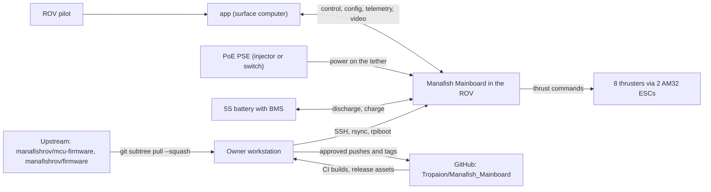
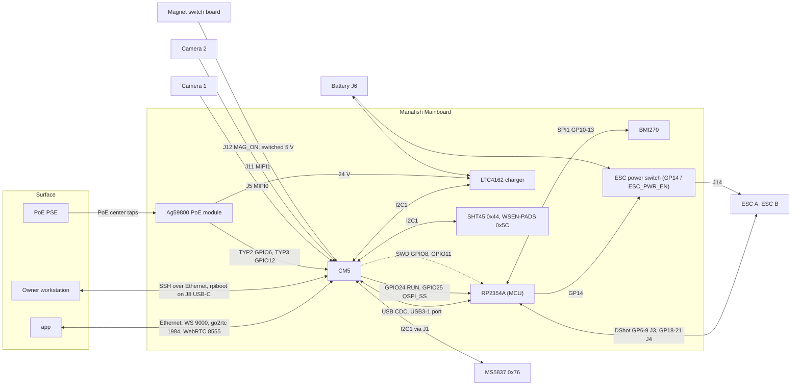

# 3. Context and Scope

The system is the mainboard with its two programmable parts, the CM5 and the
RP2354A (MCU), plus the image and release pipeline. Status labels are
explained on [Home](Home).

## 3.1 Business context

| Partner | Exchanges with the system |
|---|---|
| ROV pilot | Uses the app only; never talks to the board directly. |
| app | Commands, config, status, readings, actions, toasts, video. Separate repo, out of scope. |
| PoE PSE | Up to 90 W (Type 4) on the tether. The Ag59800 PoE module reports the PSE type. |
| 5S battery | Powers the ROV; charged by the LTC4162 charger when PoE is present. Its BMS is the only overcurrent protection on the ESC branch. |
| Thrusters and ESCs | Two 4-in-1 ESCs running AM32 firmware, eight thrusters. |
| Owner workstation | Development, flashing, deployment over a direct cable. Runs every `sudo` step. |
| GitHub | Main repo, CI **[done]**, release assets: MCU UF2 (workflow **[done]**, first release waits for the owner), CM5 image **[planned: Phase 3]**. |
| Upstream repos | Source of `firmware/` and `software/`. Pulled in by subtree; tags are never fetched. |

## 3.2 Technical context

### External interfaces

| ID | Interface | Medium and protocol | Details | Status |
|---|---|---|---|---|
| E1 | app WebSocket | Ethernet tether, TCP 9000 | Config, status, telemetry, capability catalog (readings and actions), toasts. IP from `config.json` `ipAddress`, default 10.10.10.10/24. | **[upstream]** |
| E2 | Video | go2rtc: API on :1984, WebRTC on :8555 | Stream `cam` = camera 1 **[upstream]**. Stream `cam2` = camera 2, on demand **[planned: Phase 3]**. Config limits 1920x1080, 25 Mbit/s **[upstream]**. | see details |
| E3 | DHCP for the surface computer | dnsmasq on eth0, authoritative | Range .150-.200 of the ROV's /24 (or .50-.100 when the ROV's own address falls in .150-.200). | **[upstream]** |
| E4 | Service access | SSH `pi@10.10.10.10`, direct cable only | Dev loop: rsync of `software/src/`, service restart by the owner, `nixos-rebuild --target-host`. | **[upstream]** SSH; CM5 deploy **[planned: Phase 3]** |
| E5 | eMMC and EEPROM flashing | J8 USB-C: CM5 USB 2.0 port, device role, data only, no VBUS | rpiboot with jumper J7 pins 9-10 (nRPIBOOT); `mass-storage-gadget64` exposes the eMMC, `recovery5` updates the EEPROM. | hardware; procedure **[bring-up]** B3 |
| E6 | PoE input | MagJack center taps to the Ag59800 PoE module (Ag59824, 24 V) | Fixed Type 4 class 8 PD. The module does no LLDP; some PSEs give at most 15.4 W until they get LLDP. | hardware |
| E7 | Cameras | 22-pin MIPI CSI-2; J5 = MIPI0, J11 = MIPI1 | Camera 1 (J5) uses the dedicated CAM pins. Camera 2 (J11) uses i2c0 on GPIO0/GPIO1 and GPIO14/GPIO15 as IO0/IO1. HQ camera (imx477) with a 22-to-15 cable. | camera 1 **[upstream]** on the Pi 3; CM5 overlays **[planned: Phase 3]**; both detected **[bring-up]** B8 |
| E8 | ESC signals | DShot (or PWM): GP6-9 to J3 (ESC A, M1-M4), GP18-21 to J4 (ESC B, M5-M8) | Matches `motors.h` bases 6/18: no remap. Lines are bare. AM32 passthrough updates over the same lines. | **[upstream]**; motor map **[bring-up]** B13 |
| E9 | ESC power | J14 XT60, switched by Q3 / IC16 from GP14 | Static switch, no current limit, soft start 1.5 s typical, 12 s worst case. | hardware; control **[done]**; ramp **[bring-up]** B11 |
| E10 | Battery | J6 XT60 (pin 2 = BAT_IN), 5S | Through the LTC4162 charger; also feeds the ESC power switch. | hardware |
| E11 | Magnet switch | J12, MAG_ON to load switch IC15 | Cuts the switched 5 V rail. Not readable by the CM5. | hardware; toggling **[bring-up]** B2 |
| E12 | Depth sensor | MS5837-30BA module on J1, I2C1 0x76 | Read by the rov_firmware service at 15 Hz and forwarded to the MCU (PRESSURE 0x11). | **[upstream]** |
| E13 | GitHub release assets | HTTPS | The software flake fetches the MCU UF2 at build time: upstream's `pico2` UF2 today **[upstream]**, `mainboard-vX.Y.Z-mb.N.uf2` from this repo **[planned: Phase 3]**. | see details |

### CM5 to RP2354A (MCU)

| ID | Interface | Details | Status |
|---|---|---|---|
| I1 | USB CDC | CM5 USB3-1 port (USB 2.0 pins only, no VBUS) to the RP2354A USB (27 Ω series). Pico control protocol v1: extended frames (start 0xF0, CRC32C), CAPS (feature bits 0x1f), HELLO session, 628-byte settings transaction, CONTROL 0x10, PRESSURE 0x11, ATTITUDE 0x90 at 60 Hz, STATS 0x91, IMU 0x92; legacy packets and the ESC firmware upload. See [PICO_CONTROL_PROTOCOL.md](https://github.com/Tropaion/Manafish_Mainboard/blob/main/firmware/docs/PICO_CONTROL_PROTOCOL.md). | **[upstream]** |
| I2 | ESC power over I1 | Request ESC_POWER 0x26 (u32 0/1; results APPLIED, BUSY, INVALID, UNSUPPORTED, never NOT_READY), CAPS feature bit 0x20, state in ATTITUDE health bits 4-6. | **[done]** MCU, **[planned: Phase 4]** CM5 |
| I3 | USB identity | Running: 2e8a:0009 (like a Pico 2), product "Manafish Mainboard", udev symlink `/dev/manafish-mcu`. BOOTSEL: 2e8a:000f. | IDs **[upstream]** (Pico SDK); product string **[done]**; symlink **[planned: Phase 3]** |
| I4 | GPIO24 to RUN | 330 Ω series, 4.7 kΩ pull-up. Low = reset. Released to input otherwise, never driven high. | hardware; driver **[planned: Phase 4]**; never low during boot **[bring-up]** B5 |
| I5 | GPIO25 to QSPI_SS | 1 kΩ series, 10 kΩ pull-up. Low during reset = BOOTSEL. Never low while the firmware runs. | same as I4 |
| I6 | SWD | GPIO8 = SWDIO, GPIO11 = SWCLK, also on J2. Keep SPI0 off. Released after use. | **[bring-up]** B7 |

Hardware BOOTSEL sequence (GPIO24 RUN, GPIO25 QSPI_SS) **[planned: Phase 4]**:
GPIO24 low, GPIO25 low, wait 10 ms, release GPIO24, hold GPIO25 low 100 ms
more, release GPIO25, wait for 2e8a:000f, `picotool load -v -x` without `-f`.

### I2C1 (CM5 GPIO2/GPIO3, at most 400 kHz)

| Address | Device | Use | Status |
|---|---|---|---|
| 0x44 | SHT45 | Hull temperature and humidity: command 0xFD, wait 10 ms, 6 bytes, CRC-8 (0x31, init 0xFF) | **[planned: Phase 4]** |
| 0x5C | WSEN-PADS | Hull pressure: WHO_AM_I 0xB3, CTRL_1 = 0x12 (1 Hz, BDU), 5 bytes from 0x28 | **[planned: Phase 4]** |
| 0x68 | LTC4162 charger | vbat, ibat, vin, iin, die temperature, `system_status`, charger settings; word access, low byte first | **[planned: Phase 4]** |
| 0x76 | MS5837 (on J1) | Depth and water temperature | **[upstream]** |

No pull-ups on the board; the CM5 module has 1.8 kΩ. All four addresses and
the rise time are checked at **[bring-up]** B6.

### PoE type pins (GPIO6 = TYP2, GPIO12 = TYP3)

Optocouplers IC6/IC7, active low, no board pull-ups: the CM5 needs
`gpio=6,12=ip,pu` **[planned: Phase 3]**. Decoding **[planned: Phase 4]**.
Truth table (Ag59800 Table 5):

| GPIO6 (TYP2) | GPIO12 (TYP3) | PSE | Charger input limit code |
|---|---|---|---|
| high | high | Type 1, non-classifying PSE, or no PoE | 6 |
| low | high | Type 2 | 14 |
| high | low | Type 3 | 29 |
| low | low | Type 4 | 41 |

PoE presence comes from LTC4162 `system_status` bit `vin_gt_4p2v` (0x39
bit 1), not from the pins. Pins and vin are checked at **[bring-up]** B9.

### Other on-board links

| Link | Details | Status |
|---|---|---|
| BMI270 IMU | MCU SPI1, GP10 SCK, GP11 MOSI, GP12 MISO, GP13 CS; polled. Axis map per board **[done]**, measured at **[bring-up]** B13. | **[upstream]** |
| ESC power switch (GP14 / ESC_PWR_EN) | GP14 through R31 180 Ω to the IC16 LED; 12 mA drive; low by default. | **[done]** |
| J9 breakout | Free CM5 GPIO 4, 5, 7, 9, 10, 13, 16-23, 26, 27. | hardware |
| J13 breakout | RP2354A GP22-29 (GP26-29 are ADC inputs); the only UART access. | hardware |

## 3.3 Out of scope

| Item | Where it lives |
|---|---|
| The app, including app support for `cam2` | Separate repo. The contract stays unchanged. |
| ESC firmware (AM32) | [manafishrov/esc-firmware](https://github.com/manafishrov/esc-firmware). The image only bundles a binary **[upstream]**. |
| Changes to upstream repos | Nothing is pushed upstream; their changes come in by subtree pull. |
| PCB redesign | `hardware/` is fixed for this board revision. Findings become notes and BOM recommendations. |
| Magnet switch board | Hardware only (`hardware/magnetic_switch/`); no software. |
| Surface network, PSE, battery and BMS | Owner equipment. |
| LLDP power negotiation | Not planned. |
| Kernel drivers for the charger and sensors | Not used: userspace smbus2 instead (see [Solution Strategy](04-Solution-Strategy)). |
