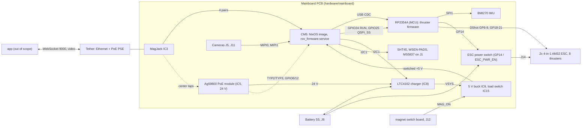
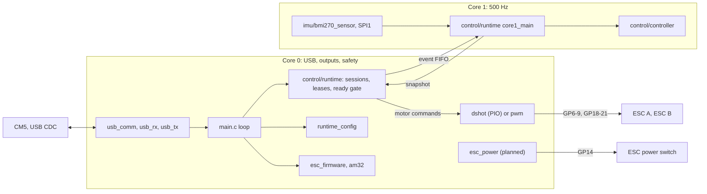
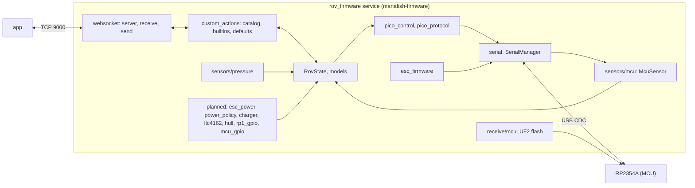

# 5. Building Block View

Status labels: **[upstream]** exists in the imported code, **[done]** done in this repo,
**[planned: Phase N]** from the plan, **[bring-up]** to be measured on the board (step Bx).
Hardware facts from the schematic and netlist carry no label. The board is designed and
ordered, not built. Terms: [Glossary](12-Glossary). Flows: [Runtime View](06-Runtime-View).

## 5.1 Level 1: the whole system

### Hardware blocks

Source: [README.md](https://github.com/Tropaion/Manafish_Mainboard/blob/main/README.md) and the
plan's board facts, checked against the netlist.

| Block | Parts | Responsibility |
|---|---|---|
| CM5 | Raspberry Pi Compute Module 5 (BCM2712), eMMC | Runs the NixOS image and the rov_firmware service (manafish-firmware): app link, cameras, I2C sensors, charger policy, MCU supervision and flashing. Variant (RAM, eMMC, wireless) is an owner question. |
| RP2354A (MCU) | RP2354A, 2 MB in-package flash, 12 MHz Y1 (slow start: ESR 60 Ω, 1 kΩ series) | Control loop, BMI270 IMU, DShot to 8 thrusters, ESC power switch. Keeps the Pico pin wiring: `motors.h` bases 6/18 and SPI1 GP10-13 match, no remap. |
| Power path | Ag59800 PoE module (IC5, Ag59824, 24 V), bridges D2-D5, LTC4162 charger (IC8, LTC4162-LAD, 5 cells strapped), 5 V buck IC9, load switch IC15 | PoE input, battery charging, VSYS, switched +5 V. RSNSB 10 mΩ, RSNSI 8 mΩ. Fixed 10 k/10 k NTC divider (reads 25 °C, no pack NTC). |
| magnet switch | `hardware/magnetic_switch`: A1104 Hall switch, CD4013 flip-flop; J12 = +5V_AON, MAG_ON, GND | A swipe toggles MAG_ON, which drives IC15. Hard cut of +5 V to everything except the charger. Comes up OFF after a battery or PoE connect. |
| ESC power switch (GP14 / ESC_PWR_EN) | Q3, photovoltaic driver IC16, R31 180 Ω, J14 | Battery to both ESCs. Static, no current limit, soft start 1.5 s typical, 12 s worst case. GP14 needs 12 mA drive. |
| Sensors | BMI270 on MCU SPI1 (INT not connected, polled). On CM5 I2C1 (GPIO2/3, max 400 kHz, 1.8 kΩ pull-ups on the CM5 module): LTC4162 0x68, SHT45 0x44, WSEN-PADS 0x5C (WHO_AM_I 0xB3), MS5837 0x76 on J1 | IMU for the MCU control loop; hull, charger and depth data for the CM5. 0x68 is the charger, not a BMI270. |
| Cameras | J5 (MIPI0, CAM pins), J11 (MIPI1, i2c0 on GPIO0/1, IO on CM5 GPIO14/15) | Two HQ cameras (imx477). |
| Ethernet | MagJack IC3 with PoE center taps, ESD IC1/IC2 | Tether. |
| Service and debug | J8 USB-C (CM5 USB2, device role, data only, no VBUS), J7 jumpers (nRPIBOOT 9-10, EEPROM_nWP 11-12), J2 SWD (also on CM5 GPIO8/11), J9 CM5 GPIO breakout, J13 MCU GP22-29 | rpiboot, EEPROM, SWD, the only MCU UART access (J13). |
| Not fitted | RTC battery, fan, LEDs; no SMBALERT, PGOOD or MAG_ON wire to the CM5 | Everything is polled. |

Electrical facts the code depends on:

| Fact | Consequence |
|---|---|
| GPIO24 → RUN (330 Ω, 4.7 kΩ pull-up), low = reset. GPIO25 → QSPI_SS (1 kΩ, 10 kΩ pull-up), low during reset = BOOTSEL | Hardware BOOTSEL (GPIO24 RUN, GPIO25 QSPI_SS). Never drive either line high; release it to an input. Never pull GPIO25 low while the MCU runs. |
| GPIO6/GPIO12 = PoE TYP2/TYP3 through optos, active low, no board pull-ups | Needs `gpio=6,12=ip,pu`. HIGH/HIGH = Type 1 or no PoE. |
| ibat excludes thruster current (Q3 taps the battery ahead of R20); vbat is measured at BAT_IN | `batteryCurrent` is charger plus system only; vbat sags under thruster load. |
| CM5 GPIO14/15 = camera 2 IO; MCU GP14 = ESC_PWR_EN | Two different pins on two chips. `gpio=14=op,dh` in config.txt is camera 2 power. |

### Software systems

| System | Repo path | Runs on | Stack | Status |
|---|---|---|---|---|
| RP2354A firmware | [firmware/](https://github.com/Tropaion/Manafish_Mainboard/tree/main/firmware) | RP2354A (MCU) | C11, Pico SDK 2.3.1, CMake, Unity tests | **[upstream]** mcu-firmware `88bd6a0`, Pico/Pico 2 builds; mainboard target **[planned: Phase 2]** |
| rov_firmware service (manafish-firmware) | [software/src/rov_firmware](https://github.com/Tropaion/Manafish_Mainboard/tree/main/software/src/rov_firmware) | CM5 | Python 3.13.15, asyncio, pydantic | **[upstream]** firmware `9e282b5`; board code **[planned: Phase 4]** |
| NixOS image | [software/flake.nix](https://github.com/Tropaion/Manafish_Mainboard/blob/main/software/flake.nix), [software/nix/](https://github.com/Tropaion/Manafish_Mainboard/tree/main/software/nix) | built on workstation or CI, runs on CM5 | Nix flake, nixos-raspberrypi, impermanence | **[upstream]** Pi 3 config; `cm5-mainboard` **[planned: Phase 3]** |
| ESC firmware | AM32 binary, release asset of manafishrov/esc-firmware | ESCs | flashed through the MCU | **[upstream]** bundled in the image |
| CI and releases | `.github/` | GitHub Actions | YAML workflows, actionlint, pre-commit | CI **[done]** (Phase 1); release workflow **[planned: Phase 2]** |

The app is a separate repo. It talks only to the CM5 and is out of scope.

## 5.2 Level 2: RP2354A firmware

Core 1 owns SPI and the pure control state. Core 0 owns USB, motor outputs and safety
arbitration. They share a bounded event FIFO (16 events) and output snapshots.

| Module | Files | Core | Responsibility | Status |
|---|---|---|---|---|
| Main loop | [src/main.c](https://github.com/Tropaion/Manafish_Mainboard/blob/main/firmware/src/main.c) | 0 | Init, packet dispatch by start byte, legacy 0x5A motor and 0xC5 config packets, protocol init and teardown, ESC firmware transactions, output service | **[upstream]** |
| usb_comm | `src/usb_comm.*`, `usb_rx.*`, `usb_tx.*` | 0 | CDC readers per start byte: 0xF0 extended, 0x5A, 0xC5, 0xE7/0xE8 ESC firmware; legacy 200 ms comm timeout to neutral; framed TX | **[upstream]** |
| Control protocol | `src/control/protocol.*` | 0 | Extended frame: 0xF0, version 1, 14-byte header, CRC32C, payload max 768; 628-byte settings image | **[upstream]** |
| Control runtime | [src/control/runtime.c](https://github.com/Tropaion/Manafish_Mainboard/blob/main/firmware/src/control/runtime.c) | 0 and 1 | HELLO, settings BEGIN/CHUNK/COMMIT, CONTROL, PRESSURE, RAW, ENTER_MAINTENANCE; leases (host 200 ms, output 10 ms, pressure 500 ms); one `ready` gate in `control_runtime_get_motors`; ATTITUDE 0x90 and IMU 0x92 at 60 Hz, STATS 0x91 every 5 s; launches core 1; 1 ms safety timer; 1 s watchdog | **[upstream]** |
| Controller | `src/control/controller.*` | 1 | Pure math without SDK: Mahony AHRS, attitude and depth PID, 8x8 allocation, nullspace, at 500 Hz. Checked by the C-vs-Python differential test in `software/tests` | **[upstream]** |
| IMU | `src/imu/bmi270_sensor.*`, `third_party/bmi270` | 1 | BMI270 on SPI1 GP10-13, polled, axis signs [+1,-1,-1]. `MANAFISH_IMU_AXIS_*` macros; mainboard values measured at B13 | **[upstream]**; macros **[planned: Phase 2]** |
| DShot | `src/dshot/` (`dshot.c`, `dshot.pio`, `control.c`, `telemetry_usb.c`, `current_sensing.c`) | 0 | Bidirectional DShot on PIO; telemetry (eRPM, voltage, temperature, current, signal quality) to the host as 0xA5/0xA6; board current | **[upstream]** |
| PWM | `src/pwm/` | 0 | Analog ESC alternative behind the same selector | **[upstream]** |
| Runtime config | `src/runtime_config.*` | 0 | DShot or PWM selection; legacy 0xC5 config; GET_INFO answer 0xD6 (release version); 0xD5 status | **[upstream]** |
| ESC firmware | `src/esc_firmware/update.*`, `src/am32/bootloader.*` | 0 | AM32 upload over 0xE7/0xE8, status 0xE9; bit-banged AM32 bootloader on the motor pins; blocks core 0 while flashing | **[upstream]** |
| Log, version | `src/log.*`, `src/version.h`, `src/release_version.h.in` | 0 | Framed log; X.Y.Z macros and `MANAFISH_RELEASE_VERSION` | **[upstream]** |
| Board target | `boards/manafish_mainboard.h`, `make build-mainboard` | build | RP2350A, 2 MB flash, XOSC start-up delay x64, USB product "Manafish Mainboard", `MANAFISH_ESC_POWER_PIN 14` | **[planned: Phase 2]** |
| ESC power | `src/esc_power.*` | 0 | Pure state machine, time passed in; `esc_power_init()` is the first statement of `main()`; no-op stub without the pin macro (pico/pico2) | **[planned: Phase 2]** |
| Output parking | `outputs_parked` in `main.c` | 0 | 8 motor pins on SIO low while ESC power is not live; re-park after each protocol re-init | **[planned: Phase 2]** |
| Runtime hooks | `thrust_permitted`, `esc_power_request`, `esc_power_state` | 0 | NULL-checked hooks; `thrust_permitted` joins the `ready` gate; request 0x26; CAPS bit 0x20; health bits 4-6 | **[planned: Phase 2]** |
| Bench script | `scripts/mainboard_bringup.py` | host | `info`, `imu`, `esc on/off/watch`; needs `--execute` | **[planned: Phase 2]** |

Protocol contract: [firmware/docs/PICO_CONTROL_PROTOCOL.md](https://github.com/Tropaion/Manafish_Mainboard/blob/main/firmware/docs/PICO_CONTROL_PROTOCOL.md).

## 5.3 Level 2: rov_firmware service

Entry point: [main.py](https://github.com/Tropaion/Manafish_Mainboard/blob/main/software/src/rov_firmware/main.py)
starts the WebSocket server, `SerialManager`, `PressureSensor`, then the tasks
`pressure.read_loop`, `mcu.read_loop`, `pico_control.send_loop` and `FieldDiagnostics`.

| Module | Path (`software/src/…`) | Responsibility | Status |
|---|---|---|---|
| WebSocket send/receive | `rov_firmware/websocket/` (`server.py`, `handler.py`, `receive/`, `send/`) | App link on TCP 9000: config set/import, actions, auto-tuning, MCU flash requests; catalog samples at 60 Hz, status every 0.5 s | **[upstream]** |
| pico_control + pico_protocol | `rov_firmware/pico_control.py`, `pico_protocol.py` | Negotiation (C5 GET_INFO, CAPS, HELLO), settings transaction, 60 Hz CONTROL, PRESSURE, ATTITUDE parsing (health bits 0 and 3), maintenance gate | **[upstream]**; 0x26 requests and health bits 4-6 **[planned: Phase 4]** |
| serial (MCU discovery) | `rov_firmware/serial.py` | Finds and opens the MCU port; first-boot flash after 5 failed lookups. Today: `/dev/serial/by-id/usb-Raspberry_Pi_Pico*`, then any `ttyACM*` | **[upstream]**; `find_mcu_port()` (`/dev/manafish-mcu`, sysfs 2e8a:0009, no `ttyACM*` fallback) **[planned: Phase 4]** |
| sensors/mcu | `rov_firmware/sensors/mcu.py` | Reads the MCU stream: DShot telemetry, logs, 0xD5/0xD6, ESC firmware status; version check and 60 s auto-flash window | **[upstream]** |
| sensors/pressure | `rov_firmware/sensors/pressure.py` | MS5837 at 15 Hz, reconnect every 10 s | **[upstream]** |
| sensors/pi_power | `rov_firmware/sensors/pi_power.py` | Undervoltage flag from hwmon | **[upstream]** |
| sensors/imu | `rov_firmware/sensors/imu.py`, `tools/test_imu.py` | CM5-side BMI270 at 0x68. Not started by the service. Removed because running it would write the BMI270 config blob into the charger | **[upstream]**, removal **[planned: Phase 4]** |
| sensors/hull | `rov_firmware/sensors/hull.py` | SHT45 (0xFD, 10 ms, CRC-8) and WSEN-PADS (1 Hz, BDU) at 1 Hz, `state.hull`, reconnect like `pressure.py` | **[planned: Phase 4]** |
| sensors/ltc4162 | `rov_firmware/sensors/ltc4162.py` | LTC4162 charger registers over smbus2; datasheet-checked addresses and scales | **[planned: Phase 4]** |
| sensors/charger | `rov_firmware/sensors/charger.py` | `ChargerMonitor`, 1 Hz policy loop and read-back | **[planned: Phase 4]** |
| power_policy | `rov_firmware/power_policy.py` | Pure functions: PoE presence and type, input limit codes, derating, charge targets | **[planned: Phase 4]** |
| LowBatteryMonitor | location set in Phase 4 (own 1 Hz task; the status builder only reads its result) | Battery %, warn, critical, 3.0 V/cell shutdown | **[planned: Phase 4]** |
| esc_power | `rov_firmware/esc_power.py` | `EscPowerController`: enable conditions, state map from health bits, adoption on reconnect | **[planned: Phase 4]** |
| rp1_gpio | `rov_firmware/rp1_gpio.py` | lgpio on chip `pinctrl-rp1`: `drive_low`, `release` (input, bias off); lazy import (lgpio is aarch64-only) | **[planned: Phase 4]** |
| mcu_gpio | `rov_firmware/mcu_gpio.py` | `enter_bootsel()` (Decision 9 order), `reset()` (10 ms GPIO24 pulse); release in `finally` | **[planned: Phase 4]** |
| UF2 flash | `rov_firmware/websocket/receive/mcu.py` | Resolves `~/mcu-firmware/<prefix>-v*.uf2`, board detection by USB IDs, runs picotool. Today `picotool load -f -v -x` | **[upstream]**; GPIO BOOTSEL path, prefix `mainboard` **[planned: Phase 4]** |
| custom_actions catalog | `rov_firmware/custom_actions/` (`builtins.py`, `runtime.py`, `defaults/`), `manafish_sdk` | Built-in readings and actions, user custom actions, bundled defaults (blackbox, extended telemetry, water sensor). Every `values()` key must be in `READING_DEFINITIONS` | **[upstream]**; new `rov.*` readings and `escPower.set` **[planned: Phase 4]** |
| motor_safety | `rov_firmware/motor_safety.py` | `disruptive_motor_operation_blocker`: refuses during MCU flashing, ESC recovery, ESC telemetry wait, auto-tuning, thruster test, stabilization, depth hold or non-zero input | **[upstream]** |
| esc_firmware | `rov_firmware/esc_firmware.py`, `esc_recovery.py` | AM32 update through the MCU (0xE7/0xE8), recovery journal | **[upstream]**; ESC-power-ON preflight, error 11 **[planned: Phase 4]** |
| State and models | `rov_firmware/rov_state.py`, `models/` | `RovState`, `RovConfig`, `RovStatus`, `SystemHealth` (shapes stay unchanged) | **[upstream]**; `mcu_board` default `pico2` **[planned: Phase 4]** |
| Diagnostics | `rov_firmware/diagnostics.py` | 1 Hz field snapshots in the debug log | **[upstream]**; power/hull/ESC/SoC block **[planned: Phase 4]** |
| Legacy control path | `rov_firmware/thrusters.py`, `regulator.py` | Python control loop from before the MCU port; not started by `main.py`, kept for tests and the differential reference | **[upstream]** |
| tools | `src/tools/` | Interactive menu (`uv run tools`): IMU, pressure, thruster test (legacy 0x5A), package check, mock WebSocket server (also `--local`); `mock_esc_firmware.py` | **[upstream]**; argv dispatch, `mcu-reset`, `mcu-recover` **[planned: Phase 4]**; `board-check` **[planned: Phase 5]** |

## 5.4 Level 2: NixOS image

| Module | File | Content today **[upstream]** | Planned change |
|---|---|---|---|
| Flake | [flake.nix](https://github.com/Tropaion/Manafish_Mainboard/blob/main/software/flake.nix) | `pi3-imx477` (raspberry-pi-3.base, sd-image, impermanence); inputs incl. pico/pico2 UF2s, AM32 bin, bmi270, ms5837, numpydantic; `releaseVersionFromLock`; check `camera-headless`; treefmt | `cm5-mainboard` on raspberry-pi-5.base; drop pi3, `bmi270-src`, `mcu-firmware-pico`; `mcu-firmware` from this repo's release; check `camera-encoder` **[planned: Phase 3]** |
| board.nix | `nix/board.nix` | does not exist | All board config: `gpio=6,12=ip,pu`, `gpio=24,25=ip,pn`, `gpio=14=op,dh`, two imx477 overlays, auto-detect off, `enable_uart` 0, polkit poweroff for `pi`, `trusted-users`, libgpiod, usbutils, ethtool, iperf3 **[planned: Phase 3]** |
| camera | [nix/camera.nix](https://github.com/Tropaion/Manafish_Mainboard/blob/main/software/nix/camera.nix) | rpicam-vid wrapper reads `config.json`; go2rtc stream `cam`; libav off | libav encoder on (software H.264, BCM2712 has no encoder), `--camera N`, `cam2` on demand, go2rtc `Nice=10`, `CPUWeight=50` **[planned: Phase 3]** |
| mcu | [nix/mcu.nix](https://github.com/Tropaion/Manafish_Mainboard/blob/main/software/nix/mcu.nix) | `cdc_acm`, udev rule by manufacturer, on-device ARM/Clang/Pico SDK toolchain, picotool | Drop the toolchain; rule on USB idVendor 2e8a plus tty 0009 `SYMLINK+="manafish-mcu"` **[planned: Phase 3]** |
| system | [nix/system.nix](https://github.com/Tropaion/Manafish_Mainboard/blob/main/software/nix/system.nix) | User `pi`; `manafish-setup` copies `software/` and the pico/pico2 UF2s and AM32 bin into `/home/pi` | One `mainboard-<ver>.uf2` copy **[planned: Phase 3]** |
| firmware | [nix/firmware.nix](https://github.com/Tropaion/Manafish_Mainboard/blob/main/software/nix/firmware.nix) | Python env, `start` and `tools` scripts, unit `manafish-firmware` | Drop bmi270 (same commit as deleting `tools/test_imu.py`), `tools` passes `"$@"`, `CPUWeight=200` **[planned: Phase 3]** |
| networking | [nix/networking.nix](https://github.com/Tropaion/Manafish_Mainboard/blob/main/software/nix/networking.nix) | Static IP, dnsmasq DHCP on eth0, avahi, sshd, NetworkManager + iwd, disable-wifi/bt | Keep or drop the radio overlays by CM5 variant **[planned: Phase 3]** |
| sensors | [nix/sensors.nix](https://github.com/Tropaion/Manafish_Mainboard/blob/main/software/nix/sensors.nix) | I2C on, 1 MHz, i2c-dev, i2c-tools | 400 kHz **[planned: Phase 3]** |
| impermanence | [nix/impermanence.nix](https://github.com/Tropaion/Manafish_Mainboard/blob/main/software/nix/impermanence.nix) | tmpfs `/`, `/persistent`, binds, persisted paths, `grow-persistent` | Comment only **[planned: Phase 3]** |
| Dependency sync | `sync-python-deps.sh` | Pins `pyproject.toml` to nixpkgs versions | Remove bmi270 **[planned: Phase 4]** |

Where these run and how the image is built: [Deployment View](07-Deployment-View).
