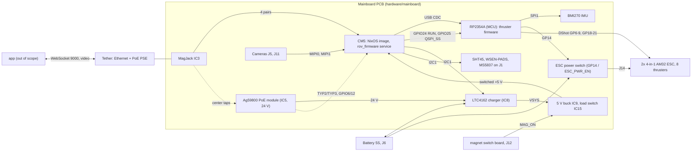
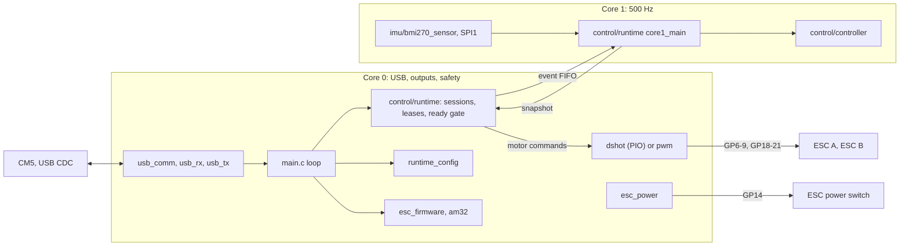
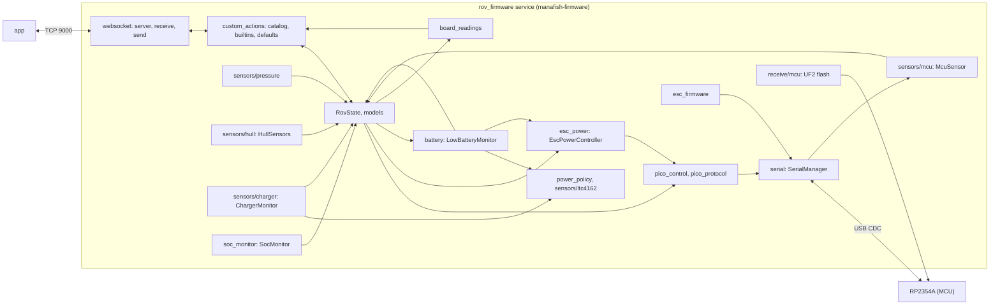

# 5. Building Block View

Status labels: **[upstream]** exists in the imported code, **[done]** done in this repo,
**[planned: Phase N]** from the plan, **[bring-up]** to be measured on the board (step Bx).
Hardware facts from the schematic and netlist carry no label. The board is designed and
ordered, not built. Terms: [Glossary](12-Glossary). Flows: [Runtime View](06-Runtime-View).

## 5.1 Level 1: the whole system

### Hardware blocks

Source: [README.md](https://github.com/Tropaion/Manafish_Mainboard/blob/main/README.md) and the
plan's board facts, checked against the netlist.

| Block | Parts | Responsibility |
|---|---|---|
| CM5 | Raspberry Pi Compute Module 5 (BCM2712), eMMC | Runs the NixOS image and the rov_firmware service (manafish-firmware): app link, cameras, I2C sensors, charger policy, MCU supervision and flashing. Any CM5 with eMMC (16 GB or more), with or without wireless, any RAM size; CM5 Lite is not a target (the board has no SD slot). |
| RP2354A (MCU) | RP2354A, 2 MB in-package flash, 12 MHz Y1 (slow start: ESR 60 Ω, 1 kΩ series) | Control loop, BMI270 IMU, DShot to 8 thrusters, ESC power switch. Keeps the Pico pin wiring: `motors.h` bases 6/18 and SPI1 GP10-13 match, no remap. |
| Power path | Ag59800 PoE module (IC5, Ag59824, 24 V), bridges D2-D5, LTC4162 charger (IC8, LTC4162-LAD, 5 cells strapped), 5 V buck IC9, load switch IC15 | PoE input, battery charging, VSYS, switched +5 V. RSNSB 10 mΩ, RSNSI 8 mΩ. Fixed 10 k/10 k NTC divider (reads 25 °C, no pack NTC). |
| magnet switch | `hardware/magnetic_switch`: A1104 Hall switch, CD4013 flip-flop; J12 = +5V_AON, MAG_ON, GND | A swipe toggles MAG_ON, which drives IC15. Hard cut of +5 V to everything except the charger. Comes up OFF after a battery or PoE connect. |
| ESC power switch (GP14 / ESC_PWR_EN) | Q3, photovoltaic driver IC16, R31 180 Ω, J14 | Battery to both ESCs. Static, no current limit, soft start 1.5 s typical, 12 s worst case. GP14 needs 12 mA drive. |
| Sensors | BMI270 on MCU SPI1 (INT not connected, polled). On CM5 I2C1 (GPIO2/3, max 400 kHz, 1.8 kΩ pull-ups on the CM5 module): LTC4162 0x68, SHT45 0x44, WSEN-PADS 0x5C (WHO_AM_I 0xB3), MS5837 0x76 on J1 | IMU for the MCU control loop; hull, charger and depth data for the CM5. 0x68 is the charger, not a BMI270. |
| Cameras | J5 (MIPI0, CAM pins), J11 (MIPI1, i2c0 on GPIO0/1, IO on CM5 GPIO14/15) | Two HQ cameras (imx477). |
| Ethernet | MagJack IC3 with PoE center taps, ESD IC1/IC2 | Tether. |
| Service and debug | J8 USB-C (CM5 USB2, device role, data only, no VBUS), J7 jumpers (nRPIBOOT 9-10, EEPROM_nWP 11-12), J2 SWD (also on CM5 GPIO8/11), J9 CM5 GPIO breakout, J13 MCU GP22-29 | rpiboot, EEPROM, SWD, the only MCU UART access (J13). |
| Not fitted | RTC battery, fan, LEDs; no SMBALERT, PGOOD or MAG_ON wire to the CM5 | Everything is polled. |

Electrical facts the code depends on:

| Fact | Consequence |
|---|---|
| GPIO24 → RUN (330 Ω, 4.7 kΩ pull-up), low = reset. GPIO25 → QSPI_SS (1 kΩ, 10 kΩ pull-up), low during reset = BOOTSEL | Hardware BOOTSEL (GPIO24 RUN, GPIO25 QSPI_SS). Never drive either line high; release it to an input. Never pull GPIO25 low while the MCU runs. |
| GPIO6/GPIO12 = PoE TYP2/TYP3 through optos, active low, no board pull-ups | Needs `gpio=6,12=ip,pu`. HIGH/HIGH = Type 1 or no PoE. |
| ibat excludes thruster current (Q3 taps the battery ahead of R20); vbat is measured at BAT_IN | `batteryCurrent` is charger plus system only; vbat sags under thruster load. |
| CM5 GPIO14/15 = camera 2 IO; MCU GP14 = ESC_PWR_EN | Two different pins on two chips. `gpio=14=op,dh` in config.txt is camera 2 power. The imx477 overlay cannot switch it: in the CM5 device tree `cam1_reg` is an alias of `cam0_reg` (CAM_GPIO). |

### Software systems

| System | Repo path | Runs on | Stack | Status |
|---|---|---|---|---|
| RP2354A firmware | [firmware/](https://github.com/Tropaion/Manafish_Mainboard/tree/main/firmware) | RP2354A (MCU) | C11, Pico SDK 2.3.1, CMake, Unity tests | **[upstream]** mcu-firmware `88bd6a0`, Pico/Pico 2 builds; mainboard target, ESC power and bring-up script **[done]** (Phase 2) |
| rov_firmware service (manafish-firmware) | [software/src/rov_firmware](https://github.com/Tropaion/Manafish_Mainboard/tree/main/software/src/rov_firmware) | CM5 | Python 3.13.15, asyncio, pydantic | **[upstream]** firmware `9e282b5`; Pi-side BMI270 code removed **[done]** (Phase 3); board code **[done]** (Phase 4, unit-tested; on the board **[bring-up]**) |
| NixOS image | [software/flake.nix](https://github.com/Tropaion/Manafish_Mainboard/blob/main/software/flake.nix), [software/nix/](https://github.com/Tropaion/Manafish_Mainboard/tree/main/software/nix) | built on workstation or CI, runs on CM5 | Nix flake, nixos-raspberrypi, impermanence | `cm5-mainboard` **[done]** (Phase 3, Pi 3 config removed); on the CM5 IO Board **[done]** (spike, 2026-11-14) |
| ESC firmware | AM32 binary, release asset of manafishrov/esc-firmware | ESCs | flashed through the MCU | **[upstream]** bundled in the image |
| CI and releases | `.github/` | GitHub Actions | YAML workflows, actionlint, pre-commit | CI **[done]** (Phase 1); `build-mainboard` in CI and the release workflow **[done]** (Phase 2) |

The app is a separate repo. It talks only to the CM5 and is out of scope.

## 5.2 Level 2: RP2354A firmware

Core 1 owns SPI and the pure control state. Core 0 owns USB, motor outputs and safety
arbitration. They share a bounded event FIFO (16 events) and output snapshots.

| Module | Files | Core | Responsibility | Status |
|---|---|---|---|---|
| Main loop | [src/main.c](https://github.com/Tropaion/Manafish_Mainboard/blob/main/firmware/src/main.c) | 0 | Init, packet dispatch by start byte, legacy 0x5A motor and 0xC5 config packets, protocol init and teardown, ESC firmware transactions, output service | **[upstream]** |
| usb_comm | `src/usb_comm.*`, `usb_rx.*`, `usb_tx.*` | 0 | CDC readers per start byte: 0xF0 extended, 0x5A, 0xC5, 0xE7/0xE8 ESC firmware; legacy 200 ms comm timeout to neutral; framed TX | **[upstream]** |
| Control protocol | `src/control/protocol.*` | 0 | Extended frame: 0xF0, version 1, 14-byte header, CRC32C, payload max 768; 628-byte settings image | **[upstream]** |
| Control runtime | [src/control/runtime.c](https://github.com/Tropaion/Manafish_Mainboard/blob/main/firmware/src/control/runtime.c) | 0 and 1 | HELLO, settings BEGIN/CHUNK/COMMIT, CONTROL, PRESSURE, RAW, ENTER_MAINTENANCE; leases (host 200 ms, output 10 ms, pressure 500 ms); one `ready` gate in `control_runtime_get_motors`; ATTITUDE 0x90 and IMU 0x92 at 60 Hz, STATS 0x91 every 5 s; launches core 1; 1 ms safety timer; 1 s watchdog | **[upstream]** |
| Controller | `src/control/controller.*` | 1 | Pure math without SDK: Mahony AHRS, attitude and depth PID, 8x8 allocation, nullspace, at 500 Hz. Checked by the C-vs-Python differential test in `software/tests` | **[upstream]** |
| IMU | `src/imu/bmi270_sensor.*`, `third_party/bmi270` | 1 | BMI270 on SPI1 GP10-13, polled. Board axis map `MANAFISH_IMU_AXIS_*` / `MANAFISH_IMU_SIGN_*` (defaults: upstream's axes, signs [+1,-1,-1]) | **[upstream]**; macros **[done]**; mainboard values **[bring-up]** (B13) |
| DShot | `src/dshot/` (`dshot.c`, `dshot.pio`, `control.c`, `telemetry_usb.c`, `current_sensing.c`) | 0 | Bidirectional DShot on PIO; telemetry (eRPM, voltage, temperature, current, signal quality) to the host as 0xA5/0xA6; board current | **[upstream]** |
| PWM | `src/pwm/` | 0 | Analog ESC alternative behind the same selector | **[upstream]** |
| Runtime config | `src/runtime_config.*` | 0 | DShot or PWM selection; legacy 0xC5 config; GET_INFO answer 0xD6 (release version); 0xD5 status | **[upstream]** |
| ESC firmware | `src/esc_firmware/update.*`, `src/am32/bootloader.*` | 0 | AM32 upload over 0xE7/0xE8, status 0xE9; bit-banged AM32 bootloader on the motor pins; blocks core 0 while flashing | **[upstream]** |
| Log, version | `src/log.*`, `src/version.h`, `src/release_version.h.in` | 0 | Framed log; X.Y.Z macros and `MANAFISH_RELEASE_VERSION` | **[upstream]** |
| Board target | `boards/manafish_mainboard.h`, `make build-mainboard`, `make flash-mainboard` (no `-f`, BOOTSEL first) | build | RP2350A, 2 MB flash, XOSC start-up delay x64, USB product "Manafish Mainboard", `MANAFISH_ESC_POWER_PIN 14`, IMU axis map | **[done]**; on the board **[bring-up]** (B7) |
| ESC power | `src/esc_power.*` | 0 | Pure state machine, time passed in; `esc_power_init()` is the first statement of `main()`; no-op stub without the pin macro (pico/pico2). Tests: `tests/test_esc_power.c` | **[done]**; timing on the board **[bring-up]** (B11) |
| Output parking | `outputs_parked` in `main.c` | 0 | 8 motor pins on SIO low while ESC power is not live; re-park after each protocol re-init; the protocol restarts when the lines go live | **[done]**; no back-powering **[bring-up]** (B12) |
| Runtime hooks | `thrust_permitted`, `esc_power_request`, `esc_power_state` | 0 | NULL-checked hooks; `thrust_permitted` joins the `ready` gate; request 0x26; CAPS bit 0x20; health bits 4-6; ESC update error 11 | **[done]** |
| Bench script | `scripts/mainboard_bringup.py` | host | `info`, `imu`, `esc on/off/watch`; reuses `control_smoke.py`; needs `--execute`; port `/dev/manafish-mcu`. Offline test `tests/test_mainboard_bringup.py`. Copied to the CM5 for bring-up, not in the image (`BRINGUP.md`, B7 and B11) | **[done]** |

Protocol contract: [firmware/docs/PICO_CONTROL_PROTOCOL.md](https://github.com/Tropaion/Manafish_Mainboard/blob/main/firmware/docs/PICO_CONTROL_PROTOCOL.md).

## 5.3 Level 2: rov_firmware service

Entry point: [main.py](https://github.com/Tropaion/Manafish_Mainboard/blob/main/software/src/rov_firmware/main.py)
starts the WebSocket server, the BOOTSEL leftover check (`Board.prepare()`, Phase 4),
`SerialManager`, `PressureSensor`, then the tasks `pressure.read_loop`, `mcu.read_loop`,
`pico_control.send_loop` and `FieldDiagnostics`, plus the five board tasks from
`Board.create_tasks()` (Phase 4): `hull.run`, `charger.run`, `battery.run`, `soc.run` and
`esc_power.run`. `Board` ([board.py](https://github.com/Tropaion/Manafish_Mainboard/blob/main/software/src/rov_firmware/board.py)) builds them; the
`EscPowerController` gets the battery checks from `LowBatteryMonitor.enable_blockers()`.

| Module | Path (`software/src/…`) | Responsibility | Status |
|---|---|---|---|
| WebSocket send/receive | `rov_firmware/websocket/` (`server.py`, `handler.py`, `receive/`, `send/`) | App link on TCP 9000: config set/import, actions, auto-tuning, MCU flash requests; catalog samples at 60 Hz, status every 0.5 s | **[upstream]** |
| pico_control + pico_protocol | `rov_firmware/pico_control.py`, `pico_protocol.py` | Negotiation (C5 GET_INFO, CAPS, HELLO), settings transaction, 60 Hz CONTROL, PRESSURE, ATTITUDE parsing (health bits 0 and 3), maintenance gate | **[upstream]**; 0x26 requests (`request_esc_power`), CAPS feature bits and health bits 4-6 **[done]** (Phase 4) |
| serial (MCU discovery) | `rov_firmware/serial.py` | Finds and opens the MCU port (`mcu_usb.find_mcu_port()` in a worker thread); first-boot flash after 5 failed lookups in a row, once per run: before the first successful connection, or later for an MCU waiting in BOOTSEL | **[upstream]**; the image's `/dev/manafish-mcu` symlink **[done]** (Phase 3); `find_mcu_port()` and the first-boot disarm **[done]** (Phase 4) |
| mcu_usb | `rov_firmware/mcu_usb.py` | Read-only sysfs USB lookups. `find_mcu_port()`: `/dev/manafish-mcu`, then a `/sys/class/tty/ttyACM*` scan for 2e8a:0009 that prefers the product "Manafish Mainboard"; no blind `ttyACM*` fallback. `usb_ids()`, `rp_usb_devices()` (product ID to sysfs paths), `rp_usb_products()`, `read_text()` and the IDs 2e8a, 000f (BOOTSEL) and 0009 (CDC). Used by `SerialManager._find_mcu_port`, `mcu_gpio`, `tools/test_thrusters.py`, `tools mcu-reset` and `tools board-check` | **[done]** (Phase 4) |
| sensors/mcu | `rov_firmware/sensors/mcu.py` | Reads the MCU stream: DShot telemetry, logs, 0xD5/0xD6, ESC firmware status; version check and 60 s auto-flash window | **[upstream]** |
| sensors/pressure | `rov_firmware/sensors/pressure.py` | MS5837 at 15 Hz, reconnect every 10 s | **[upstream]** |
| sensors/pi_power | `rov_firmware/sensors/pi_power.py` | Undervoltage flag from hwmon; `SocMonitor` polls it and latches it, and the status builder reads the latch instead of sysfs | **[upstream]**; latch **[done]** (Phase 4) |
| sensors/imu | removed: `rov_firmware/sensors/imu.py`, `tools/test_imu.py` and the bmi270 dependency | Upstream's CM5-side BMI270 at 0x68 would write the BMI270 config blob into the charger. `tests/test_no_pi_side_bmi270.py` keeps it out: no `bmi270` import under `src/` | removed **[done]** (Phase 3) |
| sensors/hull | `rov_firmware/sensors/hull.py`, `models/hull.py` | `HullSensors` at 1 Hz, I2C in a worker thread: SHT45 (0xFD, then a separate 6-byte read 10 ms later, NACK retried, CRC-8 0x31/0xFF, RH clamped) and WSEN-PADS (ID 0xB3, CTRL_1 = 0x12 for 1 Hz + BDU, checked every cycle and rewritten after a reset, one 5-byte burst from 0x28, raw/4096 hPa and raw/100 °C). Read-only helpers for `tools board-check`: `read_sht45_serial()` (0x89) and `check_pads()` (ID and the CTRL_2 auto-increment bit, without the CTRL_1 write of `configure_pads()`). Publishes a frozen `HullData` in `state.hull`; each sensor is unhealthy after 3 failed cycles and retried every 10 s, like `pressure.py` | **[done]** (Phase 4); on the board **[bring-up]** (B6) |
| sensors/ltc4162 | `rov_firmware/sensors/ltc4162.py` | `Ltc4162`: datasheet-checked registers over smbus2 words (low byte first), sign-extended telemetry with fixed 5 cells, RSNSB 10 mΩ / RSNSI 8 mΩ; writes only the five settings registers inside their fields (`write_setting` refuses 0x19 and every other address); `ensure_force_telemetry_on()` (RMW, clears `run_bsr`) and `apply_settings()` (read-back, 0x29 first, full rewrite when `en_jeita` reads 1); read-only `read_settings()`, `DEFAULT_SETTINGS` (power-on values), `describe_settings()` and the `system_status`/`config_bits` flag names, shared with `tools board-check` | **[done]** (Phase 4); registers on the board **[bring-up]** (B6, B9) |
| sensors/charger | `rov_firmware/sensors/charger.py`, `models/charger.py` | `ChargerMonitor`, 1 Hz in a worker thread: PoE pins, `force_telemetry_on`, telemetry validity, policy, read-back only with `CHARGER_WRITES_ENABLED` (False until B9), state and fault logs. Publishes a frozen `ChargerStatus` in `state.charger` (6.6) | **[done]** (Phase 4); writes enabled **[bring-up]** (B9) |
| power_policy | `rov_firmware/power_policy.py` | Pure functions: PoE presence (`vin_gt_4p2v`) and type (Ag59800 Table 5), input limit codes, halved code, derating with hysteresis, chemistry check, charge targets; the owner-confirmable charge and battery values as named constants | **[done]** (Phase 4) |
| LowBatteryMonitor | `rov_firmware/battery.py`, `models/battery.py` | Own 1 Hz task on the event loop (no I/O of its own). 10 s EMA of vbat for the battery %, warn / critical / shutdown levels with neutral gating and hysteresis, the shutdown chain, battery-present tracking, the pulled-pack auto-off on PoE and the ESC enable checks (`enable_blockers()`). Publishes a frozen `BatteryStatus` in `state.battery`; the status builder only reads it (6.7) | **[done]** (Phase 4); shutdown on the board **[bring-up]** (B15) |
| soc_monitor | `rov_firmware/soc_monitor.py`, `models/soc.py` | `SocMonitor`, 1 Hz in a worker thread: `rpi_volt` alarm latched 60 s (upstream's `sensors/pi_power.py` reader), `thermal_zone0` temperature (cpu-thermal), `vcgencmd get_throttled` every 10 s (looked up once; absent → unavailable). Publishes a frozen `SocStatus` in `state.soc` | **[done]** (Phase 4) |
| board | `rov_firmware/board.py` | `Board`: builds `HullSensors`, `ChargerMonitor`, `LowBatteryMonitor`, `SocMonitor` and the `EscPowerController` (with the battery checks) and sets `state.esc_power`; `prepare()` at service start, before the serial link (release GPIO24/25, one RUN pulse for a stale BOOTSEL, 6.2); `create_tasks()` starts the five board loops. `main.py` keeps only these three hooks | **[done]** (Phase 4) |
| board_readings | `rov_firmware/board_readings.py` | `BOARD_READING_DEFINITIONS` and `board_readings()` for the twelve new `rov.*` readings (joined into `READING_DEFINITIONS` and `values()`); `board_state()`, `board_diagnostics()` and `board_faults()` for `diagnostics.py`. No I/O | **[done]** (Phase 4) |
| esc_power | `rov_firmware/esc_power.py`, `models/esc_power.py` | `EscPowerController`: state map from health bits, operator on/off with enable checks, BUSY retry, adoption on reconnect, `wait_until_off`, `prepare_for_mcu_reset` (8.1) | **[done]** (Phase 4), including the injected battery and charger checks |
| rp1_gpio | `rov_firmware/rp1_gpio.py` | `Rp1Gpio`: lgpio on the chip labelled `pinctrl-rp1` (found by trying `/dev/gpiochip*`); `drive_low` (output claimed at level 0), `release` (reclaim as input with bias off, then free: pinctrl-rp1 keeps a freed output driving), `read_input` (no bias flag, so the config.txt pull stays; for the PoE lines); `close` releases what it still drives. Lazy import (lgpio is aarch64-only); tests inject a fake | **[done]** (Phase 4); bias and persistence on the CM5 **[bring-up]** (B5) |
| mcu_gpio | `rov_firmware/mcu_gpio.py` | `enter_bootsel()` (Decision 9 order, then waits until 2e8a:000f exists and udev made its `/dev/bus/usb` node usable), `reset()` (10 ms GPIO24 pulse), `leave_stale_bootsel()` (service start: release GPIO24/25, one `reset()` for 000f without 0009); on any exception the `Rp1Gpio` context manager releases every driven line (GPIO24 first); never drives high | **[done]** (Phase 4); on the board **[bring-up]** (B5, B7) |
| UF2 flash | `rov_firmware/websocket/receive/mcu.py` | Resolves `~/mcu-firmware/mainboard-v*.uf2` (`_BOARD_PREFIXES = {PICO2: "mainboard"}`, `pico` normalised to `pico2`), board detection by USB IDs; then `prepare_for_mcu_reset()`, `mcu_flashing`, `enter_bootsel()` and `picotool load -v -x` without `-f` (`picotool_load_command`) | **[upstream]**; prefix `mainboard` and the GPIO BOOTSEL path **[done]** (Phase 4) |
| custom_actions catalog | `rov_firmware/custom_actions/` (`builtins.py`, `runtime.py`, `defaults/`), `manafish_sdk` | Built-in readings and actions, user custom actions, bundled defaults (blackbox, extended telemetry, water sensor). Every `values()` key must be in `READING_DEFINITIONS` (key-set test). The blackbox default records the new readings too | **[upstream]**; new `rov.*` readings, the actions `rov.escPower.on` / `rov.escPower.off` and the blackbox columns **[done]** (Phase 4) |
| motor_safety | `rov_firmware/motor_safety.py` | `disruptive_motor_operation_blocker`: refuses during MCU flashing, ESC recovery, ESC telemetry wait, auto-tuning, thruster test, stabilization, depth hold or non-zero input | **[upstream]** |
| esc_firmware | `rov_firmware/esc_firmware.py`, `esc_recovery.py` | AM32 update through the MCU (0xE7/0xE8), recovery journal | **[upstream]**; ESC-power-ON preflight, error 11, `mcu_reset_refusal()` **[done]** (Phase 4) |
| State and models | `rov_firmware/rov_state.py`, `models/` | `RovState`, `RovConfig`, `RovStatus`, `SystemHealth` (shapes stay unchanged). `RovConfig.save()` fsyncs the temp file before the rename and the directory after. Board-side state outside the app contract: `esc_power_telemetry`, `hull` (`HullData`), `charger` (`ChargerStatus`), `battery` (`BatteryStatus`), `soc` (`SocStatus`), each replaced whole by its owner | **[upstream]**; `mcu_board` default `pico2` with the `pico` validator, hull camera defaults, fsync, board-side state **[done]** (Phase 4) |
| Diagnostics | `rov_firmware/diagnostics.py` | 1 Hz field snapshots in the debug log; `board` block (power, hull, ESC power, SoC, `get_throttled`), board state on change, board faults, latched undervoltage (8.10) | **[upstream]**; board block **[done]** (Phase 4) |
| Legacy control path | `rov_firmware/thrusters.py`, `regulator.py` | Python control loop from before the MCU port; not started by `main.py`, kept for tests and the differential reference | **[upstream]** |
| tools | `src/tools/` | Interactive menu (`uv run tools`): pressure, thruster test (legacy 0x5A), package check, mock WebSocket server (also `--local`; simulates the new readings and the two ESC power actions, a test keeps its readings equal to `READING_DEFINITIONS`), MCU reset and recover; `mock_esc_firmware.py`. Subcommands `tools mcu-reset` and `tools mcu-recover [UF2]` (`tools/mcu_recovery.py`, 8.4). `tools board-check [--json]` (`tools/board_check.py`): read-only bring-up check of what the CM5 sees, run with the service stopped; check ids, criteria and exit codes in [BRINGUP.md](https://github.com/Tropaion/Manafish_Mainboard/blob/main/BRINGUP.md) 3.1 | **[upstream]**; IMU entry removed **[done]** (Phase 3); argv dispatch in Python and `"$@"` in the image's `tools` script, `mcu-reset`, `mcu-recover` **[done]** (Phase 4); `board-check` **[done]** (Phase 5), on the board **[bring-up]** (B4-B10, B14-B16) |

## 5.4 Level 2: NixOS image

| Module | File | Content | Status |
|---|---|---|---|
| Flake | [flake.nix](https://github.com/Tropaion/Manafish_Mainboard/blob/main/software/flake.nix) | `nixosConfigurations.cm5-mainboard` = nixos-raspberrypi `raspberry-pi-5.base` + `sd-image` + impermanence; `packages.sdImage`/`default` point at it. Inputs: `mcu-firmware` (this repo's `firmware-v1.0.4-mb.1` mainboard UF2), AM32 bin, ms5837, numpydantic. `releaseVersionFromLock` accepts `/download/v…/` and `/download/firmware-v…/`. Check `camera-headless`: both rpicam-apps builds have libav on and every preview backend off, and the rpi build links an ffmpeg with libx264. `pi3-imx477`, `bmi270-src` and the pico/pico2 UF2 inputs are gone | **[done]** (Phase 3) |
| board.nix | [nix/board.nix](https://github.com/Tropaion/Manafish_Mainboard/blob/main/software/nix/board.nix) | Board config and the local additions upstream's modules lack (keeps subtree patches small): `camera_auto_detect`, `display_auto_detect` and `force_eeprom_read` = 0, `enable_uart=0` (`mkForce`), and an `[all]` block with `gpio=6,12=ip,pu`, `gpio=24,25=ip,pn`, `gpio=14=op,dh`, `dtoverlay=imx477,cam0`, `dtoverlay=imx477` (lines in 7.2); `CPUWeight` go2rtc 50, `manafish-firmware` 200 (8.11); raspberrypi-utils on the `manafish-firmware` PATH for `vcgencmd get_throttled` (Phase 4); polkit power-off and reboot for `pi`; libgpiod, ethtool, iperf3; flakes on and `trusted-users` root and `@wheel`. The base already brings raspberrypi-utils (`pinctrl`, `vcgencmd`), the gpio group and its udev rules (in the system PATH, not in a unit's); the sd-image profile brings usbutils | **[done]** (Phase 3); service PATH entry **[done]** (Phase 4; the service reads and logs `get_throttled` on the IO Board, 2026-11-14/15); J8 gadget mode and an SSH key for `pi` not added |
| camera | [nix/camera.nix](https://github.com/Tropaion/Manafish_Mainboard/blob/main/software/nix/camera.nix) | rpicam-vid wrapper reads `config.json` and takes the camera index; libav encoder on, linked against `ffmpeg-headless` (has libx264); go2rtc `cam` = camera 0, `cam2` = camera 1, each encoding only while watched; `LIBPISP_BE_CONFIG_FILE` for all units and sessions (8.11) | **[done]** (Phase 3); `cam` on the IO Board **[done]** (spike, 2026-11-14); `cam2` **[bring-up]** (B8) |
| mcu | [nix/mcu.nix](https://github.com/Tropaion/Manafish_Mainboard/blob/main/software/nix/mcu.nix) | `cdc_acm`, picotool. udev: picotool's own rules (RP-series BOOTSEL and CDC USB devices) and every RP-series `ttyACM*` (idVendor 2e8a, also a development Pico); the tty of 2e8a:0009 also gets `SYMLINK+="manafish-mcu"`; all group `plugdev`, mode 660. The on-device ARM/Clang/Pico SDK toolchain is gone | **[done]** (Phase 3); symlink on the board **[bring-up]** (B7) |
| system | [nix/system.nix](https://github.com/Tropaion/Manafish_Mainboard/blob/main/software/nix/system.nix) | User `pi`; `manafish-setup` copies `software/`, one `mainboard-v<ver>.uf2` and the AM32 bin into `/home/pi`, and deletes stale `mainboard-v*.uf2` and `esc-v*` files. Each copy is compared by content and flushed | **[done]** (Phase 3) |
| firmware | [nix/firmware.nix](https://github.com/Tropaion/Manafish_Mainboard/blob/main/software/nix/firmware.nix) | Python env (no bmi270), `start` and `tools` scripts (`tools` passes its arguments on, `"$@"`), unit `manafish-firmware` | **[done]** (Phase 3); `"$@"` **[done]** (Phase 4; `tools mcu-reset --help` works on the IO Board, 2026-11-14/15) |
| networking | [nix/networking.nix](https://github.com/Tropaion/Manafish_Mainboard/blob/main/software/nix/networking.nix) | Static IP, dnsmasq DHCP on eth0, avahi, sshd, NetworkManager + iwd, `disable-wifi`/`disable-bt` (the firmware maps them to the `-pi5` overlays; harmless on a CM5 without wireless) | **[upstream]**; kept for every CM5 variant **[done]** |
| sensors | [nix/sensors.nix](https://github.com/Tropaion/Manafish_Mainboard/blob/main/software/nix/sensors.nix) | I2C on, 400 kHz, i2c-dev, i2c-tools | 400 kHz **[done]** (Phase 3) |
| impermanence | [nix/impermanence.nix](https://github.com/Tropaion/Manafish_Mainboard/blob/main/software/nix/impermanence.nix) | tmpfs `/`, `/persistent`, binds, persisted paths, `grow-persistent` | **[upstream]**; Pi 5 boot comment **[done]** |
| Dependency sync | `sync-python-deps.sh` | Pins `pyproject.toml` to nixpkgs versions | bmi270 removed **[done]** (Phase 3) |

Where these run and how the image is built: [Deployment View](07-Deployment-View).
