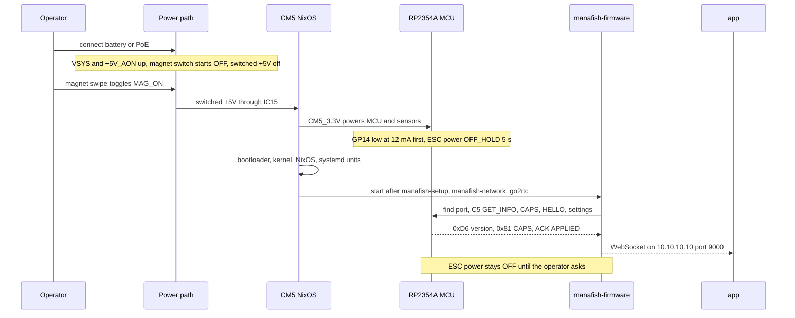
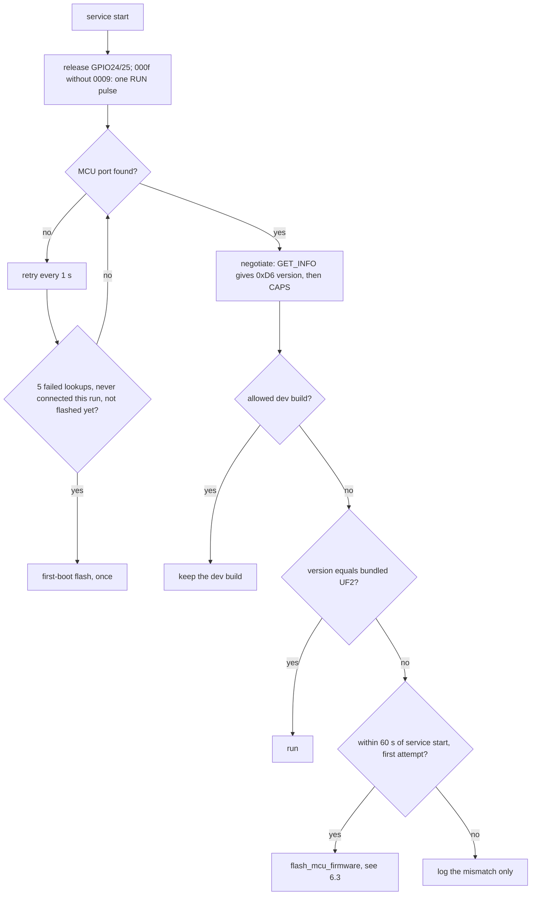
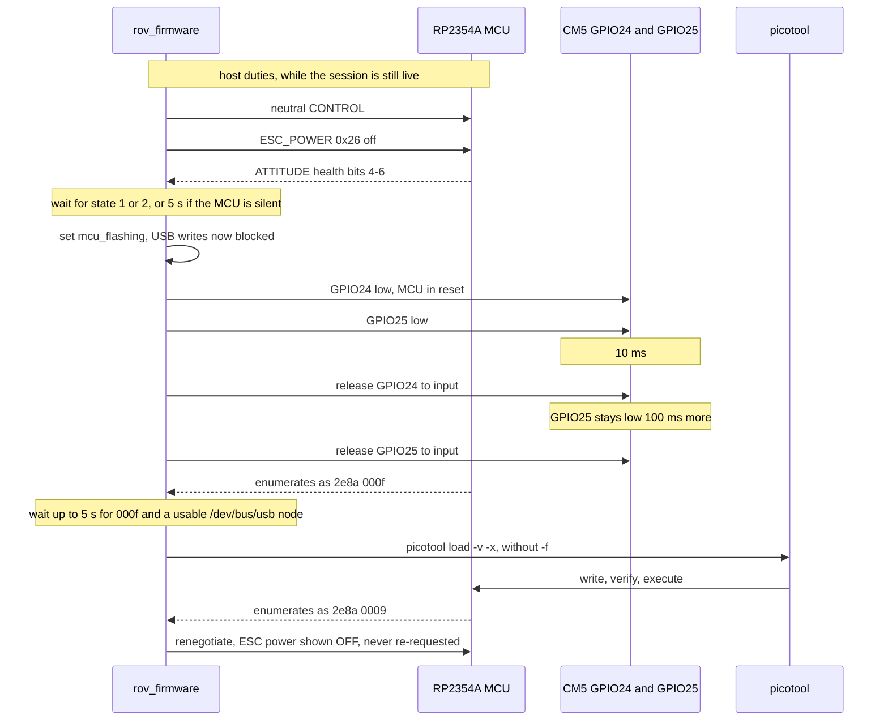
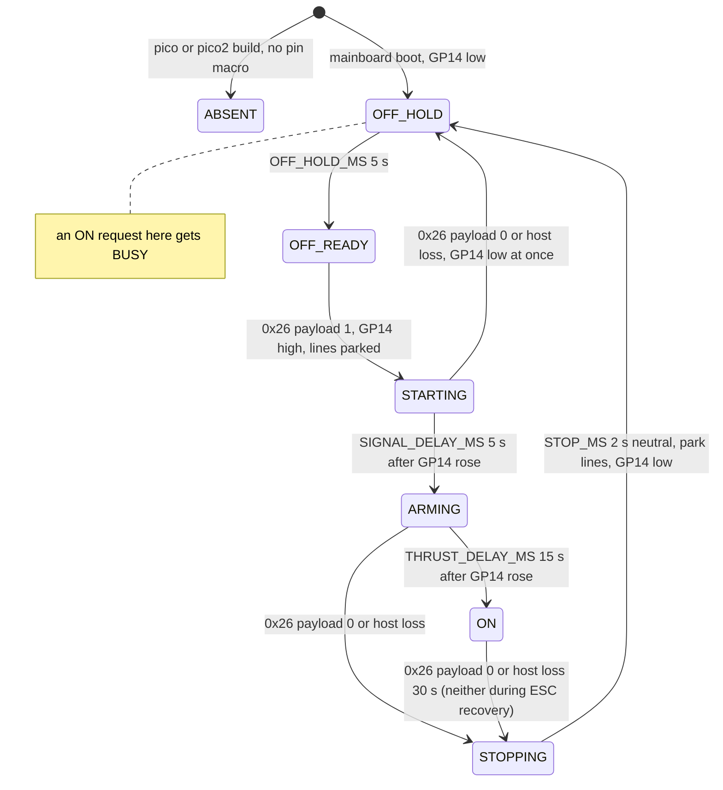
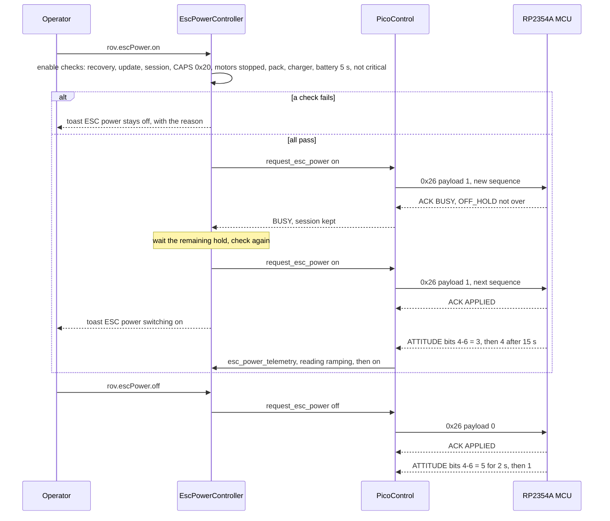
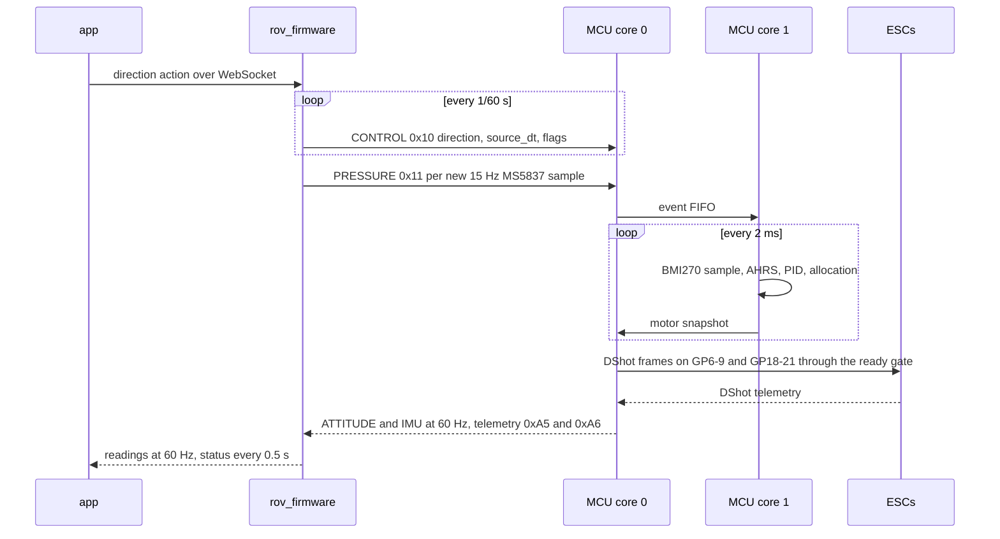
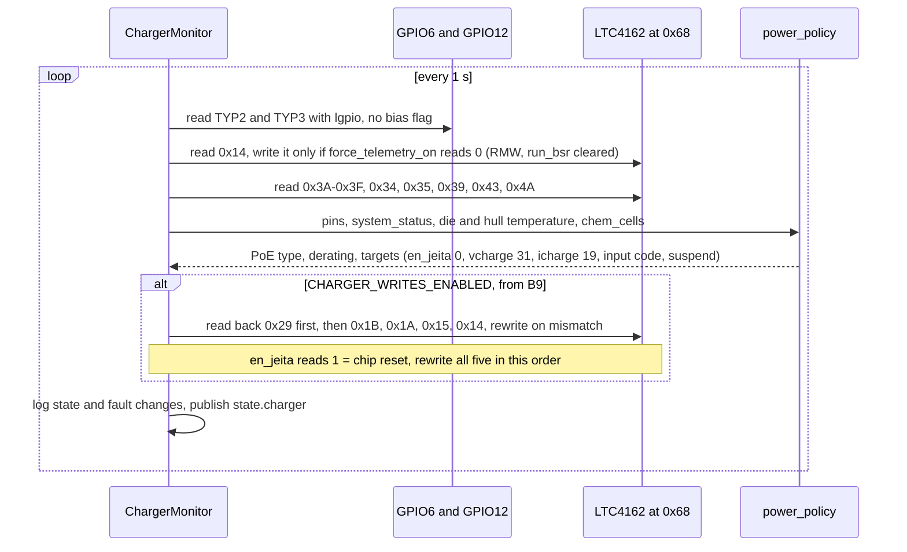
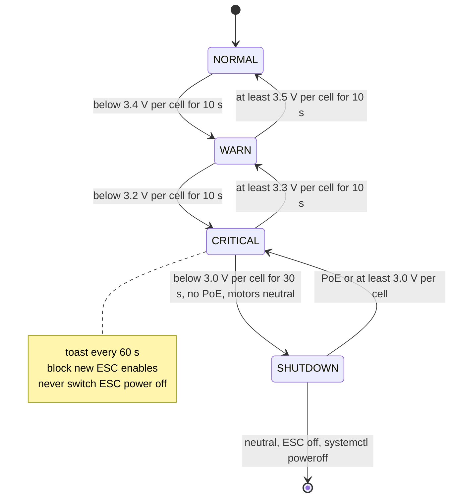

# 6. Runtime View

Status labels: **[upstream]** exists in the imported code, **[done]** done in this repo,
**[planned: Phase N]** from the plan, **[bring-up]** to be measured on the board (step Bx).
Modules: [Building Block View](05-Building-Block-View). Safety rules behind these flows:
[Crosscutting Concepts](08-Crosscutting-Concepts).

## 6.1 Power-up via the magnet switch

| Step | Detail | Status |
|---|---|---|
| Power applied | Charger and +5V_AON run; the magnet switch board comes up OFF | hardware; +5V_AON about 5.115 V **[bring-up]** (B2) |
| Magnet swipe | The Hall switch toggles the CD4013 flip-flop; MAG_ON enables load switch IC15; +5 V in about 18 ms | **[bring-up]** (B2) |
| MCU boot | `esc_power_init()` before `stdio_init_all()`: GP14 output, low, 12 mA; then OFF_HOLD | **[done]**; GP14 stays 0 V for 60 s **[bring-up]** (B7) |
| CM5 boot | `grow-persistent` (first boot only), `manafish-setup`, `manafish-network`, `dnsmasq`, `go2rtc`, `manafish-firmware` | **[upstream]** units; CM5 image **[done]** (Phase 3); boot on the IO Board **[done]** (spike, 2026-11-14); first boot **[bring-up]** (B4) |
| Service start | WebSocket server, the BOOTSEL leftover check (`Board.prepare()`, 6.2), `SerialManager.initialize()`, `PressureSensor.initialize()`, then the read, send and diagnostics tasks | **[upstream]**; BOOTSEL leftover check **[done]** (Phase 4) |
| Board tasks | From `Board.create_tasks()`: `hull.run` (SHT45, WSEN-PADS), `charger.run` (`ChargerMonitor`, 6.6) and `soc.run` (`SocMonitor`: `rpi_volt`, `thermal_zone0`, `get_throttled`) at 1 Hz, their I2C, GPIO, sysfs and vcgencmd in worker threads; `battery.run` (`LowBatteryMonitor`, 6.7) at 1 Hz on the event loop; `esc_power.run` watches the reported ESC power state, adopts an MCU state of 3 or 4 and never sends ON. All **[done]** (Phase 4) | see each |
| Magnet off | Hard cut of +5 V: CM5, MCU and GP14 lose power; the charger keeps running | hardware; AM32 stops within 0.5 s **[bring-up]** (B13) |

## 6.2 MCU discovery, version check and auto-flash window

| Item | Rule | Status |
|---|---|---|
| Port lookup | `mcu_usb.find_mcu_port()`: `/dev/manafish-mcu` (udev symlink for 2e8a:0009), then a sysfs scan for a ttyACM backed by 2e8a:0009 (prefers the product "Manafish Mainboard"); no blind `ttyACM*` fallback. Upstream used `/dev/serial/by-id/usb-Raspberry_Pi_Pico*`, else any `/dev/ttyACM*` | udev **[done]** (Phase 3), Python **[done]** (Phase 4) |
| BOOTSEL leftover | At start, before the first lookup: release GPIO24/25, then one `reset()` (10 ms GPIO24 pulse) if 2e8a:000f is present without 0009; not while the ESC recovery journal is set | **[done]** (Phase 4) |
| First-boot flash | After `MCU_FIRST_BOOT_RETRY_LIMIT` (5) failed lookups in a row (a connection resets the count), once per run; skipped while ESC recovery is required; ignores the dev override. Before the first successful connection of the run any missing MCU qualifies; after it only an MCU waiting in BOOTSEL (2e8a:000f, left by a failed flash, holding no ESC power; any RP2350 boot ROM on the USB counts, so on the bench keep a second one in BOOTSEL off the CM5). A flash restarts the miss count. The flash resets the MCU through RUN/BOOTSEL, and after a mid-run USB loss of a running MCU the host has no session to send ESC power off while the MCU may still hold it on (host loss takes 30 s) | **[upstream]**; after the first connection only for BOOTSEL **[done]** (Phase 4) |
| Version compare | Equality (`mcu_update_required` = not `mcu_versions_match`), so no downgrade refusal: `1.0.4-mb.1` replaces a running `1.0.4-rc.3` (test). Bundled version = highest SemVer of `~/mcu-firmware/mainboard-v*.uf2` | **[upstream]**; `-mb` test **[done]** (Phase 4) |
| Prefix | `{PICO2: "mainboard"}`, matching the bundled `mainboard-v<ver>.uf2`; a stored or requested `pico` is normalised to `pico2`. Upstream's `pico`/`pico2` prefixes found nothing in the image, so before Phase 4 no auto-flash happened | **[done]** (Phase 4) |
| Window | `MCU_AUTO_UPDATE_WINDOW_S` = 60 s from service start, at most one auto-flash per run (ADR-21) | **[upstream]** |
| Dev override | Needs `MANAFISH_PICO_CONTROL_DEVELOPMENT=1`, identity `pico-control-dev:…`, CAPS feature bit 16 and the same USB generation. Otherwise test dev builds with the service stopped | **[upstream]**; **[bring-up]** (B7) |

Never keep `mainboard-v1.0.4.uf2` next to `mainboard-v1.0.4-mb.1.uf2`: in SemVer `mb.1` is a
prerelease, so the plain file wins.

## 6.3 Hardware BOOTSEL flash (Decision 9)

Every flash path (manual from the app, first boot, version mismatch) goes through
`flash_mcu_firmware` in `websocket/receive/mcu.py` **[done]** (Phase 4). Upstream ran
`picotool load -f -v -x` (USB reset into BOOTSEL) with no GPIO step. The firmware side is
**[done]**: `make flash-mainboard` runs `picotool load -v -x` without `-f` and expects
BOOTSEL already; `firmware/docs/PICO_CONTROL_HANDOFF.md` gives the GPIO24/GPIO25 sequence
for `pinctrl` and `firmware/docs/PICO_CONTROL_PROTOCOL.md` the host duties before a flash
or reset. Before any step reaches the MCU, the service checks that the image exists, fits
the attached board and that picotool is present, so a flash that cannot run switches
nothing off.

By hand, with the service stopped, `tools mcu-recover [UF2]` runs the same GPIO steps and
load, and `tools mcu-reset` only the 10 ms RUN pulse. They cannot do the host duties over
the MCU link, so they wait for the MCU's host-loss auto-off instead (the 35 s rule below)
**[done]** (Phase 4).

| Rule | Why | Status |
|---|---|---|
| Host duties run before `state.mcu_flashing` is set | Once it is set, `PicoControl._write` raises and the send loop stops. A refusal (recovery pending, ESC power still on after 5 s) ends the flash before any GPIO step | **[done]** (Phase 4) |
| Never drive GPIO24 or GPIO25 high; `release` = input with bias off; on any exception the `Rp1Gpio` context manager releases every driven line, GPIO24 first | The board has pull-ups; GPIO25 is the in-package flash CS; pinctrl-rp1 keeps a freed output driving, so `release` reclaims the line as an input first | **[done]** (Phase 4) |
| GPIO25 low only while GPIO24 is low or within 100 ms after its release | Unit test in `tests/test_mcu_gpio.py`, also for an interrupted sequence | **[done]** (Phase 4) |
| No `-f` | BOOTSEL is already entered by hardware; the same path works on a blank, hung or bricked MCU | **[done]** (Phase 4) |
| `tools mcu-reset` / `mcu-recover` refuse until `manafish-firmware` has been inactive or failed for 35 s, and while the ESC recovery journal is set | MCU host-loss auto-off (30 s) plus STOP (2 s) plus margin; during ESC recovery the MCU holds ESC power on and a reset forgets its recovery state | **[done]** (Phase 4) |
| GP14 through RUN pulse and BOOTSEL | Unknown (pad isolation); until measured the "off first" duty is mandatory | **[bring-up]** (B11) |
| Cold BOOTSEL with the slow-start crystal | 20 reboots plus cold cycles at 0-5 °C | **[bring-up]** (B7) |

## 6.4 ESC power on and off

MCU state machine in `esc_power` **[done]**; the safety rules behind it are in
[Crosscutting Concepts](08-Crosscutting-Concepts).

| State | Wire value (health bits 4-6) | GP14 | Motor lines | CM5 shows |
|---|---|---|---|---|
| ABSENT | 0 | not driven | normal Pico behaviour | unavailable |
| OFF_HOLD, OFF_READY | 1, 2 | low | parked (SIO low) | off |
| STARTING | 3 | high | parked | ramping |
| ARMING | 3 | high | live, neutral frames only | ramping |
| ON | 4 | high | live, thrust permitted | on |
| STOPPING | 5 | high, then low | neutral for 2 s, then parked | off (stopping) |

| Rule | Detail | Status |
|---|---|---|
| Timers | `OFF_HOLD_MS` 5000, `SIGNAL_DELAY_MS` 5000, `THRUST_DELAY_MS` 15000, `STOP_MS` 2000; wrap-safe unsigned compares | **[done]** |
| `SIGNAL_DELAY_MS` final value | At least the measured ESC rail-up time plus 1 s | **[bring-up]** (B12) |
| CM5 enable checks | Operator action `rov.escPower.on`, then in order: no ESC recovery pending, no firmware update running, MCU session live with a fresh report, CAPS bit 0x20, `disruptive_motor_operation_blocker` = None; then the injected battery checks: no pack missing on PoE (`bat_missing_fault`, vbat ≤ 12 V or 0), charger readable and fresh, battery present for 5 s (with PoE: vbat > 12 V, no battery detection running and no `bat_detect_failed_fault`, which is unknown presence, not a missing pack), battery not critical. An on press while an off waits for its answer is refused | **[done]** (Phase 4) |
| BUSY | ON: during the hold, before settings apply, while stopping, during upload, recovery or a protocol transition. OFF: only during ESC firmware recovery (the ESCs stay powered in the AM32 bootloader until a recovery flash succeeds; an MCU reset meanwhile forgets the recovery state, and the next power-on on parked low lines starts the partly programmed firmware). The CM5 retries with a fresh frame after the remaining hold (estimated from the reported state, else every 0.5 s, at most 10 s); the session stays up | MCU **[done]**, CM5 **[done]** (Phase 4) |
| Host-loss auto-off | `HOST_LOSS_MS` 30000 (30 s, confirmed by the owner) without a host packet → STOPPING. A host packet is every extended frame that decodes (length, version, CRC32C), also one the session rejects, and every valid legacy 0x5A, 0xC5, 0xE7 or 0xE8 packet. Paused only during ESC firmware recovery; during an upload every accepted 0xE7/0xE8 packet renews it, and `esc_power_host_activity()` runs again after the AM32 flash returns | **[done]**; auto-off at 30 s **[bring-up]** (B11) |
| CM5 auto-off | Only when the pack is removed while on PoE (ESC power reads ramping or on: 0x26 off, one toast, retried every 10 s while it still reads on; `bat_missing_fault` or vbat 0 counts at once, low vbat counts only with the motors neutral for 2 s; battery detection, `bat_detect_failed_fault` and charger read errors never count), or at the 3.0 V/cell shutdown (6.7) | **[done]** (Phase 4); pulled pack **[bring-up]** (B10) |
| Reconnect or service restart | Adopt state 3 or 4 without sending ON; after re-enumeration show OFF; never re-request. An off the CM5 did not request gets a warning toast | **[done]** (Phase 4) |
| ESC firmware update | Needs state 4. The CM5 checks it before ENTER_MAINTENANCE (0x25 closes the session, so an OFF afterwards needs a new HELLO); the MCU rejects begin/commit with error 11 otherwise, which the CM5 shows as a plain message | MCU **[done]**, CM5 **[done]** (Phase 4); AM32 passthrough **[bring-up]** (B12) |
| ESC recovery pending | The CM5 refuses ON and OFF (the MCU holds ESC power on for the recovery flash) and any MCU flash or reset; the reading shows unavailable, because the host holds no session during recovery | **[done]** (Phase 4) |
| Measured on the board | BUSY before 5 s, ramp warm and cold, lines at 0 V until 5 s, 3 → 4 at 15 s, off sequence, auto-off at 30 s | **[bring-up]** (B11) |

### CM5 request sequence

`EscPowerController` in `esc_power.py` and `PicoControl.request_esc_power` **[done]**
(Phase 4). The app actions `rov.escPower.on` and `rov.escPower.off` that call it **[done]**
(Phase 4). Rules: 8.1
"ESC power on the CM5".

## 6.5 Control loop and failsafe

| Trigger | Reaction | Status |
|---|---|---|
| App direction older than 200 ms (`HOST_TIMEOUT` in `pico_control.py`) | CONTROL with `input_valid` = 0: the MCU neutralises at once | **[upstream]** |
| No fresh CONTROL for 200 ms (host lease) | Core 0 outputs neutral | **[upstream]** |
| Core 1 output older than 10 ms | Core 0 outputs neutral | **[upstream]** |
| Core 0 stalled | 1 ms hardware timer: PWM neutral, DShot GPIO forced low | **[upstream]** |
| Whole MCU stalled | 1 s watchdog reset | **[upstream]** |
| Legacy 0x5A stream stops | 200 ms `usb_check_timeout` sets neutral | **[upstream]** |
| Pressure older than 500 ms | Depth-dependent control inhibited | **[upstream]** |
| Bad length, version or CRC | Never executed; an invalid packet inhibits output | **[upstream]** |
| ESC power not ON | `thrust_permitted` in the `ready` gate keeps neutral; lines parked before ARMING | **[done]** |
| Host gone 30 s | ESC power off (6.4) | **[done]**; **[bring-up]** (B11) |
| Host killed / magnet off while spinning | Neutral within 200 ms / AM32 stops within 0.5 s | **[bring-up]** (B13) |

## 6.6 Charger policy loop (1 Hz)

Code: [sensors/charger.py](https://github.com/Tropaion/Manafish_Mainboard/blob/main/software/src/rov_firmware/sensors/charger.py)
(`ChargerMonitor`), [power_policy.py](https://github.com/Tropaion/Manafish_Mainboard/blob/main/software/src/rov_firmware/power_policy.py),
[sensors/ltc4162.py](https://github.com/Tropaion/Manafish_Mainboard/blob/main/software/src/rov_firmware/sensors/ltc4162.py).
Every cycle runs in a worker thread and ends by swapping a new frozen `ChargerStatus` into
`state.charger`. Built and unit-tested with fakes **[done]** (Phase 4); register facts come from
the LTC4162 datasheet check; on the board **[bring-up]** (B6, B9, B10).

| Step | Rule |
|---|---|
| PoE present | `system_status` `vin_gt_4p2v` (0x39 bit 1). `vin_gt_vbat` (bit 2) is secondary ("can charge"). Not from the vin ADC, which converts only every ~5 s on battery |
| PoE type | Only when present: GPIO6/GPIO12 per Ag59800 Table 5 → input limit code 6 / 14 / 29 / 41 (Type 1 / 2 / 3 / 4). HIGH/HIGH with PoE present also covers a non-classifying PSE or one waiting for LLDP, so it gets the Type 1 limit; unreadable pins give `unknown` with the Type 1 limit. The limit drops at once and rises only after two equal reads |
| Telemetry valid | `force_telemetry_on` = 1 always (RMW of 0x14 that clears `run_bsr`, bit 4). Valid only after `telemetry_valid` (0x4A bit 0) plus one conversion wait after that write: 6 s, because `telemetry_speed` stays `tel_low_speed` (8.2); not while vbat reads 0, not after an I2C error. The die temperature counts for derating once the ADC converts, also without a pack |
| Not a validity rule | `cell_count` reads 0 without input power. Pack voltage uses a fixed 5 cells. `chem` (0 = LAD) and `cell_count` (5) are checked only while `en_chg` (0x39 bit 8) = 1 and `cell_count` ≠ 0. Three mismatching reads in a row latch a chemistry fault that suspends charging until the service restarts; a later read never releases it |
| Invalid telemetry | `ChargerStatus.telemetry` None with `telemetry_problem` set, charger unhealthy; ESC enable blocked ("Charger unreadable, ESC power blocked:" and the reason). `charger_state` and `vbat_zero` (vbat 0 after a full conversion) are published also without valid telemetry, for the pulled-pack check **[done]** (Phase 4) |
| Targets | vcharge code 31 = 4.20 V/cell (21.0 V; 4.10 V would be 23), charge code 19 = 2.0 A, `en_jeita` = 0 written first (else JEITA overwrites 0x1A/0x1B every 11 ms) |
| Derating | SHT45 > 45 °C halves the limit (also while the hull temperature is unknown); > 55 °C or die > 100 °C suspends; 5 °C hysteresis; an unknown temperature never releases a suspend |
| Reset detect | `en_jeita` reading 1 = the chip lost its registers: rewrite 0x29, 0x1B, 0x1A, 0x15, 0x14 |
| Never | Write 0x19 (ship mode) or undocumented addresses; port the Linux integer maths; toggle suspend needlessly |
| On the board | Registers verified and writes enabled at **[bring-up]** (B9); CC/CV and defaults window (4.0 A in, 3.2 A charge with the magnet off) at **[bring-up]** (B10) |

## 6.7 Low battery and the 3.0 V/cell shutdown

`LowBatteryMonitor` in
[battery.py](https://github.com/Tropaion/Manafish_Mainboard/blob/main/software/src/rov_firmware/battery.py),
1 Hz on the event loop, publishes a frozen `BatteryStatus` in `state.battery`. Built and
unit-tested with an injectable clock **[done]** (Phase 4); the shutdown chain on the board
**[bring-up]** (B15). Upstream had only the ESC voltage average and no low-battery logic.

| Rule | Detail |
|---|---|
| When vbat counts | Only after all motor commands have been neutral for 2 s (ESC power off counts as neutral); otherwise keep the level and restart every window, so each window is continuous neutral time (vbat at BAT_IN sags under thrust). Sampled at 1 Hz, so a short tap between samples is not seen; the 10 s and 30 s windows outlast one sagged 5 s conversion |
| 5S thresholds | 17.0 V warn, 16.0 V critical, 15.0 V shutdown (`power_policy.py`); values and auto power-off confirmed by the owner (2026-11-14) |
| Toasts | Warn once ("Battery low"); critical at once and every 60 s ("Battery critical"); "Battery no longer critical" on recovery; "Battery empty: powering off"; "Battery voltage unknown" after 15 s of invalid telemetry; toast id `battery` |
| Battery % | 10 s EMA of LTC4162 vbat through the min/max config (16 / 20.5 V); ESC voltage only when the charger is unhealthy |
| Invalid telemetry | Warn only, never power off; the level stays and every window restarts |
| Shutdown chain | Toast → pilot input cleared → 0x26 off → `wait_until_off()` → PoE checked again → `systemctl poweroff` (polkit lets `pi` do it, board.nix) → EEPROM `POWER_OFF_ON_HALT=1` drops CM5 3.3 V → MCU off → GP14 low. A failed or replaced ESC off does not stop it (it still waits for off; the halt drops GP14 anyway). It holds `mcu_flash_lock` from the toast to the power-off, so no flash starts under it, and waits while a firmware update holds the lock. While the ESC recovery journal is set it does not power off and toasts every 60 s instead (8.1, 11.2); a failed `systemctl poweroff` is toasted and retried after 60 s. Checked at **[bring-up]** (B15) |
| Recovery from WARN or CRITICAL | Phase 4 hysteresis: 10 s at or above the threshold plus 0.1 V/cell (`BATTERY_RECOVERY_HYSTERESIS_V_PER_CELL`) |
