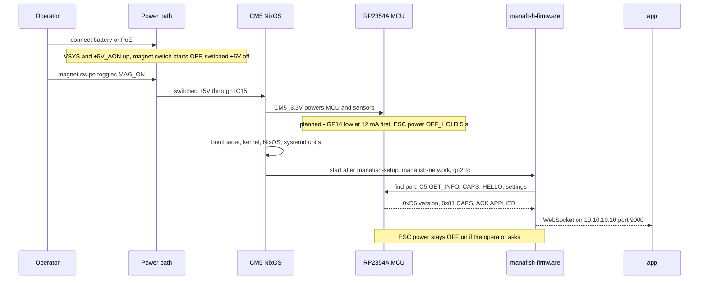
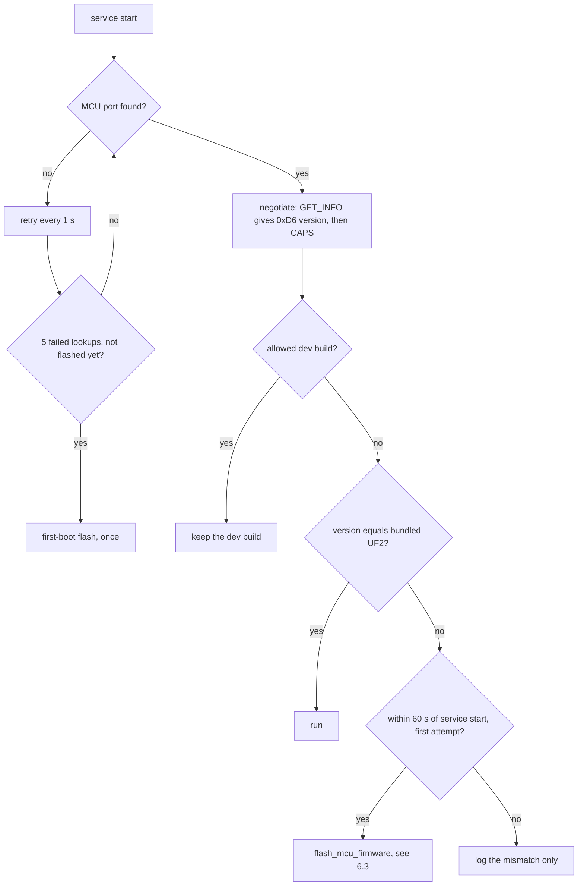
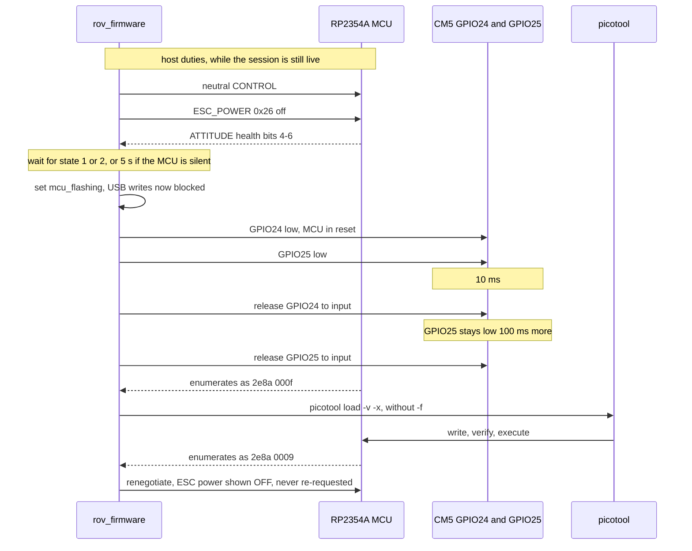
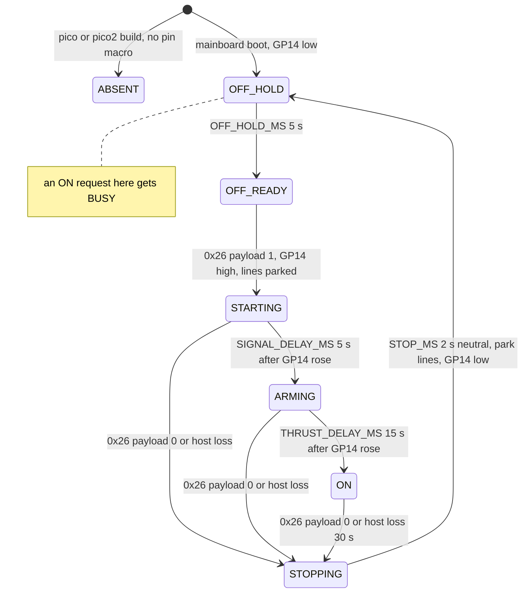
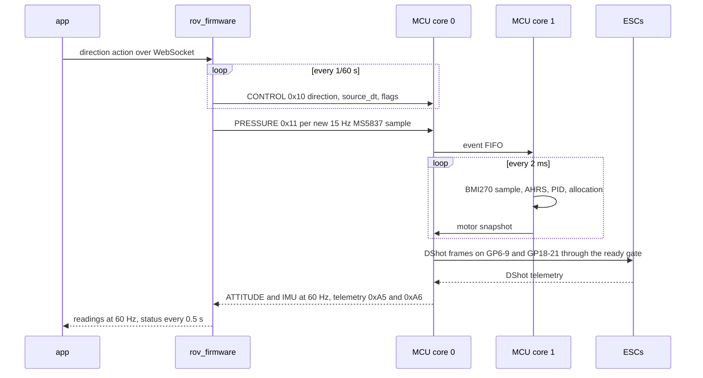
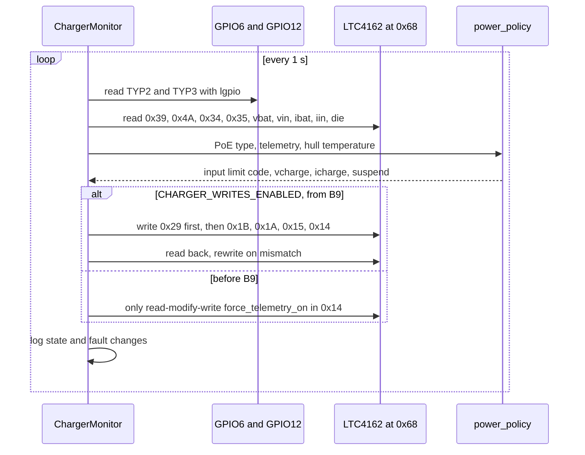
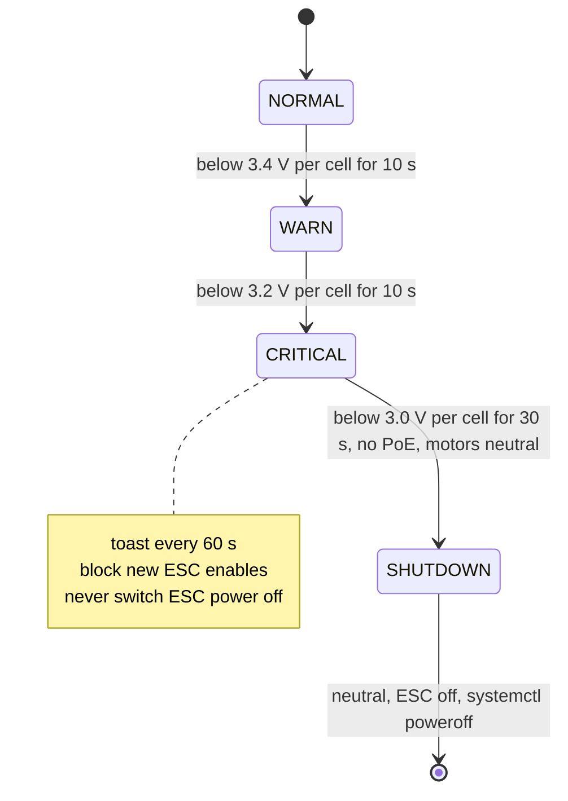

# 6. Runtime View

Status labels: **[upstream]** exists in the imported code, **[done]** done in this repo,
**[planned: Phase N]** from the plan, **[bring-up]** to be measured on the board (step Bx).
Modules: [Building Block View](05-Building-Block-View). Safety rules behind these flows:
[Crosscutting Concepts](08-Crosscutting-Concepts).

## 6.1 Power-up via the magnet switch

| Step | Detail | Status |
|---|---|---|
| Power applied | Charger and +5V_AON run; the magnet switch board comes up OFF | hardware; +5V_AON about 5.115 V **[bring-up]** (B2) |
| Magnet swipe | The Hall switch toggles the CD4013 flip-flop; MAG_ON enables load switch IC15; +5 V in about 18 ms | **[bring-up]** (B2) |
| MCU boot | `esc_power_init()` before `stdio_init_all()`: GP14 output, low, 12 mA; then OFF_HOLD | **[planned: Phase 2]**; GP14 stays 0 V for 60 s **[bring-up]** (B7) |
| CM5 boot | `grow-persistent` (first boot only), `manafish-setup`, `manafish-network`, `dnsmasq`, `go2rtc`, `manafish-firmware` | **[upstream]** units; CM5 image **[planned: Phase 3]**; first boot **[bring-up]** (B4) |
| Service start | WebSocket server, `SerialManager.initialize()`, `PressureSensor.initialize()`, then the read, send and diagnostics tasks | **[upstream]** |
| Board tasks | `ChargerMonitor` and hull sensors at 1 Hz; `EscPowerController` adopts an MCU state of 3 or 4, never sends ON | **[planned: Phase 4]** |
| Magnet off | Hard cut of +5 V: CM5, MCU and GP14 lose power; the charger keeps running | hardware; AM32 stops within 0.5 s **[bring-up]** (B13) |

## 6.2 MCU discovery, version check and auto-flash window

| Item | Rule | Status |
|---|---|---|
| Port lookup today | `/dev/serial/by-id/usb-Raspberry_Pi_Pico*`, else any `/dev/ttyACM*`. With the product string "Manafish Mainboard" the by-id glob would probably miss the board (udev naming, not checked on hardware) | **[upstream]** |
| Port lookup target | `find_mcu_port()`: `/dev/manafish-mcu` (udev symlink for 2e8a:0009), then a sysfs scan for 2e8a:0009; no blind `ttyACM*` fallback | udev **[planned: Phase 3]**, Python **[planned: Phase 4]** |
| BOOTSEL leftover | At start, if 2e8a:000f is present without 0009, run one `reset()` (10 ms GPIO24 pulse) first | **[planned: Phase 4]** |
| First-boot flash | After `MCU_FIRST_BOOT_RETRY_LIMIT` (5) failed lookups, once per run; skipped while ESC recovery is required; ignores the dev override | **[upstream]** |
| Version compare | Equality (`mcu_update_required` = not `mcu_versions_match`), so no downgrade refusal. Bundled version = highest SemVer of `~/mcu-firmware/<prefix>-v*.uf2` | **[upstream]** |
| Prefix | `pico`/`pico2` today; `{PICO2: "mainboard"}`, a stored `pico` is normalised to `pico2` | **[upstream]** / **[planned: Phase 4]** |
| Window | `MCU_AUTO_UPDATE_WINDOW_S` = 60 s from service start, at most one auto-flash per run (ADR-21) | **[upstream]** |
| Dev override | Needs `MANAFISH_PICO_CONTROL_DEVELOPMENT=1`, identity `pico-control-dev:…`, CAPS feature bit 16 and the same USB generation. Otherwise test dev builds with the service stopped | **[upstream]**; **[bring-up]** (B7) |

Never keep `mainboard-v1.0.4.uf2` next to `mainboard-v1.0.4-mb.1.uf2`: in SemVer `mb.1` is a
prerelease, so the plain file wins.

## 6.3 Hardware BOOTSEL flash (Decision 9)

Every flash path (manual from the app, first boot, version mismatch) goes through
`flash_mcu_firmware` in `websocket/receive/mcu.py` **[planned: Phase 4]**. Today it runs
`picotool load -f -v -x` (USB reset into BOOTSEL), with no GPIO step **[upstream]**.

| Rule | Why | Status |
|---|---|---|
| Host duties run before `state.mcu_flashing` is set | Once it is set, `PicoControl._write` raises and the send loop stops | **[planned: Phase 4]** |
| Never drive GPIO24 or GPIO25 high; `release` = input with bias off; release in `finally` | The board has pull-ups; GPIO25 is the in-package flash CS | **[planned: Phase 4]** |
| GPIO25 low only while GPIO24 is low or within 100 ms after its release | Unit test in `mcu_gpio` | **[planned: Phase 4]** |
| No `-f` | BOOTSEL is already entered by hardware; the same path works on a blank, hung or bricked MCU | **[planned: Phase 4]** |
| `tools mcu-reset` / `mcu-recover` refuse until `manafish-firmware` has been inactive or failed for 35 s | MCU host-loss auto-off (30 s) plus STOP (2 s) plus margin | **[planned: Phase 4]** |
| GP14 through RUN pulse and BOOTSEL | Unknown (pad isolation); until measured the "off first" duty is mandatory | **[bring-up]** (B11) |
| Cold BOOTSEL with the slow-start crystal | 20 reboots plus cold cycles at 0-5 °C | **[bring-up]** (B7) |

## 6.4 ESC power on and off

MCU state machine in `esc_power` **[planned: Phase 2]**; the safety rules behind it are in
[Crosscutting Concepts](08-Crosscutting-Concepts).

| State | Wire value (health bits 4-6) | GP14 | Motor lines | CM5 shows |
|---|---|---|---|---|
| ABSENT | 0 | not driven | normal Pico behaviour | unavailable |
| OFF_HOLD, OFF_READY | 1, 2 | low | parked (SIO low) | off |
| STARTING | 3 | high | parked | ramping |
| ARMING | 3 | high | live, neutral frames only | ramping |
| ON | 4 | high | live, thrust permitted | on |
| STOPPING | 5 | high, then low | neutral for 2 s, then parked | off (stopping) |

| Rule | Detail | Status |
|---|---|---|
| Timers | `OFF_HOLD_MS` 5000, `SIGNAL_DELAY_MS` 5000, `THRUST_DELAY_MS` 15000, `STOP_MS` 2000; wrap-safe unsigned compares | **[planned: Phase 2]** |
| `SIGNAL_DELAY_MS` final value | At least the measured ESC rail-up time plus 1 s | **[bring-up]** (B12) |
| CM5 enable checks | Operator `escPower.set true`, CAPS bit 0x20, battery present for 5 s (with PoE: vbat > 12 V, no bat_missing or detection state), charger readable and fresh, `disruptive_motor_operation_blocker` = None, battery not critical | **[planned: Phase 4]** |
| BUSY | During the hold, before settings apply, while stopping, during upload, recovery or a protocol transition. The CM5 retries with a fresh frame on its own timer; the session stays up | **[planned: Phase 2]**, **[planned: Phase 4]** |
| Host-loss auto-off | `HOST_LOSS_MS` 30000 without a valid packet (extended frames after CRC and session checks, legacy 0x5A, 0xC5, 0xE7, 0xE8) → STOPPING. Paused during an ESC update or recovery; `esc_power_host_activity()` runs again after the AM32 flash returns. Owner to confirm 30 s | **[planned: Phase 2]** |
| CM5 auto-off | Only when the pack is removed while on PoE, or at the 3.0 V/cell shutdown (6.7) | **[planned: Phase 4]** |
| Reconnect or service restart | Adopt state 3 or 4 without sending ON; after re-enumeration show OFF; never re-request | **[planned: Phase 4]** |
| ESC firmware update | Needs state 4. The CM5 checks it before ENTER_MAINTENANCE (0x25 closes the session, so an OFF afterwards needs a new HELLO); the MCU rejects begin/commit with error 11 otherwise | **[planned: Phase 2]**, **[planned: Phase 4]** |
| Measured on the board | BUSY before 5 s, ramp warm and cold, lines at 0 V until 5 s, 3 → 4 at 15 s, off sequence, auto-off at 30 s | **[bring-up]** (B11) |

## 6.5 Control loop and failsafe

| Trigger | Reaction | Status |
|---|---|---|
| App direction older than 200 ms (`HOST_TIMEOUT` in `pico_control.py`) | CONTROL with `input_valid` = 0: the MCU neutralises at once | **[upstream]** |
| No fresh CONTROL for 200 ms (host lease) | Core 0 outputs neutral | **[upstream]** |
| Core 1 output older than 10 ms | Core 0 outputs neutral | **[upstream]** |
| Core 0 stalled | 1 ms hardware timer: PWM neutral, DShot GPIO forced low | **[upstream]** |
| Whole MCU stalled | 1 s watchdog reset | **[upstream]** |
| Legacy 0x5A stream stops | 200 ms `usb_check_timeout` sets neutral | **[upstream]** |
| Pressure older than 500 ms | Depth-dependent control inhibited | **[upstream]** |
| Bad length, version or CRC | Never executed; an invalid packet inhibits output | **[upstream]** |
| ESC power not ON | `thrust_permitted` in the `ready` gate keeps neutral; lines parked before ARMING | **[planned: Phase 2]** |
| Host gone 30 s | ESC power off (6.4) | **[planned: Phase 2]** |
| Host killed / magnet off while spinning | Neutral within 200 ms / AM32 stops within 0.5 s | **[bring-up]** (B13) |

## 6.6 Charger policy loop (1 Hz)

All of this is **[planned: Phase 4]**; register facts come from the LTC4162 datasheet check.

| Step | Rule |
|---|---|
| PoE present | `system_status` `vin_gt_4p2v` (0x39 bit 1). `vin_gt_vbat` (bit 2) is secondary ("can charge"). Not from the vin ADC, which converts only every ~5 s on battery |
| PoE type | Only when present: GPIO6/GPIO12 per Ag59800 Table 5 → input limit code 6 / 14 / 29 / 41 (Type 1 / 2 / 3 / 4). HIGH/HIGH with PoE present also covers a non-classifying PSE or one waiting for LLDP, so it gets the Type 1 limit |
| Telemetry valid | `force_telemetry_on` = 1 always (RMW of 0x14 that clears `run_bsr`, bit 4). Valid only after `telemetry_valid` (0x4A bit 0) plus one conversion wait after that write (20 ms or more in fast mode), not while vbat reads 0, not after an I2C error |
| Not a validity rule | `cell_count` reads 0 without input power. Pack voltage uses a fixed 5 cells. `chem` (0 = LAD) and `cell_count` (5) are checked only while `en_chg` (0x39 bit 8) = 1, and never used to release a suspend |
| Invalid telemetry | Readings None, charger unhealthy, ESC enable blocked ("charger unreadable, ESC power blocked") |
| Targets | vcharge code 31 = 4.20 V/cell (21.0 V; 4.10 V would be 23), charge code 19 = 2.0 A, `en_jeita` = 0 written first (else JEITA overwrites 0x1A/0x1B every 11 ms) |
| Derating | SHT45 > 45 °C halves the limit; > 55 °C or die > 100 °C suspends; 5 °C hysteresis |
| Reset detect | `en_jeita` reading 1 = the chip lost its registers: rewrite 0x29, 0x1B, 0x1A, 0x15, 0x14 |
| Never | Write 0x19 (ship mode) or undocumented addresses; port the Linux integer maths; toggle suspend needlessly |
| On the board | Registers verified and writes enabled at **[bring-up]** (B9); CC/CV and defaults window (4.0 A in, 3.2 A charge with the magnet off) at **[bring-up]** (B10) |

## 6.7 Low battery and the 3.0 V/cell shutdown

All of this is **[planned: Phase 4]**. Today the battery % is the average ESC telemetry voltage
and there is no low-battery logic and no power-off **[upstream]**.

| Rule | Detail |
|---|---|
| When vbat counts | Only after all motor commands have been neutral for 2 s; otherwise keep the last state (vbat at BAT_IN sags under thrust) |
| 5S thresholds | 17.0 V warn, 16.0 V critical, 15.0 V shutdown; owner to confirm values and auto power-off |
| Battery % | 10 s EMA of LTC4162 vbat through the min/max config (16 / 20.5 V); ESC voltage only when the charger is unhealthy |
| Invalid telemetry | Warn only, never power off |
| Shutdown chain | Neutral → 0x26 off → `systemctl poweroff` (polkit lets `pi` do it, board.nix) → EEPROM `POWER_OFF_ON_HALT=1` drops CM5 3.3 V → MCU off → GP14 low. Checked at **[bring-up]** (B15) |
| Recovery from WARN or CRITICAL | Hysteresis is not in the plan; Phase 4 defines it |
