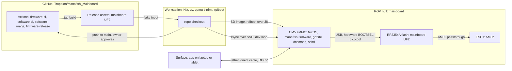
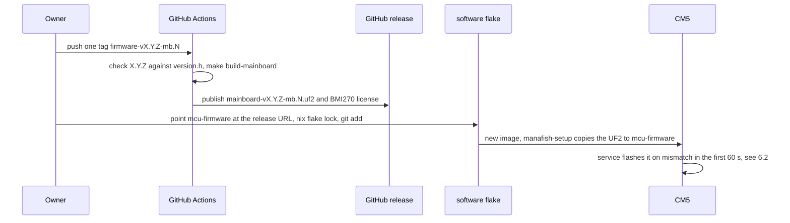

# 7. Deployment View

Status labels: **[upstream]** exists in the imported code, **[done]** done in this repo,
**[planned: Phase N]** from the plan, **[bring-up]** to be measured on the board (step Bx).
Modules: [Building Block View](05-Building-Block-View). Release and tag rules in full:
[CLAUDE.md](https://github.com/Tropaion/Manafish_Mainboard/blob/main/CLAUDE.md).

## 7.1 Nodes



| Node | Runs | Storage | Status |
|---|---|---|---|
| CM5 | NixOS image `cm5-mainboard`: rov_firmware service (manafish-firmware), go2rtc, dnsmasq, sshd, avahi | eMMC, 16 GB or more; any CM5 with eMMC (7.2) | image **[done]** (Phase 3); boot on the CM5 IO Board **[planned: Phase 3 spike]**; on the board **[bring-up]** (B4) |
| RP2354A (MCU) | Mainboard UF2 from a `firmware-vX.Y.Z-mb.N` release | 2 MB in-package flash | board target, release workflow and release `firmware-v1.0.4-mb.1` **[done]**; bundled in the image **[done]** (Phase 3); flashed from the CM5 **[planned: Phase 4]** |
| ESCs | AM32 2.21.1 (`AM32_SKYSTARS_AM60_V2_F421`, manafishrov/esc-firmware `v2.21.1-rc.1`), flashed through the MCU | ESC flash | **[upstream]** |
| Workstation | Nix with flakes and `extra-platforms = aarch64-linux`, qemu-aarch64 binfmt (F flag), uv, `~/usbboot`. rpiboot is not installed: it runs through `nix shell nixpkgs#rpiboot` (7.3). The `rpi-eeprom` submodule of `~/usbboot`, which the EEPROM update needs, is not initialised yet (7.3) | | **[done]** (Phase 0.1) |
| GitHub Actions | CI and the release build | 7-day image artifacts, release assets | CI workflows **[done]** (Phase 1); release workflow **[done]** (Phase 2) |
| Surface | the app (separate repo) | | out of scope |

## 7.2 Building the NixOS image

| Item | Fact | Status |
|---|---|---|
| Build | From `software/`: `nix build --accept-flake-config .#sdImage` → `result/sd-image/*.img.zst` | **[upstream]** |
| Configuration | `nixosConfigurations.cm5-mainboard` = nixos-raspberrypi `raspberry-pi-5.base` (same BCM2712) + `sd-image` + impermanence; `packages.sdImage`/`default` point at it. Flakes are enabled on the device. `pi3-imx477` is gone | **[done]** (Phase 3) |
| File name | `result/sd-image/manafish-cm5-mainboard-<rev>.img.zst`. The sd-image builder names the file after `image.baseName`, which nixos-raspberrypi sets to `nixos-image-rpi5-kernel`; `software/flake.nix` overrides it with `mkForce`. `<rev>` is the monorepo `shortRev` (`<rev>-dirty` for a dirty tree), so any commit (also under `hardware/`) renames the image | **[done]** (Phase 3) |
| Platform | aarch64-linux only (no cross build); on x86_64 it builds under qemu binfmt, or on the ARM CI runner | **[upstream]** |
| Caches | nix-community and nixos-raspberrypi cachix from the flake `nixConfig`; nixos-raspberrypi pinned to `1b9ac7d`. Don't bump the pin before its cachix has the aarch64 builds | **[upstream]** |
| Inputs | Flakes see only git-tracked files: `git add` new files and a changed `flake.lock` first. `firmwareSource = ./..` puts only `software/` on the device | **[upstream]** |
| Gates | `nix fmt -- --ci .`, `nix flake check`, `nix build --accept-flake-config --dry-run .#sdImage` | **[upstream]** |
| Boot | Pi 5 generational `kernel` bootloader: config.txt, kernels, initrds and device trees on the FAT firmware partition (1024 MB), mounted at `/boot/firmware`. The firmware picks the device tree itself; on a CM5 with eMMC its default is `bcm2712-rpi-cm5-cm5io.dtb`, on the IO Board and on the mainboard (no HAT EEPROM) | **[done]**; on the IO Board **[planned: Phase 3 spike]** |
| Spike | One day on the CM5 IO Board; checks 1-4 (boot and SSH, config.txt and serial console, cameras, software H.264) must pass. Fallback (Raspberry Pi OS Lite) only with owner approval | **[planned: Phase 3 spike]** |

### CM5 variants

One image for every CM5 with eMMC (owner, 2026-11-13; ADR-26). Nothing in `software/nix`
depends on wireless, the RAM size or the eMMC size.

| CM5 | Supported | Note |
|---|---|---|
| eMMC 16 GB or more | yes | `grow-persistent` grows `/persistent` to the end of the eMMC on first boot |
| 2, 4, 8 or 16 GB RAM | yes | tmpfs `/` is capped at 512 MB |
| with or without wireless | yes | `disable-wifi` and `disable-bt` stay: the firmware loads the `-pi5` variants, which only disable the SDIO and Bluetooth nodes; on a CM5 without wireless they have nothing to disable |
| CM5 Lite (no eMMC) | no | the mainboard has no SD card slot |

The owner's unit: CM5 without wireless, 4 GB RAM, 16 GB eMMC. It is the only variant tested
so far **[planned: Phase 3 spike]**.

### config.txt

Generated by nixos-raspberrypi from `software/nix`. Print it from `software/` with
`nix eval --raw .#nixosConfigurations.cm5-mainboard.config.hardware.raspberry-pi.config-generated`.
Rendering traps at the pinned rev: `false` renders as `key=`, so values are 0/1; extra-config
is appended after the `[cm5]` section, so board.nix starts it with `[all]`; `dt-overlays` is
keyed by name, so the two imx477 lines live in extra-config. Generated today **[done]**:

```
[all]
arm_64bit=1
arm_boost=1
avoid_warnings=1
camera_auto_detect=0
disable_fw_kms_setup=1
disable_overscan=1
display_auto_detect=0
enable_uart=0
force_eeprom_read=0
kernel=kernel.img
max_framebuffers=2
os_prefix=nixos/default/
dtparam=audio=on
dtparam=i2c_arm=on
dtparam=i2c_arm_baudrate=400000
dtoverlay=disable-bt
dtoverlay=
dtoverlay=disable-wifi
dtoverlay=
dtoverlay=vc4-kms-v3d
dtoverlay=

[cm4]
otg_mode=1

[cm5]
dtoverlay=dwc2
dtparam=dr_mode=host
dtoverlay=

[all]
initramfs initrd followkernel

[all]
# PoE type detect TYP2/TYP3, active low
gpio=6,12=ip,pu
# RP2354A RUN and QSPI_SS: released, external pull-ups
gpio=24,25=ip,pn
# Camera 2 (J11) power enable
gpio=14=op,dh
# Camera 1 on CAM/DISP0 (J5), camera 2 on CAM/DISP1 (J11)
dtoverlay=imx477,cam0
dtoverlay=imx477
```

| Lines | Why | Set in |
|---|---|---|
| `camera_auto_detect=0`, `display_auto_detect=0` | The cameras are listed explicitly; there is no DSI display | board.nix |
| `force_eeprom_read=0` | No HAT EEPROM; GPIO0/1 are camera 2's I2C (i2c0) | board.nix |
| `enable_uart=0` | GPIO14/15 are camera 2's IO0/IO1, not UART0. The base sets 1 without `mkDefault`, so board.nix uses `mkForce` | board.nix |
| `dtparam=i2c_arm=on`, `i2c_arm_baudrate=400000` | I2C1 for the LTC4162, SHT45, WSEN-PADS and MS5837; the LTC4162 and WSEN-PADS allow at most 400 kHz | sensors.nix |
| `dtoverlay=disable-bt`, `disable-wifi` | Radios off; the firmware maps them to `disable-bt-pi5` and `disable-wifi-pi5` | networking.nix |
| `gpio=6,12=ip,pu` | PoE TYP2/TYP3 detect through optos, active low, no pull-ups on the board | board.nix |
| `gpio=24,25=ip,pn` | RP2354A RUN and QSPI_SS released as inputs without bias; the board has 4.7 kΩ and 10 kΩ pull-ups | board.nix |
| `gpio=14=op,dh` | Camera 2 power enable (J11 IO0). The imx477 overlay cannot switch it: in the CM5 device tree `cam1_reg` is an alias of `cam0_reg` (CAM_GPIO) | board.nix |
| `dtoverlay=imx477,cam0` | Camera 1 on CAM/DISP0 (J5) | board.nix |
| `dtoverlay=imx477` | Camera 2 on CAM/DISP1 (J11, i2c0 on GPIO0/1). The imx477 overlay has no `cam1` parameter | board.nix |
| `[cm5] dtoverlay=dwc2`, `dr_mode=host` | Base default. J8 gadget mode is not used | base |
| `kernel=`, `os_prefix=`, `initramfs` | Generational `kernel` bootloader | base |

On the CM5 IO Board, GPIO6, 12, 24 and 25 are free header pins, and GPIO14 (header TXD) is
driven high with nothing attached. Plug the cameras in only while the board is unpowered;
the HQ camera needs the 22-to-15-pin cable.

- Camera 1 goes on CAM/DISP 0 and needs no jumper. It is camera index 0 and stream `cam`.
- Camera 2 goes on CAM/DISP 1 and needs both jumpers on the IO Board's J6 (not the
  mainboard's battery connector J6). The silkscreen reads "Fit two jumpers for CAM/DISP 1"
  (CM5IO datasheet, section 5.3); the jumpers route header GPIO0/1 (i2c0) to the connector.
  Without them the second imx477 never answers, and spike check 3 fails.
- With a single HQ camera the second imx477 overlay finds no sensor.
- The IO Board keeps CAM/DISP 1 powered all the time, and GPIO14 is only header TXD there.
  So camera 2's GPIO14 power enable is first tested on the mainboard (B8).

The kernel command line keeps the base's `console=serial0,115200n8`; with `enable_uart=0`,
`serial0` should be the debug UART `ttyAMA10`, not GPIO14/15. Spike check 2 confirms this
and the `gpio=` lines with `readlink /dev/serial0` and `pinctrl get 6,12,14,15,24,25`.
Expected: 6 and 12 `ip pu`, 14 `op dh`, 24 and 25 `ip pn`, and neither 14 nor 15 as
`TXD0`/`RXD0`. Repeat the readback on the mainboard at B5 and B8 **[planned: Phase 3 spike]**.

## 7.3 Flashing the eMMC and the EEPROM

The owner runs every `sudo` step and every jumper. Write only to the new USB disk that
`lsblk -o NAME,SIZE,MODEL,TRAN,MOUNTPOINTS` shows after step 2, never to a workstation disk.

| Step | CM5 IO Board (dev) | Mainboard |
|---|---|---|
| 1. USB boot mode | Fit J2 pins 1-2 (`nRPIBOOT`, silkscreen "Fit jumper to disable eMMC Boot"). Cable the USB-C port J11 ("Power In / USB Device") to the workstation; J11 also powers the board, so use a powered hub if the port can't | Power the board normally (J8 has no VBUS); fit J7 pins 9-10 (`nRPIBOOT`) |
| 2. Expose the eMMC | `nix shell nixpkgs#rpiboot -c sh -c 'r=$(command -v rpiboot); sudo "$r" -d "${r%/bin/rpiboot}/share/rpiboot/mass-storage-gadget64"'`. Works in fish and zsh; rpiboot is not installed, and a bare `sudo "$(command -v rpiboot)"` runs an empty command. The gadget comes with the nixpkgs package, so flashing needs no usbboot clone | Same, over J8 |
| 3. Write | `lsblk -o NAME,SIZE,MODEL,TRAN,MOUNTPOINTS`. On a re-flash the desktop may mount `FIRMWARE` or `NIXOS_SD`; if so, `sudo umount /dev/sdX1 /dev/sdX2`. Then `zstd -dc <image>.img.zst \| sudo dd of=/dev/sdX bs=4M conv=fsync` | Same |
| 4. Boot | Unplug J11, remove the J2 jumper, then connect a 5 V/5 A USB-C supply to J11 | Remove the jumper, power-cycle with the magnet |
| Status | **[planned: Phase 3 spike]** | **[bring-up]** (B3); if rpiboot over J8 fails, flash on the IO Board |

EEPROM (bootloader config), first on the IO Board **[planned: Phase 3 spike]**, then on the board
**[bring-up]** (B3). recovery5's EEPROM image, its `recovery.bin` and `rpi-eeprom-config` come
from the `rpi-eeprom` submodule of `~/usbboot`, which is not initialised yet.

1. Once, without sudo, with internet: `git -C ~/usbboot submodule update --init --depth 1`.
2. Edit `~/usbboot/recovery5/boot.conf` (settings below), then run
   `cd ~/usbboot/recovery5 && ./update-pieeprom.sh`. The script uses relative paths, so it must
   run from `recovery5`.
3. Put the board into USB boot mode (step 1 above), then run
   `nix shell nixpkgs#rpiboot -c sh -c 'sudo "$(command -v rpiboot)" -d ~/usbboot/recovery5'`.
4. EEPROM write protect must be open: on the IO Board J2 pins 3-4 (`EEPROM_nWP`), on the
   mainboard J7 pins 11-12.

Spike check 1 records `vcgencmd bootloader_version`. Updating the EEPROM before the first boot
of the image is optional; if check 1 fails, update it first.

| Setting | Why |
|---|---|
| `PSU_MAX_CURRENT=5000` | The CM5 is not powered over USB-C, so it cannot detect the supply |
| `POWER_OFF_ON_HALT=1` | `poweroff` drops CM5 3.3 V, so the MCU and GP14 go off too (6.7) |
| `BOOT_UART=0` | No bootloader output on the UART |

## 7.4 File system on the CM5

The root is tmpfs so that the hard power cut of the magnet switch cannot corrupt it
**[upstream]** ([impermanence.nix](https://github.com/Tropaion/Manafish_Mainboard/blob/main/software/nix/impermanence.nix)).

| Path | Storage | Survives reboot |
|---|---|---|
| `/` (also `/etc`) | tmpfs, 512 MB | no; `systemctl edit` overrides are lost |
| `/persistent` | ext4, label `NIXOS_SD`; `grow-persistent` grows it once on first boot | yes |
| `/nix`, `/boot` | bind mounts from `/persistent` | yes |
| `/home/pi` | persisted directory, mode 0700 | yes |
| `/var/log`, `/var/lib/{nixos,systemd,NetworkManager,iwd}` | persisted directories | yes |
| `/etc/machine-id`, `/etc/ssh/ssh_host_ed25519_key{,.pub}` | persisted files | yes |

The Pi 5 base boots with the generational kernel loader and keeps the firmware files in
`/boot/firmware`; the `/boot` bind still works (comment in impermanence.nix **[done]**).
Power-cut tests: 20 cuts in the spike **[planned: Phase 3 spike]**, 50 cuts including a config save
**[bring-up]** (B15).

| Path in `/home/pi` | Written by | Content | Status |
|---|---|---|---|
| `firmware/` | `manafish-setup` | Copy of the `software/` store path, replaced when the `.nix-source` marker differs | **[upstream]** |
| `firmware/src/rov_firmware/config.json` | the service | `RovConfig` (mode 0600). Kept across image updates; also read by the camera wrapper and `manafish-network` | **[upstream]** |
| `mcu-firmware/` | `manafish-setup` | One `mainboard-v<ver>.uf2`, now `mainboard-v1.0.4-mb.1.uf2`. Other `mainboard-v*.uf2` files are deleted. Until Phase 4 the service looks for `pico2-v*.uf2`, finds none and never flashes the MCU by itself | **[done]** (Phase 3) |
| `esc-firmware/esc-v<ver>.bin` | `manafish-setup` | AM32 binary | **[upstream]** |

## 7.5 Services and ports

| Unit | Order | Port | Notes | Status |
|---|---|---|---|---|
| `grow-persistent` | first boot, before setup and firmware | | stamp `/persistent/.partition-expanded` | **[upstream]** |
| `manafish-setup` | oneshot, before `go2rtc` and `manafish-firmware` | | Copies source, UF2 and AM32 bin; restores `config.json`. Re-copies the UF2 and AM32 bin whenever their content differs, and runs `sync` before the source marker and at the end (8.3) | **[upstream]**; content check and `sync` **[done]** (Phase 3) |
| `manafish-network` | oneshot, after NetworkManager | | nmcli static IP from `config.json` `ipAddress`, default 10.10.10.10/24; writes the dnsmasq range | **[upstream]** |
| `dnsmasq` | after `manafish-network` | DHCP on eth0 | Authoritative; range .150-.200 (or .50-.100 when the ROV address is in .150-.200); no router or DNS option except for Android clients | **[upstream]** |
| `go2rtc` | after `manafish-setup`, user `pi` | 1984 (API), 8555 (WebRTC) | Stream `cam` = camera 1, `cam2` = camera 2; each camera encodes only while watched. `CPUWeight=50` (board.nix, 8.11) | **[upstream]**; `cam2` and CPU shares **[done]** (Phase 3) |
| `manafish-firmware` | after setup, network and go2rtc; `Restart=always`, 5 s; user `pi`, in `/home/pi/firmware` | 9000 (WebSocket, config `websocketPort`) | Nix Python env, not uv. `CPUWeight=200` (board.nix) | **[upstream]**; `CPUWeight` **[done]** (Phase 3) |
| `sshd` | | 22 | Password login, user `pi`, password `manafish` | **[upstream]** |
| `avahi` | | mDNS on eth0 | Host name `manafish` | **[upstream]** |

The firewall is off **[upstream]**.

## 7.6 Network

**Warning:** never connect a board running a Manafish image to a LAN. It uses static
10.10.10.10 and runs an authoritative DHCP server on eth0. Use a direct cable (for example a
USB-Ethernet adapter on the workstation); the CM5 then has no internet. The app connects to
10.10.10.10:9000. Measured link: `ethtool eth0` = 1000 full **[bring-up]** (B4), PoE and
iperf3 **[bring-up]** (B9, B16).

## 7.7 Bundled MCU firmware and the release flow

The MCU UF2 is never built in Nix (the Pico SDK is fetched over the network and its version
is enforced). The software flake fetches it as a GitHub release asset.



| Item | Rule | Status |
|---|---|---|
| MCU tag | `firmware-vX.Y.Z-mb.N`; X.Y.Z from the `MCU_FIRMWARE_VERSION_*` macros in `firmware/src/version.h` (now 1.0.4; the first release is `firmware-v1.0.4-mb.1`). Never `-rc`: `version.py` and the flake reject `X.Y.Z-rc.N-mb.N` | scheme in CLAUDE.md **[done]** (owner-approved) |
| Release workflow | `firmware-release.yml` on `firmware-v*`: version check against `version.h`, no `-rc`, `-DMANAFISH_RELEASE_VERSION=X.Y.Z-mb.N`, memory check, assets `mainboard-vX.Y.Z-mb.N.uf2` with the third-party notices (`NOTICE.md`, BMI270, Pico SDK, pico_printf, TinyUSB and pio-dshot licenses), published, `prerelease: false` (ADR-24) | **[done]** |
| Flake input | One `mcu-firmware` input: `https://github.com/Tropaion/Manafish_Mainboard/releases/download/firmware-v1.0.4-mb.1/mainboard-v1.0.4-mb.1.uf2`. The pico/pico2 inputs from manafishrov are gone | **[done]** (Phase 3) |
| Version from the lock | `releaseVersionFromLock` accepts `/download/v…/` (AM32) and `/download/firmware-v…/`: `.*/download/(firmware-)?(v[^/]+)/.*` with `elemAt matched 1` (`head` would return the first group). It reads the tracked `flake.lock` | **[done]** (Phase 3) |
| New MCU tag into the image | Change the `mcu-firmware` URL in `software/flake.nix`, run `nix flake lock` from `software/`, `git add software/flake.nix software/flake.lock`. The next image bundles `mainboard-vX.Y.Z-mb.N.uf2` | **[done]** (CLAUDE.md) |
| Software tag | `software-v<pyproject version>-mb.N`, for example `software-v1.2.0-rc.3-mb.1`; never write `-mb` into `pyproject.toml`. No software release workflow is planned yet | scheme in CLAUDE.md **[done]** |
| Tag hygiene | Ask first; confirm version and notes; push one tag (`git push origin <tag>`), never `--tags`; never fetch upstream tags (their `v*` tags trigger release workflows) | **[done]** (CLAUDE.md) |
| Storage | GitHub release assets in this repo; no S3, no minisign | rule in CLAUDE.md **[done]**; first release `firmware-v1.0.4-mb.1` published **[done]** |

## 7.8 Dev loops

| Loop | How | Status |
|---|---|---|
| Python on the device | `rsync -rlt --delete --exclude __pycache__ --exclude config.json software/src/ pi@10.10.10.10:firmware/src/`, then the owner runs `ssh -t pi@10.10.10.10 'sudo systemctl restart manafish-firmware; journalctl -fu manafish-firmware'`. Never overwrite the device config. New Python dependencies need an image rebuild; the next new image replaces the synced tree | documented in CLAUDE.md **[done]** |
| App work without hardware | `uv run tools` → "Run Mock Websocket Server Locally" | **[upstream]** |
| NixOS change without reflashing | `nix shell nixpkgs#nixos-rebuild-ng -c nixos-rebuild switch --flake ./software#cm5-mainboard --target-host pi@10.10.10.10 --sudo --ask-sudo-password`; builds on the workstation | flakes and `trusted-users` on the device **[done]**; the loop itself **[planned: Phase 3 spike]** (check 8) |
| MCU firmware | `cd firmware && nix develop`, `make test`, `make build-pico2`; `make build-mainboard`, and `flash-mainboard` without `-f` (expects BOOTSEL already) | **[upstream]** / **[done]** |
| MCU bench scripts | `scp firmware/scripts/control_smoke.py firmware/scripts/mainboard_bringup.py pi@10.10.10.10:`, run with the service stopped and `--port /dev/manafish-mcu`; not in the image | **[planned: Phase 5]** |

## 7.9 CI workflows

Upstream's own workflows and pre-commit files were removed on import **[done]**. The root
workflows below were added in Phase 1 **[done]**; they run only after an owner-approved push,
and their first runs were green **[done]**. Run the gates in CLAUDE.md by hand
before every commit anyway.

| File | Trigger | Runs | Status |
|---|---|---|---|
| [firmware-ci.yml](https://github.com/Tropaion/Manafish_Mainboard/blob/main/.github/workflows/firmware-ci.yml) | push or PR to `main` touching `firmware/**` or the file; manual | `ubuntu-26.04`, LLVM 19 (`clang-format-19`, `clang-tidy-19`), in `firmware/`: `make test`, `format-check`, `lint-check` (mainboard compile DB), `build-pico`, `build-pico2`, `build-mainboard` | **[done]** |
| [software-ci.yml](https://github.com/Tropaion/Manafish_Mainboard/blob/main/.github/workflows/software-ci.yml) | push or PR to `main` touching `software/**`, `firmware/src/control/**` or the file; manual | Job `python`: `uv sync`, `ruff check --no-fix`, `ruff format --check`, `ty check`, pytest with `PICO_CONTROLLER_SOURCE` (the differential test runs). Job `nix`: `nix fmt -- --ci .`, `nix flake check`, `nix build --accept-flake-config --dry-run .#sdImage`, dependency sync must be a no-op | **[done]** |
| [software-image.yml](https://github.com/Tropaion/Manafish_Mainboard/blob/main/.github/workflows/software-image.yml) | push to `main` touching `software/flake.nix`, `software/flake.lock`, `software/nix/**` or the file; manual | Builds `.#sdImage` on `ubuntu-26.04-arm` (ADR-23), uploads artifact `sd-image` for 7 days. Builds the CM5 image `cm5-mainboard` from the first push of the Phase 3 change on | **[done]** |
| [firmware-release.yml](https://github.com/Tropaion/Manafish_Mainboard/blob/main/.github/workflows/firmware-release.yml) | tag `firmware-v*` | See 7.7 | **[done]** |
| [actionlint.yaml](https://github.com/Tropaion/Manafish_Mainboard/blob/main/.github/actionlint.yaml) | | Adds the `ubuntu-26.04` and `ubuntu-26.04-arm` labels for actionlint | **[done]** |
| [.pre-commit-config.yaml](https://github.com/Tropaion/Manafish_Mainboard/blob/main/.pre-commit-config.yaml) | commit hook | ruff check (with `--fix`), ruff format and ty through `uv run` in `software/`; clang-format v19.1.7 for `firmware/` without `third_party` and `tests/unity` | **[done]** |

Renovate stays off. Pushes go only to `main`, after owner approval; there are no PRs.
