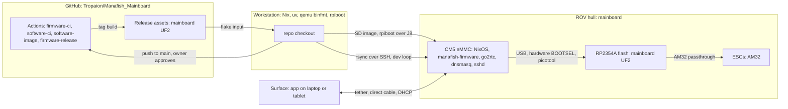
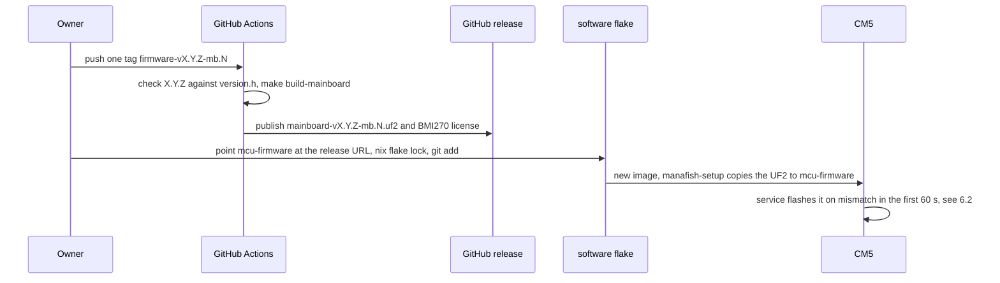

# 7. Deployment View

Status labels: **[upstream]** exists in the imported code, **[done]** done in this repo,
**[planned: Phase N]** from the plan, **[bring-up]** to be measured on the board (step Bx).
Modules: [Building Block View](05-Building-Block-View). Release and tag rules in full:
[CLAUDE.md](https://github.com/Tropaion/Manafish_Mainboard/blob/main/CLAUDE.md).

## 7.1 Nodes

| Node | Runs | Storage | Status |
|---|---|---|---|
| CM5 | NixOS image `cm5-mainboard`: rov_firmware service (manafish-firmware), go2rtc, dnsmasq, sshd, avahi | eMMC (at least 16 GB, variant is an owner question) | **[planned: Phase 3]**; the imported image targets the Pi 3 **[upstream]** |
| RP2354A (MCU) | Mainboard UF2 from a `firmware-vX.Y.Z-mb.N` release | 2 MB in-package flash | board target and release workflow **[done]**; the first release waits for the owner, and until it exists the image keeps upstream's pico2 UF2 (plan 3.1) |
| ESCs | AM32 2.21.1 (`AM32_SKYSTARS_AM60_V2_F421`, manafishrov/esc-firmware `v2.21.1-rc.1`), flashed through the MCU | ESC flash | **[upstream]** |
| Workstation | Nix with flakes and `extra-platforms = aarch64-linux`, qemu-aarch64 binfmt (F flag), uv, rpiboot, `~/usbboot` | | **[done]** (Phase 0.1) |
| GitHub Actions | CI and the release build | 7-day image artifacts, release assets | CI workflows **[done]** (Phase 1); release workflow **[done]** (Phase 2) |
| Surface | the app (separate repo) | | out of scope |

## 7.2 Building the NixOS image

| Item | Fact | Status |
|---|---|---|
| Build | From `software/`: `nix build --accept-flake-config .#sdImage` → `result/sd-image/*.img.zst` | **[upstream]** |
| Configuration | `nixosConfigurations.pi3-imx477` today; `cm5-mainboard` = nixos-raspberrypi `raspberry-pi-5.base` (same BCM2712) + `sd-image` + impermanence; `packages.sdImage`/`default` point at it | **[upstream]** / **[planned: Phase 3]** |
| File name | `pi3-imx477-<rev>.img` today; `manafish-cm5-mainboard-<rev>.img`. `<rev>` is the monorepo `shortRev`, so any commit (also under `hardware/`) renames the image | **[upstream]** / **[planned: Phase 3]** |
| Platform | aarch64-linux only (no cross build); on x86_64 it builds under qemu binfmt, or on the ARM CI runner | **[upstream]** |
| Caches | nix-community and nixos-raspberrypi cachix from the flake `nixConfig`; nixos-raspberrypi pinned to `1b9ac7d`. Don't bump the pin before its cachix has the aarch64 builds | **[upstream]** |
| Inputs | Flakes see only git-tracked files: `git add` new files and a changed `flake.lock` first. `firmwareSource = ./..` puts only `software/` on the device | **[upstream]** |
| Gates | `nix fmt -- --ci .`, `nix flake check`, `nix build --accept-flake-config --dry-run .#sdImage` | **[upstream]** |
| Spike | One day on the CM5 IO Board; checks 1-4 (boot and SSH, config.txt and serial console, both cameras, software H.264) must pass. Fallback (Raspberry Pi OS Lite) only with owner approval | **[planned: Phase 3]** |

## 7.3 Flashing the eMMC and the EEPROM

The owner runs every `sudo` step and every jumper. Write only to the new USB disk that
`lsblk -dno NAME,SIZE,MODEL,TRAN` shows after step 2, never to a workstation disk.

| Step | CM5 IO Board (dev) | Mainboard |
|---|---|---|
| 1. USB boot mode | Fit the eMMC-boot-disable jumper | Power the board normally (J8 has no VBUS); fit J7 pins 9-10 (`nRPIBOOT`) |
| 2. Expose the eMMC | `sudo "$(command -v rpiboot)" -d ~/usbboot/mass-storage-gadget64` | Same, over J8 |
| 3. Write | `zstd -dc <image>.img.zst \| sudo dd of=/dev/sdX bs=4M conv=fsync` | Same |
| 4. Boot | Remove the jumper, power-cycle | Remove the jumper, power-cycle with the magnet |
| Status | **[planned: Phase 3]** | **[bring-up]** (B3); if rpiboot over J8 fails, flash on the IO Board |

EEPROM (bootloader config), first on the IO Board **[planned: Phase 3]**, then on the board
**[bring-up]** (B3): edit `~/usbboot/recovery5/boot.conf`, run its `update-pieeprom.sh`, then
`sudo "$(command -v rpiboot)" -d ~/usbboot/recovery5`. J7 pins 11-12 (`EEPROM_nWP`) must be open.

| Setting | Why |
|---|---|
| `PSU_MAX_CURRENT=5000` | The CM5 is not powered over USB-C, so it cannot detect the supply |
| `POWER_OFF_ON_HALT=1` | `poweroff` drops CM5 3.3 V, so the MCU and GP14 go off too (6.7) |
| `BOOT_UART=0` | No bootloader output on the UART |

## 7.4 File system on the CM5

The root is tmpfs so that the hard power cut of the magnet switch cannot corrupt it
**[upstream]** ([impermanence.nix](https://github.com/Tropaion/Manafish_Mainboard/blob/main/software/nix/impermanence.nix)).

| Path | Storage | Survives reboot |
|---|---|---|
| `/` (also `/etc`) | tmpfs, 512 MB | no; `systemctl edit` overrides are lost |
| `/persistent` | ext4, label `NIXOS_SD`; `grow-persistent` grows it once on first boot | yes |
| `/nix`, `/boot` | bind mounts from `/persistent` | yes |
| `/home/pi` | persisted directory, mode 0700 | yes |
| `/var/log`, `/var/lib/{nixos,systemd,NetworkManager,iwd}` | persisted directories | yes |
| `/etc/machine-id`, `/etc/ssh/ssh_host_ed25519_key{,.pub}` | persisted files | yes |

The Pi 5 base boots with the generational kernel loader and keeps the firmware files in
`/boot/firmware`; the `/boot` bind still works (comment-only change **[planned: Phase 3]**).
Power-cut tests: 20 cuts in the spike **[planned: Phase 3]**, 50 cuts including a config save
**[bring-up]** (B15).

| Path in `/home/pi` | Written by | Content | Status |
|---|---|---|---|
| `firmware/` | `manafish-setup` | Copy of the `software/` store path, replaced when the `.nix-source` marker differs | **[upstream]** |
| `firmware/src/rov_firmware/config.json` | the service | `RovConfig` (mode 0600). Kept across image updates; also read by the camera wrapper and `manafish-network` | **[upstream]** |
| `mcu-firmware/` | `manafish-setup` | `pico-v*.uf2` and `pico2-v*.uf2` today; one `mainboard-v<ver>.uf2`. Stale versions are deleted | **[upstream]** / **[planned: Phase 3]** |
| `esc-firmware/esc-v<ver>.bin` | `manafish-setup` | AM32 binary | **[upstream]** |

## 7.5 Services and ports

| Unit | Order | Port | Notes | Status |
|---|---|---|---|---|
| `grow-persistent` | first boot, before setup and firmware | | stamp `/persistent/.partition-expanded` | **[upstream]** |
| `manafish-setup` | oneshot, before `go2rtc` and `manafish-firmware` | | Copies source, UF2 and AM32 bin; restores `config.json` | **[upstream]** |
| `manafish-network` | oneshot, after NetworkManager | | nmcli static IP from `config.json` `ipAddress`, default 10.10.10.10/24; writes the dnsmasq range | **[upstream]** |
| `dnsmasq` | after `manafish-network` | DHCP on eth0 | Authoritative; range .150-.200 (or .50-.100 when the ROV address is in .150-.200); no router or DNS option except for Android clients | **[upstream]** |
| `go2rtc` | after `manafish-setup`, user `pi` | 1984 (API), 8555 (WebRTC) | Stream `cam` = camera 1; `cam2` = camera 2 on demand, `Nice=10`, `CPUWeight=50` **[planned: Phase 3]** | **[upstream]** |
| `manafish-firmware` | after setup, network and go2rtc; `Restart=always`, 5 s; user `pi`, in `/home/pi/firmware` | 9000 (WebSocket, config `websocketPort`) | Nix Python env, not uv. `CPUWeight=200` **[planned: Phase 3]** | **[upstream]** |
| `sshd` | | 22 | Password login, user `pi`, password `manafish` | **[upstream]** |
| `avahi` | | mDNS on eth0 | Host name `manafish` | **[upstream]** |

The firewall is off **[upstream]**.

## 7.6 Network

**Warning:** never connect a board running a Manafish image to a LAN. It uses static
10.10.10.10 and runs an authoritative DHCP server on eth0. Use a direct cable (for example a
USB-Ethernet adapter on the workstation); the CM5 then has no internet. The app connects to
10.10.10.10:9000. Measured link: `ethtool eth0` = 1000 full **[bring-up]** (B4), PoE and
iperf3 **[bring-up]** (B9, B16).

## 7.7 Bundled MCU firmware and the release flow

The MCU UF2 is never built in Nix (the Pico SDK is fetched over the network and its version
is enforced). The software flake fetches it as a GitHub release asset.

| Item | Rule | Status |
|---|---|---|
| MCU tag | `firmware-vX.Y.Z-mb.N`; X.Y.Z from the `MCU_FIRMWARE_VERSION_*` macros in `firmware/src/version.h` (now 1.0.4, so the first tag is `firmware-v1.0.4-mb.1`). Never `-rc`: `version.py` and the flake reject `X.Y.Z-rc.N-mb.N` | scheme in CLAUDE.md **[done]** (owner-approved) |
| Release workflow | `firmware-release.yml` on `firmware-v*`: version check against `version.h`, no `-rc`, `-DMANAFISH_RELEASE_VERSION=X.Y.Z-mb.N`, memory check, assets `mainboard-vX.Y.Z-mb.N.uf2` with the third-party notices (`NOTICE.md`, BMI270, Pico SDK, pico_printf, TinyUSB and pio-dshot licenses), published, `prerelease: false` (ADR-24) | **[done]** |
| Flake input | Today `mcu-firmware-pico`/`-pico2` from manafishrov `v1.0.4-rc.3`. Target: one `mcu-firmware` input, `…/releases/download/firmware-v…-mb.N/mainboard-v….uf2` | **[upstream]** / **[planned: Phase 3]** |
| Version from the lock | `releaseVersionFromLock` accepts only `/download/v…/`. Change: `.*/download/(firmware-)?(v[^/]+)/.*` with `elemAt matched 1` (`head` would return the first group) | **[upstream]** / **[planned: Phase 3]** |
| Software tag | `software-v<pyproject version>-mb.N`, for example `software-v1.2.0-rc.3-mb.1`; never write `-mb` into `pyproject.toml`. No software release workflow is planned yet | scheme in CLAUDE.md **[done]** |
| Tag hygiene | Ask first; confirm version and notes; push one tag (`git push origin <tag>`), never `--tags`; never fetch upstream tags (their `v*` tags trigger release workflows) | **[done]** (CLAUDE.md) |
| Storage | GitHub release assets in this repo; no S3, no minisign | rule in CLAUDE.md **[done]**; the first release waits for the owner |

## 7.8 Dev loops

| Loop | How | Status |
|---|---|---|
| Python on the device | `rsync -rlt --delete --exclude __pycache__ --exclude config.json software/src/ pi@10.10.10.10:firmware/src/`, then the owner runs `ssh -t pi@10.10.10.10 'sudo systemctl restart manafish-firmware; journalctl -fu manafish-firmware'`. Never overwrite the device config. New Python dependencies need an image rebuild; the next new image replaces the synced tree | documented in CLAUDE.md **[done]** |
| App work without hardware | `uv run tools` → "Run Mock Websocket Server Locally" | **[upstream]** |
| NixOS change without reflashing | `nix shell nixpkgs#nixos-rebuild-ng -c nixos-rebuild switch --flake ./software#cm5-mainboard --target-host pi@10.10.10.10 --sudo --ask-sudo-password`; builds on the workstation | **[planned: Phase 3]** (spike check 8) |
| MCU firmware | `cd firmware && nix develop`, `make test`, `make build-pico2`; `make build-mainboard`, and `flash-mainboard` without `-f` (expects BOOTSEL already) | **[upstream]** / **[done]** |
| MCU bench scripts | `scp firmware/scripts/control_smoke.py firmware/scripts/mainboard_bringup.py pi@10.10.10.10:`, run with the service stopped and `--port /dev/manafish-mcu`; not in the image | **[planned: Phase 5]** |

## 7.9 CI workflows

Upstream's own workflows and pre-commit files were removed on import **[done]**. The root
workflows below were added in Phase 1 **[done]**; they run only after an owner-approved push,
and a green first run is still open **[planned: Phase 1]**. Run the gates in CLAUDE.md by hand
before every commit anyway.

| File | Trigger | Runs | Status |
|---|---|---|---|
| [firmware-ci.yml](https://github.com/Tropaion/Manafish_Mainboard/blob/main/.github/workflows/firmware-ci.yml) | push or PR to `main` touching `firmware/**` or the file; manual | `ubuntu-26.04`, LLVM 19 (`clang-format-19`, `clang-tidy-19`), in `firmware/`: `make test`, `format-check`, `lint-check` (mainboard compile DB), `build-pico`, `build-pico2`, `build-mainboard` | **[done]** |
| [software-ci.yml](https://github.com/Tropaion/Manafish_Mainboard/blob/main/.github/workflows/software-ci.yml) | push or PR to `main` touching `software/**`, `firmware/src/control/**` or the file; manual | Job `python`: `uv sync`, `ruff check --no-fix`, `ruff format --check`, `ty check`, pytest with `PICO_CONTROLLER_SOURCE` (the differential test runs). Job `nix`: `nix fmt -- --ci .`, `nix flake check`, `nix build --accept-flake-config --dry-run .#sdImage`, dependency sync must be a no-op | **[done]** |
| [software-image.yml](https://github.com/Tropaion/Manafish_Mainboard/blob/main/.github/workflows/software-image.yml) | push to `main` touching `software/flake.nix`, `software/flake.lock`, `software/nix/**` or the file; manual | Builds `.#sdImage` on `ubuntu-26.04-arm` (ADR-23), uploads artifact `sd-image` for 7 days. Builds the Pi 3 image until Phase 3 | **[done]** |
| [firmware-release.yml](https://github.com/Tropaion/Manafish_Mainboard/blob/main/.github/workflows/firmware-release.yml) | tag `firmware-v*` | See 7.7 | **[done]** |
| [actionlint.yaml](https://github.com/Tropaion/Manafish_Mainboard/blob/main/.github/actionlint.yaml) | | Adds the `ubuntu-26.04` and `ubuntu-26.04-arm` labels for actionlint | **[done]** |
| [.pre-commit-config.yaml](https://github.com/Tropaion/Manafish_Mainboard/blob/main/.pre-commit-config.yaml) | commit hook | ruff check (with `--fix`), ruff format and ty through `uv run` in `software/`; clang-format v19.1.7 for `firmware/` without `third_party` and `tests/unity` | **[done]** |

Renovate stays off. Pushes go only to `main`, after owner approval; there are no PRs.
