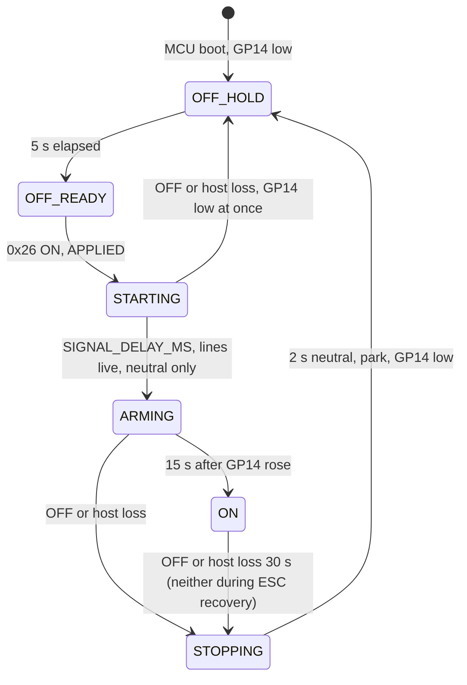

# 8. Crosscutting Concepts

Rules that span hardware, the RP2354A (MCU), the CM5 and the image. Status labels:
**[upstream]** exists in the imported code, **[done]** done in this repo,
**[planned: Phase N]** from the plan, **[bring-up]** to be measured on the board (step Bx).
Terms: [Glossary](12-Glossary). Decisions: [Architecture Decisions](09-Architecture-Decisions).

## 8.1 Thruster and ESC power safety

The ESC power switch (GP14 / ESC_PWR_EN) connects the battery to J14 through Q3, driven by the
photovoltaic driver IC16. It is static: no current limit (the battery BMS protects) and a soft
start of about 1.5 s, up to 12 s worst case
([README](https://github.com/Tropaion/Manafish_Mainboard/blob/main/README.md)).

| Rule | Where enforced | Status |
|---|---|---|
| Never switch ESC power on automatically: not at boot, not after reconnect, not after a reset | MCU `esc_power` (on only by explicit 0x26 request, nothing persisted); CM5 `EscPowerController` | MCU **[done]**, CM5 **[planned: Phase 4]** |
| GP14 low for at least 5 s after MCU boot, after any off, and after the battery is plugged in | MCU `OFF_HOLD_MS 5000`; battery-plug part on the CM5 (only it sees the LTC4162): battery present for at least 5 s | MCU **[done]**, CM5 **[planned: Phase 4]** |
| No thrust earlier than 15 s after GP14 rises | `THRUST_DELAY_MS 15000`; hook `thrust_permitted` added to the one `ready` gate in `control_runtime_get_motors` (covers legacy 0x5A, CONTROL and RAW) | **[done]** |
| Switch only with the motors stopped | On: CM5 requires `disruptive_motor_operation_blocker` = None. Off: STOPPING sends neutral for `STOP_MS 2000` before GP14 falls | off **[done]** (MCU), on **[planned: Phase 4]** (CM5) |
| GP14 is driven at 12 mA, low, before anything else runs | `esc_power_init()` is the first statement of `main()`, before `stdio_init_all()`; a source-wiring test checks the order | **[done]**; GP14 0 V for 60 s **[bring-up]** (B7) |
| Motor lines parked while ESC power is not live | Separate `outputs_parked` flag; 8 motor pins on SIO, low (no back-powering of unpowered ESCs, no AM32 idle-high bootloader trap). Never park through the existing teardowns (they clear `protocol_initialized`). Re-park after every protocol re-init | **[done]**; no back-powering **[bring-up]** (B12) |
| Never enable on PoE without a pack | CM5: with PoE, vbat > 12 V and no `bat_missing`/detection state for 5 s | **[planned: Phase 4]** |
| Charger must be readable and fresh to enable | Otherwise blocked, toast "charger unreadable, ESC power blocked" | **[planned: Phase 4]** |
| Automatic off only on: battery removed while on PoE, the 3.0 V/cell shutdown, or 30 s host loss (MCU) | CM5 policy; MCU `HOST_LOSS_MS 30000` (30 s, confirmed by the owner). The timer pauses only during ESC firmware recovery and restarts when an AM32 flash returns (it blocks core 0); during an upload every accepted 0xE7/0xE8 packet renews it | MCU **[done]**, CM5 **[planned: Phase 4]**; auto-off **[bring-up]** (B11) |
| ESC firmware update needs ESC power ON | MCU: update begin and commit fail with `ESC_FIRMWARE_UPDATE_ERROR_ESC_POWER_OFF = 11`; CM5 preflight checks state 4 before the maintenance gate | MCU **[done]**, CM5 **[planned: Phase 4]** |
| GP14 behaviour through watchdog reset, RUN pulse and BOOTSEL | Unknown (RP2350 pad isolation). Until measured, the host sends OFF and waits for state 1/2 before any reset or flash | **[bring-up]** (B11) |

### ESC power state machine (MCU)

A pure state machine with time passed in and wrap-safe unsigned compares
**[done]**. Without `MANAFISH_ESC_POWER_PIN` (pico/pico2 builds) it is a no-op stub.

| State | Wire value (ATTITUDE health bits 4-6) | CM5 shows |
|---|---|---|
| ABSENT | 0 | unavailable |
| OFF_HOLD / OFF_READY | 1 / 2 | off |
| STARTING / ARMING | 3 | ramping |
| ON | 4 | on |
| STOPPING | 5 | off (stopping) |

`SIGNAL_DELAY_MS` starts at 5000 and is set at B12 to at least the measured ESC rail-up time
plus 1 s **[bring-up]** (B12).

### 0x26 ESC_POWER request

Payload u32 0/1, reliable. Results: APPLIED, BUSY (ON: hold not over, settings not applied,
stopping, upload, recovery or protocol transition; OFF: only during ESC firmware recovery, which
keeps the ESCs powered in the AM32 bootloader until a recovery flash succeeds; the host retries
with a fresh frame on its own timer), INVALID, UNSUPPORTED (NULL hook). The handler answers synchronously and never
returns NOT_READY, because the CM5 drops the whole session on any NOT_READY ACK. A 0x26 sent
after ENTER_MAINTENANCE (0x25) or a safety latch hits a dead session, so the host sends ESC
requests before the 0x25 gate; an OFF afterwards needs a new HELLO. CAPS feature bit 0x20 marks
support; it stays out of `REQUIRED_FEATURES`. MCU **[done]**, CM5 **[planned: Phase 4]**. Contract:
[firmware/docs/PICO_CONTROL_PROTOCOL.md](https://github.com/Tropaion/Manafish_Mainboard/blob/main/firmware/docs/PICO_CONTROL_PROTOCOL.md).

### Neutral failsafe

| Layer | Behaviour | Status |
|---|---|---|
| MCU core 0 | 200 ms host gate (`HOST_TIMEOUT_US`) and 10 ms controller-output gate force neutral | **[upstream]** |
| MCU 1 ms hardware timer | Stalled core 0: PWM set to neutral, DShot GPIO forced low | **[upstream]** |
| MCU watchdog | 1 s hardware watchdog resets a fully stalled system | **[upstream]** |
| CM5 | `pico_control` sends CONTROL with `input_valid` = 0 when the app direction is older than 200 ms (`HOST_TIMEOUT` in `pico_control.py`); the MCU neutralises at once. The legacy `thrusters.py` path (`THRUSTER_TIMEOUT_MS`) is not started by `main.py` | **[upstream]** |
| Magnet switch | Hard 5 V cut of everything except the charger; ESCs lose their DShot signal | **[upstream]** hardware |
| Verified | Host killed: neutral within 200 ms; magnet off while spinning: AM32 stops within 0.5 s | **[bring-up]** (B13) |

Forced-low DShot is signal inhibition, not proof that an ESC accepts neutral. See
[Quality Requirements](10-Quality-Requirements).

## 8.2 Power and battery

| Topic | Concept | Status |
|---|---|---|
| Magnet switch | Hard cut of +5V to everything except the LTC4162 charger. The system comes up OFF after a battery or PoE connect | **[upstream]** hardware |
| LTC4162 charger access | Userspace smbus2 on I2C1 at 0x68, at most 400 kHz; 16-bit SMBus words, low byte first; sign-extend every telemetry word | **[planned: Phase 4]** |
| Writes disabled until B9 | `CHARGER_WRITES_ENABLED = False`, except the read-modify-write of `force_telemetry_on = 1` (0x14 bit 2), needed for telemetry on battery only | **[planned: Phase 4]** |
| Register discipline | Write `en_jeita = 0` (0x29) before 0x1A/0x1B, else JEITA overwrites them every 11 ms. RMW of 0x14 clears `run_bsr` (bit 4). Never write 0x19 (ship mode) or undocumented addresses. Mask fields [4:0]/[5:0]. `en_jeita` reading 1 = chip reset: rewrite 0x29, 0x1B, 0x1A, 0x15, 0x14 | **[planned: Phase 4]** |
| 1 Hz read-back | `ChargerMonitor` reads back each setting and rewrites it if it differs (covers a charger power loss); logs state and fault changes | **[planned: Phase 4]** |
| Telemetry validity | Valid only after `telemetry_valid` (0x4A bit 0) plus one conversion wait. Pack scaling uses a fixed 5 cells. `chem`/`cell_count` are checked only while `en_chg = 1` and never used to release a suspend (they read 0 without input power) | **[planned: Phase 4]** |
| PoE present | `system_status` `vin_gt_4p2v` (0x39 bit 1); `vin_gt_vbat` (bit 2) is secondary ("can charge") | **[planned: Phase 4]** |
| PoE type | Ag59800 PoE module TYP2/TYP3 on CM5 GPIO6/GPIO12, opto, active low, `gpio=6,12=ip,pu` | config.txt **[done]** (Phase 3), decoding **[planned: Phase 4]** |
| Charge targets | 4.2 V/cell (code 31, 21.0 V) and 2.0 A (code 19, 0.5 C at 4000 mAh). Owner to confirm 4.2 vs 4.1 V/cell and the pack limit | **[planned: Phase 4]** |
| Defaults window | With the magnet OFF the CM5 never configures the charger: 4.0 A input and 3.2 A charge apply | **[bring-up]** (B10) |

### PoE type limits

GPIO6 = TYP2, GPIO12 = TYP3 (Ag59800 Table 5). Codes for `iin_limit_target` (0x15) at
RSNSI 8 mΩ, 62.5 mA per step:

| GPIO6 | GPIO12 | PSE | Code | Input limit | At 24 V |
|---|---|---|---|---|---|
| high | high | Type 1, non-classifying PSE, or no PoE (tell apart with `vin_gt_4p2v`) | 6 | 0.4375 A | 10.5 W |
| low | high | Type 2 | 14 | 0.9375 A | 22.5 W |
| high | low | Type 3 | 29 | 1.875 A | 45 W |
| low | low | Type 4 | 41 | 2.625 A | 63 W |

The limit throttles only charge current. The VSYS load passes through unlimited, so the PSE
stays safe only while that load alone fits the budget **[bring-up]** (B9, B10).

### Derating and low battery

| Condition | Action | Status |
|---|---|---|
| SHT45 hull temperature > 45 °C | Halve the input limit (5 °C hysteresis) | **[planned: Phase 4]** |
| SHT45 > 55 °C or LTC4162 die > 100 °C | Suspend charging (avoid needless suspend toggles: each restarts detection and timers) | **[planned: Phase 4]** |
| vbat < 3.4 V/cell for 10 s | Warn | **[planned: Phase 4]** |
| vbat < 3.2 V/cell for 10 s | Critical: toast every 60 s, block new ESC enables, **never** switch ESC power off | **[planned: Phase 4]** |
| vbat < 3.0 V/cell for 30 s, no PoE, motors neutral | Neutral, ESC off, `systemctl poweroff`; `POWER_OFF_ON_HALT=1` then drops 3.3 V and GP14 | **[planned: Phase 4]** |
| Telemetry invalid | Warn only, never power off | **[planned: Phase 4]** |

- **vbat sags under load:** vbat is measured at BAT_IN, so `LowBatteryMonitor` evaluates it
  only after all motor commands have been neutral for 2 s; otherwise it keeps the last state.
- **ibat excludes thrusters:** Q3 taps the battery ahead of R20. `batteryCurrent` is charger
  and system current only.
- **Battery %:** 10 s EMA of LTC4162 vbat through the existing min/max config (16 / 20.5 V);
  ESC telemetry voltage only when the charger is unhealthy **[planned: Phase 4]**. Today it is
  the ESC voltage average **[upstream]**.
- Thresholds and auto power-off are owner questions (plan open question 2).

## 8.3 Robustness to hard power cuts

The magnet switch and battery removal cut power without warning.

| Measure | Status |
|---|---|
| Root `/` is tmpfs (512 MB); `/persistent` (ext4) holds `/nix`, `/boot` (bind), `/home/pi`, `/var/log`, `/var/lib/{nixos,systemd,NetworkManager,iwd}`, machine-id and SSH host keys ([impermanence.nix](https://github.com/Tropaion/Manafish_Mainboard/blob/main/software/nix/impermanence.nix)) | **[upstream]** |
| `/etc` is tmpfs: `systemctl edit` overrides are lost at reboot; board config belongs in Nix | **[upstream]** |
| `RovConfig.save()` writes a temp file and renames it over `config.json` (no fsync). Unreadable JSON loads defaults and saves them | **[upstream]** |
| `manafish-setup` keeps `config.json` when it re-copies a new source tree | **[upstream]** |
| `manafish-setup` compares the bundled UF2 and AM32 bin by content (`cmp`) and re-copies them when they differ, so an empty file left by a cut soon after a copy is repaired at the next boot. On a deploy boot it runs `sync` after the `config.json` backup, after copying the source and restoring the config, and after writing the source marker last (a cut before the marker lands only repeats the deploy); each new firmware copy is flushed on its own, so a normal boot flushes nothing | **[done]** (Phase 3) |
| go2rtc camera wrapper validates every config value with a fallback, so a corrupt config never stops the stream | **[upstream]** |
| ESC power state is never persisted; every MCU boot starts in OFF_HOLD | **[done]** |
| Charger settings re-applied by the 1 Hz read-back | **[planned: Phase 4]** |
| 20 abrupt cuts on the IO Board (spike check 7); 50 cuts on the board incl. during a config save; CM5_3.3V stays above 1.8 V during a +5V cut | **[planned: Phase 3 spike]**, **[bring-up]** (B15) |

## 8.4 MCU recovery

One flash path for every case: blank, hung, bricked or running (Decision 9).

| Step | Detail | Status |
|---|---|---|
| Lines | Hardware BOOTSEL (GPIO24 RUN, GPIO25 QSPI_SS). Never drive either line high; release to input with bias off. GPIO25 low only while GPIO24 is low or within 100 ms after its release. `gpio=24,25=ip,pn` in config.txt | config.txt **[done]** (Phase 3), driver **[planned: Phase 4]** |
| Before | Neutral, ESC_POWER off, wait for health bits 4-6 = 1 or 2, or 5 s (MCU silent). Runs before `state.mcu_flashing` is set, while the session is live. Never while the ESC recovery journal is set (OFF answers BUSY then) | **[planned: Phase 4]** |
| Enter | GPIO24 low, GPIO25 low, 10 ms, release GPIO24, hold GPIO25 100 ms, release, wait for 2e8a:000f | **[planned: Phase 4]** |
| Load | `picotool load -v -x`, never `-f`. Today upstream uses `-f` **[upstream]**; `make flash-mainboard` has no `-f` **[done]** | **[planned: Phase 4]** |
| Paths | Manual, first boot and version mismatch all go through `flash_mcu_firmware` | **[upstream]** path, **[planned: Phase 4]** steps |
| Startup | 000f present without 0009: one 10 ms `reset()` first | **[planned: Phase 4]** |
| Tools | `mcu-reset`, `mcu-recover`: refuse until the rov_firmware service (manafish-firmware) is inactive or failed for at least 35 s (host loss 30 s + stop 2 s + margin), and while the ESC recovery journal is set (the MCU then holds ESC power on, and a reset forgets its recovery state) | **[planned: Phase 4]** |
| Discovery | `/dev/manafish-mcu` udev symlink for 2e8a:0009, then a sysfs scan; no blind `ttyACM*` fallback | udev symlink **[done]** (Phase 3), Python **[planned: Phase 4]** |
| Auto re-flash | Version mismatch re-flashes only within 60 s of the rov_firmware service (manafish-firmware) start, once per run. `MANAFISH_PICO_CONTROL_DEVELOPMENT=1` keeps only `pico-control-dev` builds; the first-boot path ignores it | **[upstream]** |
| Last resort | SWD on J2 or CM5 GPIO8/11 (OpenOCD with RP2350 support) | **[bring-up]** (B7) |

Sequence diagrams: [Runtime View](06-Runtime-View).

## 8.5 Health and status reporting

| Channel | Content | Status |
|---|---|---|
| ATTITUDE 0x90 health bits 0-3 | IMU healthy, pressure healthy, output permitted by all gates, raw override. The CM5 reads bits 0 and 3 | **[upstream]** |
| ATTITUDE health bits 4-6 | ESC power state (table in 8.1). `thrust_permitted` also shows in bit 2 | **[done]** |
| CAPS feature bit 0x20 | ESC power supported (mainboard builds report 0x3f) | **[done]** |
| `SystemHealth`, `RovStatus`, `RovConfig` | Shapes unchanged (app contract) | **[upstream]** |
| Capability readings | New `rov.*` readings through the dynamic catalog: `batteryVoltage`, `batteryCurrent` (excludes thrusters), `chargerState`, `poeType`, `poeInputVoltage`, `poeInputCurrent`, `chargerTemperature`, `hullTemperature`, `hullHumidity`, `hullPressure`, `socTemperature`, `escPower`; action `rov.escPower.set` (boolean). Every key in `values()` must be in `READING_DEFINITIONS`; the catalog fixture test is an exact match | **[planned: Phase 4]** |
| Toasts | Plain-text `ToastContent` message/description; no app i18n keys needed | **[upstream]** mechanism, **[planned: Phase 4]** texts |

## 8.6 Configuration and migrations

- `config.json` lives at `/home/pi/firmware/src/rov_firmware/config.json` (mode 0600, user `pi`).
  Upstream migrations are version-gated in `apply_migrations` by `firmwareVersion`
  **[upstream]**.
- Mainboard-only settings use pydantic defaults, never version-gated migrations. Upstream
  version strings are never edited, so the migration lineage stays intact
  **[planned: Phase 4]**.
- `mcu_board` keeps `pico` and `pico2`; default `pico2`. A `mode="before"` validator on
  `RovConfig` and `PartialRovConfig` rewrites `pico` to `pico2`; `flash_mcu_firmware` and
  `resolve_mcu_firmware` normalise too. `CamelCaseModel` has no `validate_assignment`, so the
  validator runs only at the entry points (load, set-config, import) **[planned: Phase 4]**.
- Charger, ESC and power-policy values are code constants, not user config
  **[planned: Phase 4]**.

## 8.7 Testing strategy

| Level | What | Status |
|---|---|---|
| MCU host tests | Unity suites (142 at the Phase 0 baseline, 163 after Phase 2) plus Python harnesses: real runtime against a fake SDK, startup commands, build identity, linker memory, bench helpers. Phase 2 added `tests/test_esc_power.c` (called from `tests/test_main.c`), runtime scenarios in both `runtime_harness.c` and `test_control_runtime.py`, a source-wiring test, an IMU axis-map build and `tests/test_mainboard_bringup.py` | **[upstream]**, **[done]** |
| MCU static | `format-check`, `lint-check` on the LLVM 19 baseline (mainboard compile DB); `build-pico`, `build-pico2`, `build-mainboard` with the ELF/map memory check | **[upstream]**, **[done]** |
| CM5 unit tests | pytest (475 at baseline, 476 after Phase 3 with `tests/test_no_pi_side_bmi270.py`). New board code gets fakes: FakeSMBus, fake lgpio, fake sysfs tree, injectable clock | **[upstream]**, **[planned: Phase 4]** |
| C differential test | `test_pico_differential.py` compiles `firmware/src/control/controller.c` with host `cc` against hash-pinned Python references; skipped, not passed, without `PICO_CONTROLLER_SOURCE` | **[upstream]** |
| CI | `firmware-ci.yml`, `software-ci.yml` (python + nix jobs), `software-image.yml` (ubuntu-26.04-arm) | **[done]**, first runs green |
| Image | `nix fmt -- --ci .`, `nix flake check` (check `camera-headless`), `nix build --dry-run .#sdImage`; spike checks 1-8 on the CM5 IO Board | Nix gates **[done]** (Phase 3); spike **[planned: Phase 3 spike]** |
| Board | `tools board-check`, `mainboard_bringup.py`, `control_smoke.py`; `BRINGUP.md` with a record sheet per board; B0-B16 | `mainboard_bringup.py` **[done]**, `control_smoke.py` **[upstream]**; `board-check` and `BRINGUP.md` **[planned: Phase 5]**; **[bring-up]** |

Gates per component: root
[CLAUDE.md](https://github.com/Tropaion/Manafish_Mainboard/blob/main/CLAUDE.md) **[done]**.

## 8.8 Versioning and tags

| Item | Rule | Status |
|---|---|---|
| MCU tag | `firmware-vX.Y.Z-mb.N`; X.Y.Z from `MCU_FIRMWARE_VERSION_*` in `firmware/src/version.h`, never bumped; never `-rc` in it | **[done]** rule |
| MCU asset | `mainboard-vX.Y.Z-mb.N.uf2` plus the third-party notices (`NOTICE.md`, BMI270, Pico SDK, pico_printf, TinyUSB and pio-dshot licenses), published (not draft, `prerelease: false`) by `firmware-release.yml` | workflow **[done]**; first release `firmware-v1.0.4-mb.1` **[done]** |
| Software tag | `software-v<pyproject version>-mb.N`, e.g. `software-v1.2.0-rc.3-mb.1`; never `-mb` in `pyproject.toml` | **[done]** rule |
| Image | Version = monorepo `shortRev`; the flake fetches the UF2 from this repo's release URL | **[upstream]**, release URL **[done]** (Phase 3) |
| Push | One tag at a time, never `git push --tags`; no tag without the owner | **[done]** rule |
| SemVer order | `1.0.4-mb.1 < 1.0.4-rc.3 < 1.0.4`. MCU mismatch checks use version equality **[upstream]**; never mix plain and `-mb` UF2s in `~/mcu-firmware` | **[planned: Phase 4]** check |

## 8.9 Upstream sync

`git subtree pull --squash` per prefix from `--no-tags` remotes; never fetch upstream tags.
Re-remove the deleted CI/pre-commit paths, keep the local patches, run both gates
**[done]** (procedure in CLAUDE.md). Board code goes into new files and NULL-checked hooks to
keep conflicts small: MCU **[done]**, CM5 **[planned: Phase 4]**.

## 8.10 Logging and diagnostics

| Source | Behaviour | Status |
|---|---|---|
| CM5 log | `BoundedJournalHandler`: drops oldest records rather than block control; journal via stderr; app log stream stamped with session, boot id, monotonic and UTC time | **[upstream]** |
| `/var/log` | On the persistent partition | **[upstream]** |
| `diagnostics.py` | 1 Hz snapshot, 10 s summary, state on change, faults. Adds power, hull, ESC, SoC and `get_throttled` | **[upstream]**, **[planned: Phase 4]** |
| Blackbox | CSV custom action, disabled by default; whether new readings join `COLUMNS` is open | **[upstream]** |
| MCU | Framed INFO log and STATS 0x91 every 5 s | **[upstream]** |
| Board check | `tools board-check [--json]`, read-only, service stopped | **[planned: Phase 5]** |

## 8.11 Video encoding

The BCM2712 has no H.264 encoder, so the CM5 encodes video in software: rpicam-vid hands
the frames to libx264 through libav. Code:
[nix/camera.nix](https://github.com/Tropaion/Manafish_Mainboard/blob/main/software/nix/camera.nix).

| Topic | Concept | Status |
|---|---|---|
| Encoder build | `rpi.rpicam-apps` (and `rpicam-apps`) built with `withLibavEncoder = true` and linked against nixpkgs `ffmpeg-headless` (8.1, has libx264, in the binary cache; the default ffmpeg pulls in SDL and PipeWire). Preview and post-processing backends stay off. Flake check `camera-headless` asserts both, and libx264 in the linked ffmpeg | **[done]** (Phase 3) |
| Wrapper flags | `--camera N --codec h264 --libav-format h264 --low-latency`, plus profile, level, bitrate, keyframe interval and image settings from `config.json`, raw H.264 to stdout. `--libav-format h264` is needed to write to stdout; `--low-latency` selects x264's ultrafast preset with zerolatency tuning. `LIBCAMERA_LOG_LEVELS=*:WARN` keeps rpicam-vid's own error message within the first 512 bytes of stderr, which is all go2rtc keeps | **[done]** (Phase 3); runs with libx264, `--profile`/`--level` honoured **[planned: Phase 3 spike]** (check 4) |
| Sensor modes | 2028x1520 12-bit full field of view, or the 1332x990 10-bit crop when it is big enough. On PiSP, libcamera turns the packed (`:P`) raw request into its compressed raw format | **[upstream]** modes; on PiSP **[planned: Phase 3 spike]** |
| Camera order | go2rtc runs one wrapper per stream: `cam` with index 0, `cam2` with index 1. rpicam-apps numbers only the cameras it finds, sorted by libcamera id: with both fitted, CAM/DISP0 (J5, camera 1, `i2c@88000`) is index 0 and CAM/DISP1 (J11, camera 2, `i2c@70000`) index 1. Without camera 1, `cam` shows camera 2 and `cam2` fails | **[done]** (Phase 3); order **[planned: Phase 3 spike]** (check 3) |
| On demand | go2rtc starts an `exec:` source with the first viewer and stops it after the last, so an unwatched camera costs no CPU | **[upstream]** go2rtc behaviour |
| CPU share | go2rtc and its rpicam-vid children share one cgroup with `CPUWeight=50`; `manafish-firmware` has `CPUWeight=200` (other services 100). Under CPU contention the MCU link and command stream get four times go2rtc's share. This is a share, not a priority; both weights are set in board.nix. The control loop itself runs on the MCU | **[done]** (Phase 3) |
| Limits | Output at most 1920x1080, bitrate 1-25 Mbit/s, framerate capped by the sensor mode and by H.264 level 4 (245,760 macroblocks/s). Both cameras share one set of settings. Defaults 1024x768, 3538944 bit/s **[upstream]**; hull defaults (camera 1 at 1280x960@30, 4-5 Mbit/s) follow the spike measurements | **[upstream]** limits; defaults **[planned: Phase 3 spike]** |
| Load | CPU, SoC temperature and throttling with one and two streams: spike check 5, then the 60 min closed-hull soak (QF-3, QP-4) | **[planned: Phase 3 spike]**, **[bring-up]** (B14) |
