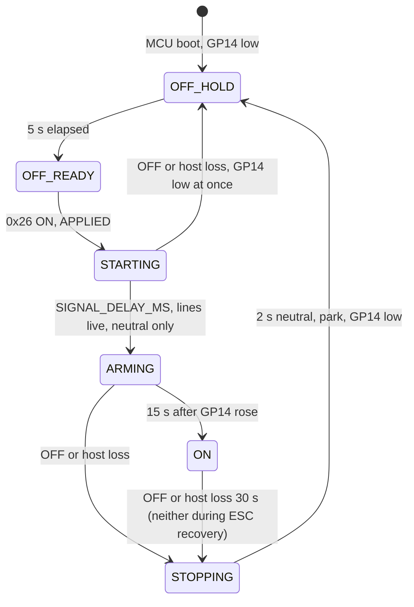

# 8. Crosscutting Concepts

Rules that span hardware, the RP2354A (MCU), the CM5 and the image. Status labels:
**[upstream]** exists in the imported code, **[done]** done in this repo,
**[planned: Phase N]** from the plan, **[bring-up]** to be measured on the board (step Bx).
Terms: [Glossary](12-Glossary). Decisions: [Architecture Decisions](09-Architecture-Decisions).

## 8.1 Thruster and ESC power safety

The ESC power switch (GP14 / ESC_PWR_EN) connects the battery to J14 through Q3, driven by the
photovoltaic driver IC16. It is static: no current limit (the battery BMS protects) and a soft
start of about 1.5 s, up to 12 s worst case
([README](https://github.com/Tropaion/Manafish_Mainboard/blob/main/README.md)).

| Rule | Where enforced | Status |
|---|---|---|
| Never switch ESC power on automatically: not at boot, not after reconnect, not after a reset | MCU `esc_power` (on only by explicit 0x26 request, nothing persisted); CM5 `EscPowerController` sends on only for an operator request, adopts a reported 3 or 4 at service start or reconnect without sending on, and never re-requests | MCU **[done]**, CM5 **[done]** (Phase 4) |
| GP14 low for at least 5 s after MCU boot, after any off, and after the battery is plugged in | MCU `OFF_HOLD_MS 5000`; battery-plug part on the CM5 (only it sees the LTC4162): `LowBatteryMonitor` tracks how long the pack has been present without a break, and the enable check wants 5 s (a charger read error or battery detection restarts the count) | MCU **[done]**, CM5 **[done]** (Phase 4) |
| No thrust earlier than 15 s after GP14 rises | `THRUST_DELAY_MS 15000`; hook `thrust_permitted` added to the one `ready` gate in `control_runtime_get_motors` (covers legacy 0x5A, CONTROL and RAW) | **[done]** |
| Switch only with the motors stopped | On: CM5 requires `disruptive_motor_operation_blocker` = None, checked again once the request holds the control gate, right before each frame. Off: STOPPING sends neutral for `STOP_MS 2000` before GP14 falls | off **[done]** (MCU), on **[done]** (Phase 4, CM5) |
| GP14 is driven at 12 mA, low, before anything else runs | `esc_power_init()` is the first statement of `main()`, before `stdio_init_all()`; a source-wiring test checks the order | **[done]**; GP14 0 V for 60 s **[bring-up]** (B7) |
| Motor lines parked while ESC power is not live | Separate `outputs_parked` flag; 8 motor pins on SIO, low (no back-powering of unpowered ESCs, no AM32 idle-high bootloader trap). Never park through the existing teardowns (they clear `protocol_initialized`). Re-park after every protocol re-init | **[done]**; no back-powering **[bring-up]** (B12) |
| Never enable on PoE without a pack | CM5 `power_policy.battery_presence`: with PoE the pack is present only with valid telemetry, vbat > 12 V and no `battery_detection`; `bat_missing_fault`, vbat ≤ 12 V or vbat 0 after a full conversion mean no pack. `bat_detect_failed_fault` is no proof of a missing pack: the charger could not source detection current (`iin_limit_active` or `vin_uvcl_active`, DS p.38) and retries every 30 s (DS p.23), so presence is unknown, an enable is refused with that reason and it never counts as a pulled pack. This check runs before the charger check, so the operator reads "No battery on the charger" rather than the invalid telemetry it causes | **[done]** (Phase 4); vbat without a pack on the board **[bring-up]** (B10) |
| Charger must be readable and fresh to enable | Valid LTC4162 telemetry no older than 3 s; otherwise the toast "ESC power stays off" with "Charger unreadable, ESC power blocked:" and the reason (I2C error, telemetry settling, no read for 3 s) | **[done]** (Phase 4) |
| Automatic off only on: battery removed while on PoE, the 3.0 V/cell shutdown, or 30 s host loss (MCU) | CM5 policy; MCU `HOST_LOSS_MS 30000` (30 s, confirmed by the owner). The timer pauses only during ESC firmware recovery and restarts when an AM32 flash returns (it blocks core 0); during an upload every accepted 0xE7/0xE8 packet renews it. The CM5 also sends off before any MCU flash or reset (8.4). An off that the CM5 did not request (host loss, MCU restart) gets a warning toast; the CM5 never switches back on | MCU **[done]**, CM5 **[done]** (Phase 4: a pack pulled on PoE while ESC power reads ramping or on sends 0x26 off, one warning toast, retried every 10 s while it still reads on; `bat_missing_fault` or vbat 0 counts at once, vbat ≤ 12 V only with the motors neutral for 2 s (vbat at BAT_IN sags under thrust); a charger read error, battery detection or `bat_detect_failed_fault` never counts as a pulled pack; the shutdown chain in 8.2); auto-off **[bring-up]** (B11), pulled pack on PoE **[bring-up]** (B10) |
| ESC firmware update needs ESC power ON | MCU: update begin and commit fail with `ESC_FIRMWARE_UPDATE_ERROR_ESC_POWER_OFF = 11`. CM5 preflight requires state 4 before the maintenance gate when the MCU reports CAPS 0x20 (Pico builds keep the upstream preflight); a recovery retry skips it, because the host holds no session then, and the MCU refuses RECOVER_BEGIN instead. Error 11 shows a plain message instead of "unknown error 11" | MCU **[done]**, CM5 **[done]** (Phase 4) |
| No ESC power change, MCU flash or MCU reset while the ESC recovery journal is set | CM5: `request_on` and `request_off` refuse with a toast (the MCU holds ESC power on for the recovery flash); `EscPowerController.prepare_for_mcu_reset()` and `esc_recovery.mcu_reset_refusal()` (`tools mcu-reset` / `mcu-recover`, and the start-up RUN pulse checks the same flag) refuse; `flash_mcu_firmware`, the auto-flash and the first-boot flash already skip **[upstream]**; the 3.0 V/cell shutdown does not power off (a halt would reset the MCU) and toasts every 60 s instead (8.2). MCU: off answers BUSY, host loss held | CM5 **[done]** (Phase 4); recovery after an MCU reset is open (11.2) |
| GP14 behaviour through watchdog reset, RUN pulse and BOOTSEL | Unknown (RP2350 pad isolation). Until measured, the host sends OFF and waits for state 1/2 before any reset or flash (`prepare_for_mcu_reset()`) | host duty and its use in every flash path **[done]** (Phase 4; the tools wait 35 s instead); **[bring-up]** (B11) |

### ESC power state machine (MCU)

A pure state machine with time passed in and wrap-safe unsigned compares
**[done]**. Without `MANAFISH_ESC_POWER_PIN` (pico/pico2 builds) it is a no-op stub.

| State | Wire value (ATTITUDE health bits 4-6) | CM5 shows |
|---|---|---|
| ABSENT | 0 | unavailable |
| OFF_HOLD / OFF_READY | 1 / 2 | off |
| STARTING / ARMING | 3 | ramping |
| ON | 4 | on |
| STOPPING | 5 | off (stopping) |

`SIGNAL_DELAY_MS` starts at 5000 and is set at B12 to at least the measured ESC rail-up time
plus 1 s **[bring-up]** (B12).

### 0x26 ESC_POWER request

Payload u32 0/1, reliable. Results: APPLIED, BUSY (ON: hold not over, settings not applied,
stopping, upload, recovery or protocol transition; OFF: only during ESC firmware recovery, which
keeps the ESCs powered in the AM32 bootloader until a recovery flash succeeds; the host retries
with a fresh frame on its own timer), INVALID, UNSUPPORTED (NULL hook). The handler answers synchronously and never
returns NOT_READY, because the CM5 drops the whole session on any NOT_READY ACK. A 0x26 sent
after ENTER_MAINTENANCE (0x25) or a safety latch hits a dead session, so the host sends ESC
requests before the 0x25 gate; an OFF afterwards needs a new HELLO. CAPS feature bit 0x20 marks
support; it stays out of `REQUIRED_FEATURES`. MCU **[done]**, CM5 **[done]** (Phase 4). Contract:
[firmware/docs/PICO_CONTROL_PROTOCOL.md](https://github.com/Tropaion/Manafish_Mainboard/blob/main/firmware/docs/PICO_CONTROL_PROTOCOL.md).

### ESC power on the CM5

Code: [esc_power.py](https://github.com/Tropaion/Manafish_Mainboard/blob/main/software/src/rov_firmware/esc_power.py)
and `PicoControl.request_esc_power` in
[pico_control.py](https://github.com/Tropaion/Manafish_Mainboard/blob/main/software/src/rov_firmware/pico_control.py).
Sequence: [Runtime View](06-Runtime-View) 6.4.

| Topic | Rule | Status |
|---|---|---|
| Request | `request_esc_power` sends one fresh reliable 0x26 frame and returns APPLIED, BUSY, INVALID or UNSUPPORTED; none of them ends the session. A lost ACK resends the same frame (4 tries, 0.5 s apart). It refuses without a live session, so nothing goes out after the 0x25 gate or while `mcu_flashing` is set | **[done]** (Phase 4) |
| BUSY | The controller sends a new frame after the remaining hold, estimated from when health bits 4-6 last changed (OFF_HOLD: 5 s; STOPPING: 2 s plus 5 s; plus 0.2 s margin), otherwise every 0.5 s, for at most 10 s, then a toast. Every frame of an on checks the enable conditions and its intent again once it holds the control gate (`before_send`), so a blocker or an off that arrives while it waits for the gate keeps it unsent; an operator off replaces a pending on. Only a request that passes its checks replaces an earlier one; an on press while an off waits for its answer is refused ("ESC power is switching off"), so it never cancels an off the MCU may already apply | **[done]** (Phase 4) |
| Enable checks, in order | No ESC recovery pending; no firmware update holding `mcu_flash_lock`; MCU session live with a fresh report; CAPS bit 0x20; `disruptive_motor_operation_blocker` = None; then the checks `LowBatteryMonitor.enable_blockers()` injects: no pack missing on PoE, charger readable and fresh, battery present for 5 s (and the battery monitor reported within 3 s), battery not critical | **[done]** (Phase 4) |
| State | Health bits 4-6 go into `RovState.esc_power_telemetry`, not `SystemHealth` (app contract). Recorded from every ATTITUDE frame of the session, also one rejected for a settings-generation mismatch; unavailable after 0.2 s without one and after a USB reconnect | **[done]** (Phase 4) |
| Operator controls | Actions `rov.escPower.on` and `rov.escPower.off` (inputType `none`, mode once; built-ins act on the press phase only) and the string reading `rov.escPower`. They call `request_on()` / `request_off()`; a refused on is toasted by the controller and still answers the capability request with ok, so the app shows one message. Owner decision: two no-input actions, because the unmodified app offers overlay buttons only for inputType-none actions and binds no keys to `rov.*` actions, so a boolean `rov.escPower.set` could not be used | **[done]** (Phase 4) |
| Toasts | Plain-text `ToastContent` (`message`, `description`), toast id `esc-power`: refusals, failures, "switching on" with the 15 s arming hint, and an off the CM5 did not request | **[done]** (Phase 4) |
| Before an MCU flash or reset | `prepare_for_mcu_reset()`: refuse while the ESC recovery journal is set; clear pilot input; 0x26 off; `wait_until_off()` returns on state 0, 1 or 2, or after 5 s without ATTITUDE (past its 5 s timeout it waits only while the MCU is silent); refuse if it still reports 3, 4 or 5 | **[done]** (Phase 4), called by `flash_mcu_firmware` (8.4) |

### Neutral failsafe

| Layer | Behaviour | Status |
|---|---|---|
| MCU core 0 | 200 ms host gate (`HOST_TIMEOUT_US`) and 10 ms controller-output gate force neutral | **[upstream]** |
| MCU 1 ms hardware timer | Stalled core 0: PWM set to neutral, DShot GPIO forced low | **[upstream]** |
| MCU watchdog | 1 s hardware watchdog resets a fully stalled system | **[upstream]** |
| CM5 | `pico_control` sends CONTROL with `input_valid` = 0 when the app direction is older than 200 ms (`HOST_TIMEOUT` in `pico_control.py`); the MCU neutralises at once. The legacy `thrusters.py` path (`THRUSTER_TIMEOUT_MS`) is not started by `main.py` | **[upstream]** |
| Magnet switch | Hard 5 V cut of everything except the charger; ESCs lose their DShot signal | **[upstream]** hardware |
| Verified | Host killed: neutral within 200 ms; magnet off while spinning: AM32 stops within 0.5 s | **[bring-up]** (B13) |

Forced-low DShot is signal inhibition, not proof that an ESC accepts neutral. See
[Quality Requirements](10-Quality-Requirements).

## 8.2 Power and battery

| Topic | Concept | Status |
|---|---|---|
| Magnet switch | Hard cut of +5V to everything except the LTC4162 charger. The system comes up OFF after a battery or PoE connect | **[upstream]** hardware |
| LTC4162 charger access | Userspace smbus2 on I2C1 at 0x68, at most 400 kHz; 16-bit SMBus words, low byte first; sign-extend every telemetry word; pack voltage = vbat × 192.4 µV × 5 cells. `Ltc4162` in [sensors/ltc4162.py](https://github.com/Tropaion/Manafish_Mainboard/blob/main/software/src/rov_firmware/sensors/ltc4162.py); every address, bit and scale from datasheet Rev A, cross-checked with Linux `ltc4162-l-charger.c`. I2C runs in a worker thread | **[done]** (Phase 4); on the board **[bring-up]** (B6) |
| Writes disabled until B9 | `CHARGER_WRITES_ENABLED = False` in `sensors/charger.py`, except the read-modify-write of `force_telemetry_on = 1` (0x14 bit 2), needed for telemetry on battery only: each cycle reads 0x14 and writes it only when the bit reads 0 | **[done]** (Phase 4); enabled at **[bring-up]** (B9) |
| Register discipline | Write `en_jeita = 0` (0x29) before 0x1A/0x1B, else JEITA overwrites them every 11 ms. RMW of 0x14 clears `run_bsr` (bit 4). Never write 0x19 (ship mode) or undocumented addresses. Mask fields [4:0]/[5:0]. `en_jeita` reading 1 = chip reset: rewrite 0x29, 0x1B, 0x1A, 0x15, 0x14. `Ltc4162.write_setting` refuses every register but those five and any value outside its field (so neither 0x19 nor `run_bsr` can be written); the Linux integer maths is not ported (its iin wraps; a test reads code 5457 as 1.0 A) | **[done]** (Phase 4) |
| 1 Hz read-back | `ChargerMonitor` reads back each setting and rewrites only what differs (`apply_settings`, covers a charger power loss); it logs charger state, charge status, `thermal_shutdown`/`vin_ovlo`, PoE type, derating, targets and every rewrite | **[done]** (Phase 4); active from **[bring-up]** (B9) |
| Telemetry validity | Valid only when `telemetry_valid` (0x4A bit 0) reads 1, one slow conversion cycle (5 s plus 1 s margin) has passed since `force_telemetry_on` was set, and vbat > 0; an I2C error makes the charger unreadable; a status older than 3 s counts as unreadable (`ChargerStatus.fresh_telemetry`). Pack scaling uses a fixed 5 cells. `chem`/`cell_count` are checked only while `en_chg = 1` and `cell_count` ≠ 0: three mismatching reads in a row suspend charging until the service restarts; they never release a suspend (they read 0 without input power) | **[done]** (Phase 4) |
| Telemetry speed | `tel_low_speed` (0x14 bit 3 = 0, the reset value, which the RMW keeps). While charging the chip converts every ~11 ms anyway; off-charge every ~5 s is enough for the 10 s and 30 s battery windows and the 10 s EMA. `tel_high_speed` costs about 2.5 mA from the pack, also while the magnet switch has the CM5 off. The cost is the 6 s wait after `force_telemetry_on` is set | **[done]** (Phase 4) |
| PoE present | `system_status` `vin_gt_4p2v` (0x39 bit 1); `vin_gt_vbat` (bit 2) is secondary ("can charge"). Known whenever the chip answers, also without valid telemetry | **[done]** (Phase 4); **[bring-up]** (B9) |
| PoE type | Ag59800 PoE module TYP2/TYP3 on CM5 GPIO6/GPIO12, opto, active low, `gpio=6,12=ip,pu`; read every cycle with `Rp1Gpio.read_input` (no bias flag, so the config.txt pull-ups stay) | config.txt **[done]** (Phase 3), decoding **[done]** (Phase 4); truth table on the board **[bring-up]** (B9) |
| Charge targets | 4.2 V/cell (code 31, 21.0 V) and 2.0 A (code 19, 0.5 C at 4000 mAh), `en_jeita` = 0; named constants in [power_policy.py](https://github.com/Tropaion/Manafish_Mainboard/blob/main/software/src/rov_firmware/power_policy.py) next to the battery thresholds. 4.2 V/cell and 2.0 A confirmed by the owner (2026-11-14) | constants **[done]** (Phase 4); written from **[bring-up]** (B9) |
| Defaults window | With the magnet OFF the CM5 never configures the charger: 4.0 A input and 3.2 A charge apply | **[bring-up]** (B10) |

### PoE type limits

GPIO6 = TYP2, GPIO12 = TYP3 (Ag59800 Table 5). Codes for `iin_limit_target` (0x15) at
RSNSI 8 mΩ, 62.5 mA per step:

| GPIO6 | GPIO12 | PSE | Code | Input limit | At 24 V |
|---|---|---|---|---|---|
| high | high | Type 1, non-classifying PSE, or no PoE (tell apart with `vin_gt_4p2v`) | 6 | 0.4375 A | 10.5 W |
| low | high | Type 2 | 14 | 0.9375 A | 22.5 W |
| high | low | Type 3 | 29 | 1.875 A | 45 W |
| low | low | Type 4 | 41 | 2.625 A | 63 W |

With PoE present but the pins unreadable the type is `unknown` and gets the Type 1 code. The
limit drops at once and rises only after the same type reads twice in a row, because the pins
may change during PSE start-up or renegotiation **[done]** (Phase 4).

The limit throttles only charge current. The VSYS load passes through unlimited, so the PSE
stays safe only while that load alone fits the budget **[bring-up]** (B9, B10).

### Derating and low battery

| Condition | Action | Status |
|---|---|---|
| SHT45 hull temperature > 45 °C | Halve the input limit: the largest code at or below half the current (41 → 20, 29 → 14, 14 → 6, 6 → 2); back to full at 40 °C or below (5 °C hysteresis). An unknown hull temperature also halves | **[done]** (Phase 4) |
| SHT45 > 55 °C or LTC4162 die > 100 °C | Suspend charging; resume only when the hull reads 50 °C or below and the die 95 °C or below, both known (an unknown temperature never releases a suspend). The hysteresis avoids needless toggles, each of which restarts detection and timers | **[done]** (Phase 4) |
| vbat < 3.4 V/cell for 10 s | Warn: one toast "Battery low" | **[done]** (Phase 4) |
| vbat < 3.2 V/cell for 10 s | Critical: toast every 60 s, block new ESC enables, **never** switch ESC power off (owner decision 2026-11-14; no switch in code, ADR-17) | **[done]** (Phase 4) |
| vbat < 3.0 V/cell for 30 s, no PoE, motors neutral | Toast, pilot input cleared, 0x26 off and `wait_until_off()` (a failed or replaced off is logged and the chain still waits), PoE checked once more, then `systemctl poweroff` (polkit lets `pi` do it); `POWER_OFF_ON_HALT=1` then drops 3.3 V and GP14. The chain holds `mcu_flash_lock` from the toast to the power-off, so no MCU or ESC flash starts under it; it waits while a firmware update holds the lock. While the ESC recovery journal is set it does not power off: no ESC power change, pilot input kept, an ERROR toast every 60 s ("Connect PoE or retry the ESC firmware update now"); the trade-off is in 11.2. A failed power-off is toasted and retried after 60 s. `AUTO_POWER_OFF_ENABLED = False` would leave only the critical toasts | **[done]** (Phase 4); chain on the board **[bring-up]** (B15) |
| Recovery | A level is left only after 10 s above its threshold plus `BATTERY_RECOVERY_HYSTERESIS_V_PER_CELL` (0.1 V/cell): critical → warn at 3.3 V/cell, warn → normal at 3.5 V/cell; "Battery no longer critical" is toasted. PoE or vbat ≥ 3.0 V/cell ends a pending shutdown (back to critical) | **[done]** (Phase 4) |
| Telemetry invalid | Warn only, never power off: the level stays, every window restarts, and after 15 s invalid (start-up settles in 6 s) one toast "Battery voltage unknown" per episode | **[done]** (Phase 4) |

- **vbat sags under load:** vbat is measured at BAT_IN, so `LowBatteryMonitor`
  ([battery.py](https://github.com/Tropaion/Manafish_Mainboard/blob/main/software/src/rov_firmware/battery.py),
  1 Hz on the event loop, no I/O of its own) evaluates it only after all motor commands have
  been neutral for 2 s; otherwise it keeps the level and restarts every window, so each window
  is continuous neutral time. Neutral means ESC power reads off, or no thruster test, no
  auto-tuning and either no live pilot input (older than 0.2 s: the MCU neutralises it) or zero
  input without stabilization or depth hold **[done]** (Phase 4). With stabilization or depth
  hold on, the motors are never neutral, so the levels freeze and only the battery % moves
  (11.2).
- **ibat excludes thrusters:** Q3 taps the battery ahead of R20. `batteryCurrent` is charger
  and system current only.
- **Battery %:** 10 s EMA of LTC4162 vbat (time-weighted, restarted after invalid telemetry)
  through the existing min/max config (16 / 20.5 V); the latest vbat until the first EMA exists;
  the ESC telemetry voltage average **[upstream]** only while the charger is unhealthy
  **[done]** (Phase 4).
- Thresholds and auto power-off: the defaults above are named constants in `power_policy.py`
  (`BATTERY_WARN_V_PER_CELL`, `BATTERY_CRITICAL_V_PER_CELL`, `BATTERY_SHUTDOWN_V_PER_CELL`,
  `AUTO_POWER_OFF_ENABLED`, plus `BATTERY_RECOVERY_HYSTERESIS_V_PER_CELL` and
  `BATTERY_PRESENT_MIN_V`) **[done]** (Phase 4);
  the windows (2 s, 10 s, 30 s, 60 s) are constants in `battery.py`. The owner confirmed
  3.4 / 3.2 / 3.0 V/cell, automatic power-off on and critical never cutting thrusters
  (2026-11-14); the 0.1 V/cell hysteresis and the 12 V presence threshold are Phase 4 choices.

## 8.3 Robustness to hard power cuts

The magnet switch and battery removal cut power without warning.

| Measure | Status |
|---|---|
| Root `/` is tmpfs (512 MB); `/persistent` (ext4) holds `/nix`, `/boot` (bind), `/home/pi`, `/var/log`, `/var/lib/{nixos,systemd,NetworkManager,iwd}`, machine-id and SSH host keys ([impermanence.nix](https://github.com/Tropaion/Manafish_Mainboard/blob/main/software/nix/impermanence.nix)) | **[upstream]** |
| `/etc` is tmpfs: `systemctl edit` overrides are lost at reboot; board config belongs in Nix | **[upstream]** |
| `RovConfig.save()` writes a temp file (mode 0600), fsyncs it, renames it over `config.json` and fsyncs the directory, so a cut leaves the old or the new file. Unreadable JSON loads defaults and saves them | write and rename **[upstream]**; both fsyncs **[done]** (Phase 4); 50 cuts incl. a save **[bring-up]** (B15) |
| `manafish-setup` keeps `config.json` when it re-copies a new source tree | **[upstream]** |
| `manafish-setup` compares the bundled UF2 and AM32 bin by content (`cmp`) and re-copies them when they differ, so an empty file left by a cut soon after a copy is repaired at the next boot. On a deploy boot it runs `sync` after the `config.json` backup, after copying the source and restoring the config, and after writing the source marker last (a cut before the marker lands only repeats the deploy); each new firmware copy is flushed on its own, so a normal boot flushes nothing | **[done]** (Phase 3) |
| go2rtc camera wrapper validates every config value with a fallback, so a corrupt config never stops the stream | **[upstream]** |
| ESC power state is never persisted; every MCU boot starts in OFF_HOLD | **[done]** |
| Charger settings re-applied by the 1 Hz read-back (a chip power cycle is detected by `en_jeita` reading 1, or by `force_telemetry_on` reading 0 before B9) | **[done]** (Phase 4, FakeSMBus test with a chip power cycle); active once writes are enabled **[bring-up]** (B9) |
| Abrupt cuts on the IO Board (spike check 7: 7 cuts, clean every boot, 7.4); 50 cuts on the board incl. during a config save; CM5_3.3V stays above 1.8 V during a +5V cut | IO Board **[done]** (spike, 2026-11-14), **[bring-up]** (B15) |

## 8.4 MCU recovery

One flash path for every case: blank, hung, bricked or running (Decision 9).

| Step | Detail | Status |
|---|---|---|
| Lines | Hardware BOOTSEL (GPIO24 RUN, GPIO25 QSPI_SS) through `rp1_gpio` (lgpio, chip `pinctrl-rp1`). Never drive either line high: `drive_low` claims an output at level 0; `release` reclaims the line as an input with bias off, then frees it, because pinctrl-rp1 keeps a freed output driving. GPIO25 low only while GPIO24 is low or within 100 ms after its release (unit test). `gpio=24,25=ip,pn` in config.txt | config.txt **[done]** (Phase 3), driver **[done]** (Phase 4); on the board **[bring-up]** (B5, B7) |
| Before | Neutral, ESC_POWER off, wait for health bits 4-6 = 1 or 2, or 5 s (MCU silent). Runs before `state.mcu_flashing` is set, while the session is live, and after the image, board and picotool checks (a flash that cannot run switches nothing off). Never while the ESC recovery journal is set (OFF answers BUSY then). A refusal is a flash-failed toast with the reason as plain text | `EscPowerController.prepare_for_mcu_reset()` (8.1), called by `flash_mcu_firmware` **[done]** (Phase 4) |
| Enter | `mcu_gpio.enter_bootsel()`: GPIO24 low, GPIO25 low, 10 ms, release GPIO24, hold GPIO25 100 ms, release, then wait up to 5 s until 2e8a:000f exists and its `/dev/bus/usb` node is readable and writable (udev gives it to plugdev a moment after the sysfs entry) | **[done]** (Phase 4); cold BOOTSEL **[bring-up]** (B7) |
| Load | `picotool load -v -x`, never `-f` (`picotool_load_command`); `make flash-mainboard` has no `-f` either | **[done]** (Phase 4), Makefile **[done]** (Phase 2) |
| Paths | Manual (app), first boot and version mismatch all go through `flash_mcu_firmware`; `pico` is normalised to `pico2`, the image prefix is `mainboard` | **[upstream]** path, steps **[done]** (Phase 4) |
| Startup | `mcu_gpio.leave_stale_bootsel()` before the first port lookup: release GPIO24/25 (undoes a line a killed process left driven), then one 10 ms `reset()` if 2e8a:000f is present without 0009; skipped while the ESC recovery journal is set; a GPIO error is logged and the service starts anyway | **[done]** (Phase 4) |
| Tools | `tools mcu-reset` (RUN pulse) and `tools mcu-recover [UF2]` (BOOTSEL, then `picotool load -v -x` of the given or bundled image): refuse while the ESC recovery journal is set (the MCU then holds ESC power on, and a reset forgets its recovery state), and until manafish-firmware is inactive or failed for at least 35 s (host loss 30 s + stop 2 s + margin), read from `systemctl show -p ActiveState -p InactiveEnterTimestampMonotonic` against CLOCK_MONOTONIC | **[done]** (Phase 4) |
| Discovery | `mcu_usb.find_mcu_port()`: `/dev/manafish-mcu` udev symlink for 2e8a:0009, then a sysfs scan for 2e8a:0009 (prefers "Manafish Mainboard"); no blind `ttyACM*` fallback | udev symlink **[done]** (Phase 3), Python **[done]** (Phase 4) |
| Auto re-flash | Version mismatch re-flashes only within 60 s of the rov_firmware service (manafish-firmware) start, once per run. `MANAFISH_PICO_CONTROL_DEVELOPMENT=1` keeps only `pico-control-dev` builds; the first-boot path ignores it | **[upstream]** |
| Last resort | SWD on J2 or CM5 GPIO8/11 (OpenOCD with RP2350 support) | **[bring-up]** (B7) |

Sequence diagrams: [Runtime View](06-Runtime-View).

## 8.5 Health and status reporting

| Channel | Content | Status |
|---|---|---|
| ATTITUDE 0x90 health bits 0-3 | IMU healthy, pressure healthy, output permitted by all gates, raw override. The CM5 reads bits 0 and 3 | **[upstream]** |
| ATTITUDE health bits 4-6 | ESC power state (table in 8.1). `thrust_permitted` also shows in bit 2. The CM5 keeps it in `RovState.esc_power_telemetry`, expired like the other health values | MCU **[done]**, CM5 **[done]** (Phase 4) |
| CAPS feature bit 0x20 | ESC power supported (mainboard builds report 0x3f). The CM5 stores the feature bits (`PicoControl.features`) and never requires 0x20 | MCU **[done]**, CM5 **[done]** (Phase 4) |
| `SystemHealth`, `RovStatus`, `RovConfig` | Shapes unchanged (app contract) | **[upstream]** |
| Capability readings | New `rov.*` readings through the dynamic catalog, sampled at the status rate (0.5 s) from board-side state ([board_readings.py](https://github.com/Tropaion/Manafish_Mainboard/blob/main/software/src/rov_firmware/board_readings.py)), `null` while unavailable: `batteryVoltage` (V), `batteryCurrent` (A, excludes thrusters, positive while charging), `chargerState` (datasheet name, also without valid telemetry, e.g. `bat_missing_fault`), `poeType` (`none`, `unknown`, `type1`-`type4`), `poeInputVoltage`, `poeInputCurrent`, `chargerTemperature` (die), `hullTemperature`, `hullHumidity` (SHT45), `hullPressure` (WSEN-PADS, hPa), `socTemperature` (`thermal_zone0`, cpu-thermal on the CM5), `escPower` (string: unavailable, off, ramping, on, stopping). Actions `rov.escPower.on` and `rov.escPower.off` (inputType `none`; the unmodified app offers overlay buttons only for inputType-none actions and binds no keys to `rov.*`, so boolean `rov.*` actions such as `rov.escPower.set` are not usable there). Every key in `values()` must be in `READING_DEFINITIONS`: a key-set equality test plus the exact-match catalog fixture | **[done]** (Phase 4); in the app **[bring-up]** (final acceptance) |
| `piUndervoltage` | `SocMonitor` latches the `rpi_volt` `in0_lcrit_alarm` for 60 s after the last sample that read 1 (it toggles every few seconds under a sagging supply, so one sample usually reads 0); the status and the diagnostics read the latch; unavailable is not an alarm. The status builder no longer reads sysfs on the event loop | **[done]** (Phase 4) |
| Toasts | Plain-text `ToastContent` message/description; no app i18n keys needed. Toast ids `esc-power` and `battery` | **[upstream]** mechanism; ESC power and battery texts **[done]** (Phase 4) |

## 8.6 Configuration and migrations

- `config.json` lives at `/home/pi/firmware/src/rov_firmware/config.json` (mode 0600, user `pi`).
  Upstream migrations are version-gated in `apply_migrations` by `firmwareVersion`
  **[upstream]**.
- Mainboard-only settings use pydantic defaults, never version-gated migrations. Upstream
  version strings are never edited, so the migration lineage stays intact. Phase 4 changed
  only defaults (`mcu_board`, camera) and added no config field, so nothing needed a migration
  **[done]** (Phase 4).
- `mcu_board` keeps `pico` and `pico2`; default `pico2`. A `mode="before"` validator on
  `RovConfig` and `PartialRovConfig` rewrites `pico` to `pico2`; `flash_mcu_firmware` and
  `resolve_mcu_firmware` normalise too (`normalize_mcu_board`). The Pico-only DShot1200
  refusal is gone with it. `CamelCaseModel` has no `validate_assignment`, so the validator
  runs only at the entry points (load, set-config, import) **[done]** (Phase 4).
- Hull camera defaults: 1280x960 at 30 fps, 4,500,000 bit/s (8.11). They apply to a new
  `config.json` and to missing fields; a stored camera block keeps its values. The go2rtc
  wrapper's fallbacks for corrupt values match them **[done]** (Phase 4).
- Charger, ESC and power-policy values are code constants, not user config:
  `sensors/ltc4162.py`, `sensors/charger.py`, `power_policy.py`, `battery.py`,
  `esc_power.py` **[done]** (Phase 4).

## 8.7 Testing strategy

| Level | What | Status |
|---|---|---|
| MCU host tests | Unity suites (142 at the Phase 0 baseline, 163 after Phase 2) plus Python harnesses: real runtime against a fake SDK, startup commands, build identity, linker memory, bench helpers. Phase 2 added `tests/test_esc_power.c` (called from `tests/test_main.c`), runtime scenarios in both `runtime_harness.c` and `test_control_runtime.py`, a source-wiring test, an IMU axis-map build and `tests/test_mainboard_bringup.py` | **[upstream]**, **[done]** |
| MCU static | `format-check`, `lint-check` on the LLVM 19 baseline (mainboard compile DB); `build-pico`, `build-pico2`, `build-mainboard` with the ELF/map memory check | **[upstream]**, **[done]** |
| CM5 unit tests | pytest (475 at baseline, 476 after Phase 3 with `tests/test_no_pi_side_bmi270.py`, 649 with the Phase 4 ESC power and MCU recovery code, 766 with the hull sensors, charger and power policy, 850 with the battery monitor, SoC monitor, readings and diagnostics, 863 after the review fixes, 868 after the second review). New board code gets fakes: `FakeSMBus` (routes by address to `FakeLtc4162`, `FakeSht45` and `FakePads` in `tests/conftest.py`, which fail the test on any read or write of an address the datasheet does not allow; the LTC4162 fake models JEITA overwriting 0x1A/0x1B and a power cycle, the SHT45 fake NACKs an early read), fake lgpio (`FakeLgpio`: lgpio 0.2.2 claim, bias and free behaviour plus pinctrl-rp1's driven freed outputs, on a fake clock), fake sysfs trees (hwmon `cpu_thermal`/`rp1_adc`/`rpi_volt`, `thermal_zone0`, USB, tty), injectable monotonic and wall clocks, fake `vcgencmd` and `systemctl` runners | **[upstream]**; FakeSMBus, fake lgpio, sysfs and clock **[done]** (Phase 4) |
| C differential test | `test_pico_differential.py` compiles `firmware/src/control/controller.c` with host `cc` against hash-pinned Python references; skipped, not passed, without `PICO_CONTROLLER_SOURCE` | **[upstream]** |
| CI | `firmware-ci.yml`, `software-ci.yml` (python + nix jobs), `software-image.yml` (ubuntu-26.04-arm) | **[done]**, first runs green |
| Image | `nix fmt -- --ci .`, `nix flake check` (check `camera-headless`), `nix build --dry-run .#sdImage`; spike checks 1-8 on the CM5 IO Board | Nix gates **[done]** (Phase 3); spike **[done]** (2026-11-14, 7.2) |
| Board | `tools board-check`, `mainboard_bringup.py`, `control_smoke.py`; `BRINGUP.md` with a record sheet per board; B0-B16 | `mainboard_bringup.py` **[done]**, `control_smoke.py` **[upstream]**; `board-check` and `BRINGUP.md` **[planned: Phase 5]**; **[bring-up]** |

Gates per component: root
[CLAUDE.md](https://github.com/Tropaion/Manafish_Mainboard/blob/main/CLAUDE.md) **[done]**.

## 8.8 Versioning and tags

| Item | Rule | Status |
|---|---|---|
| MCU tag | `firmware-vX.Y.Z-mb.N`; X.Y.Z from `MCU_FIRMWARE_VERSION_*` in `firmware/src/version.h`, never bumped; never `-rc` in it | **[done]** rule |
| MCU asset | `mainboard-vX.Y.Z-mb.N.uf2` plus the third-party notices (`NOTICE.md`, BMI270, Pico SDK, pico_printf, TinyUSB and pio-dshot licenses), published (not draft, `prerelease: false`) by `firmware-release.yml` | workflow **[done]**; first release `firmware-v1.0.4-mb.1` **[done]** |
| Software tag | `software-v<pyproject version>-mb.N`, e.g. `software-v1.2.0-rc.3-mb.1`; never `-mb` in `pyproject.toml` | **[done]** rule |
| Image | Version = monorepo `shortRev`; the flake fetches the UF2 from this repo's release URL | **[upstream]**, release URL **[done]** (Phase 3) |
| Push | One tag at a time, never `git push --tags`; no tag without the owner | **[done]** rule |
| SemVer order | `1.0.4-mb.1 < 1.0.4-rc.3 < 1.0.4`. MCU mismatch checks use version equality **[upstream]**, so a bundled `-mb` image replaces a SemVer-higher upstream build (test); no MCU path refuses a "downgrade". The ESC path picks the highest bundled AM32 version and flashes on request only. Never mix plain and `-mb` UF2s in `~/mcu-firmware` | check **[done]** (Phase 4) |

## 8.9 Upstream sync

`git subtree pull --squash` per prefix from `--no-tags` remotes; never fetch upstream tags.
Re-remove the deleted CI/pre-commit paths, keep the local patches, run both gates
**[done]** (procedure in CLAUDE.md). Board code goes into new files and NULL-checked hooks to
keep conflicts small: MCU **[done]**, CM5 **[done]** (Phase 4: new modules, plus edits to
these upstream files, which a subtree pull must keep on conflict: hooks in `main.py`
(`board = Board(state)`, `await board.prepare()`, `*board.create_tasks()`; the wiring is in
`board.py`), `builtins.py`, `status.py` (battery % from `battery.battery_voltage()`, latched
`pi_undervoltage`), `diagnostics.py`, the mock server and the blackbox `COLUMNS`;
`websocket/receive/mcu.py` (BOOTSEL path, `mainboard` prefix, ESC off before reset);
`serial.py` (calls `mcu_usb.find_mcu_port`, no ttyACM fallback, first-boot flash after the
first connection only for an MCU in BOOTSEL, 5 misses in a row); `pico_control.py` (0x26, CAPS feature bits, health bits,
`direction_input_valid()` for the battery monitor) and `pico_protocol.py` (0x26, health
bits); `esc_firmware.py`;
`esc_recovery.py`; `rov_state.py`; `models/config.py` (`pico` → `pico2`, camera defaults,
fsync); `websocket/receive/config.py` (save in a worker thread); `tools/__init__.py` and
`tools/test_thrusters.py`; `nix/camera.nix` (1280×960 / 4500000 fallbacks) and
`nix/firmware.nix` (`"$@"` in the tools wrapper); and the upstream tests and fixture they
change (`conftest.py`, `fixtures/capability-catalog.json`, `test_config.py`,
`test_default_custom_actions.py`, `test_diagnostics.py`, `test_mcu_flash.py`,
`test_mock_websocket_server.py`, `test_status.py`). The pytest gate guards the Python edits;
nothing tests the two Nix ones).

## 8.10 Logging and diagnostics

| Source | Behaviour | Status |
|---|---|---|
| CM5 log | `BoundedJournalHandler`: drops oldest records rather than block control; journal via stderr; app log stream stamped with session, boot id, monotonic and UTC time | **[upstream]** |
| `/var/log` | On the persistent partition | **[upstream]** |
| `diagnostics.py` | 1 Hz snapshot, 10 s summary, state on change, faults. Phase 4 adds a `board` block to every snapshot (the new readings, telemetry problem, PoE pins, battery EMA and evaluated V/cell, ESC power wire state, `get_throttled` value and flag names), a `board` entry in the state event (ESC power, charger state and readability, writes enabled, PoE type, derating, battery level and presence, hull sensor health), the faults `charger_unreadable`, `battery_critical` and `soc_throttled`, and the latched `pi_undervoltage` | **[upstream]**, board block **[done]** (Phase 4) |
| SoC monitor | `SocMonitor` ([soc_monitor.py](https://github.com/Tropaion/Manafish_Mainboard/blob/main/software/src/rov_firmware/soc_monitor.py)), 1 Hz in a worker thread: `rpi_volt` alarm (latched 60 s, upstream's `sensors/pi_power.py` reader), `/sys/class/thermal/thermal_zone0/temp` (the path upstream's extended telemetry reads; cpu-thermal on the CM5), `vcgencmd get_throttled` every 10 s (`shutil.which` once at start; absent → unavailable; board.nix puts raspberrypi-utils on the service PATH); logs throttling changes and the latch | **[done]** (Phase 4); on the CM5 **[bring-up]** (B4) |
| Blackbox | CSV custom action, disabled by default. Phase 4 appends the twelve new readings to the default `COLUMNS` (only a new install gets them; an installed script is never replaced) | **[upstream]**, columns **[done]** (Phase 4) |
| MCU | Framed INFO log and STATS 0x91 every 5 s | **[upstream]** |
| Board check | `tools board-check [--json]`, read-only, service stopped | **[planned: Phase 5]** |

## 8.11 Video encoding

The BCM2712 has no H.264 encoder, so the CM5 encodes video in software: rpicam-vid hands
the frames to libx264 through libav. Code:
[nix/camera.nix](https://github.com/Tropaion/Manafish_Mainboard/blob/main/software/nix/camera.nix).

| Topic | Concept | Status |
|---|---|---|
| Encoder build | `rpi.rpicam-apps` (and `rpicam-apps`) built with `withLibavEncoder = true` and linked against nixpkgs `ffmpeg-headless` (8.1, has libx264, in the binary cache; the default ffmpeg pulls in SDL and PipeWire). Preview and post-processing backends stay off. Flake check `camera-headless` asserts both, and libx264 in the linked ffmpeg | **[done]** (Phase 3) |
| Wrapper flags | `--camera N --codec h264 --libav-format h264 --low-latency`, plus profile, level, bitrate, keyframe interval and image settings from `config.json`, raw H.264 to stdout. `--libav-format h264` is needed to write to stdout; `--low-latency` selects x264's ultrafast preset with zerolatency tuning. `LIBCAMERA_LOG_LEVELS=*:WARN` keeps rpicam-vid's own error message within the first 512 bytes of stderr, which is all go2rtc keeps | **[done]** (Phase 3); runs with libx264, and go2rtc serves the configured Constrained Baseline, level 4.2, without B-frames **[done]** (spike checks 4-5) |
| PiSP config | libpisp treats a library with a RUNPATH (every Nix build) as uninstalled and looks for `backend_default_config.json` in the build tree, so libcamera aborts on the CM5 with "BE: Could not find config json file" (nvmd/nixos-raspberrypi#48). `LIBPISP_BE_CONFIG_FILE` points at the installed file of `rpi.libpisp`, for every systemd unit (`systemd.globalEnvironment`) and for shells, SSH and sudo (`environment.sessionVariables`, via PAM). A `system.checks` build step fails if the file moves. Fixing libpisp would rebuild libcamera; the pin's overlay `libpisp-default-config-path` also wanted an uncached glibc. Removal trigger in 11.2 | **[done]** (Phase 3); confirmed by hand in spike check 3 and through go2rtc in check 5 **[done]** (2026-11-14) |
| Sensor modes | 2028x1520 12-bit full field of view, or the 1332x990 10-bit crop when it is big enough. On PiSP, libcamera turns the packed (`:P`) raw request into its compressed raw format (CFE format `PC1B` for both modes) | **[upstream]** modes; both on PiSP **[done]** (spike, 2026-11-14) |
| Camera order | go2rtc runs one wrapper per stream: `cam` with index 0, `cam2` with index 1. rpicam-apps numbers only the cameras it finds, sorted by libcamera id: with both fitted, CAM/DISP0 (J5, camera 1, `i2c@88000`) is index 0 and CAM/DISP1 (J11, camera 2, `i2c@70000`) index 1. Without camera 1, `cam` shows camera 2 and `cam2` fails | **[done]** (Phase 3); camera 1 alone is index 0 **[done]** (spike check 3); order with both **[bring-up]** (B8) |
| On demand | go2rtc starts an `exec:` source with the first viewer and stops it after the last, so an unwatched camera costs no CPU | **[upstream]** go2rtc behaviour |
| CPU share | go2rtc and its rpicam-vid children share one cgroup with `CPUWeight=50`; `manafish-firmware` has `CPUWeight=200` (other services 100). Under CPU contention the MCU link and command stream get four times go2rtc's share. This is a share, not a priority; both weights are set in board.nix. The control loop itself runs on the MCU | **[done]** (Phase 3) |
| Limits | Output at most 1920x1080, bitrate 1-25 Mbit/s, framerate capped by the sensor mode and by H.264 level 4 (245,760 macroblocks/s). Both cameras share one set of settings. Upstream defaults were 1024x768, 3538944 bit/s; hull defaults 1280x960@30 at 4,500,000 bit/s (inside both ceilings: 4800 macroblocks x 30 = 144,000/s; full-FOV mode up to 40 fps), measured in the spike (Load). Stored configs keep their values; the wrapper fallbacks match the defaults | **[upstream]** limits; hull defaults **[done]** (Phase 4); confirm in the soak **[bring-up]** (B14) |
| Load | CPU, SoC temperature and throttling: one stream at spike check 5, two streams in the 60 min closed-hull soak at B14 (QF-3, QP-4). Spike, on the open IO Board with one camera: 1024x768@30 at 3.5 Mbit/s through go2rtc for 15 min took rpicam-vid 43 % of one core (whole system 11 % of four cores), SoC up to 55 °C, and the stream never broke off; 1280x960@30 at 4.5 Mbit/s, encoder only for 5 min, took 62 % of one core (system 16 %), SoC up to 55 °C. Two such streams would need about 1.25 of four cores. EXT5V sagged to 4.58 V during these runs (supply not confirmed, 7.2), and one sample showed throttling. Not measured yet: two streams, latency, closed hull | one stream **[done]** (spike, 2026-11-14); two streams, latency and the soak **[bring-up]** (B14) |
