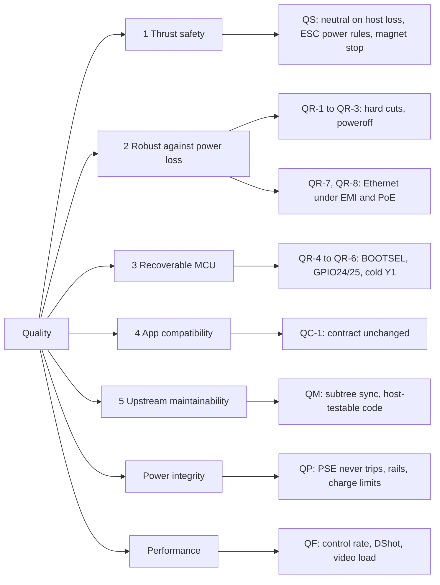

# 10. Quality Requirements

The five ranked quality goals are in [Introduction and Goals](01-Introduction-and-Goals);
power integrity and performance support them. This page makes them testable. Every scenario
names its measure and where it is verified. Status labels as in
[Crosscutting Concepts](08-Crosscutting-Concepts); B-steps are the bring-up steps of
Phase 6 (record sheet in `BRINGUP.md`, **[planned: Phase 5]**).

## 10.1 Quality tree

## 10.2 Safety scenarios

| ID | Stimulus and response | Measure | Verified | Status |
|---|---|---|---|---|
| QS-1 | Host (rov_firmware service (manafish-firmware) or the USB link) dies while thrusters run: MCU outputs neutral | Neutral within 200 ms (`HOST_TIMEOUT_US`) | Runtime harness lease-expiry scenarios; B13 on the board | **[upstream]** gate, **[bring-up]** (B13) |
| QS-2 | Magnet switch turned off while spinning: thrusters stop | AM32 stops within 0.5 s | B13 | **[bring-up]** (B13) |
| QS-3 | ESC power on: no thrust before the ESC supply is up | Motor lines 0 V until `SIGNAL_DELAY_MS` (5 s); thrust no earlier than 15 s after GP14 rises; state 3 to 4 at 15 s | `test_esc_power.c`, runtime scenarios; B11 scope warm and cold | **[done]** (host tests), **[bring-up]** (B11) |
| QS-4 | ON request during the hold after boot or off | BUSY before 5 s; session kept | `test_esc_power.c`; `mainboard_bringup.py esc on` at B11 | **[done]** (host tests), **[bring-up]** (B11) |
| QS-5 | MCU boots, is flashed or resets | GP14 stays 0 V for 60 s; never on without a request | B7 | **[bring-up]** (B7) |
| QS-6 | Operator turns ESC power off | 2 s neutral, lines parked, GP14 low, then 5 s hold | `test_esc_power.c`; B11 | **[done]** (host tests), **[bring-up]** (B11) |
| QS-7 | Host goes away with ESC power on | Auto-off after 30 s (confirmed by the owner); paused during ESC update | `test_esc_power.c`; B11 | **[done]** (host tests), **[bring-up]** (B11) |
| QS-8 | Watchdog reboot, RUN pulse or BOOTSEL entry with ESC power on | Record whether GP14 falls and stays low; if not, "off before reset" becomes a documented host rule | B11 scope | **[bring-up]** (B11) |
| QS-9 | ESC power off, ESCs connected | No back-powering (ESC 3.3 V rail dead) | B12 | **[bring-up]** (B12) |
| QS-10 | ESC firmware update requested with ESC power off | Fails with MCU error 11, mapped on the CM5; works when on | Unit tests; B12 AM32 passthrough | MCU **[done]**, CM5 mapping **[planned: Phase 4]**, **[bring-up]** (B12) |
| QS-11 | PoE present, no pack, operator requests ESC power | Refused; missing battery blocks ESC power | pytest with fakes; B10 | **[planned: Phase 4]**, **[bring-up]** (B10) |
| QS-12 | LTC4162 charger unreadable | ESC enable blocked with a toast; low-battery logic only warns, never powers off | pytest with fakes | **[planned: Phase 4]** |
| QS-13 | vbat below 3.2 V/cell for 10 s | Toast every 60 s, new enables blocked, ESC power stays on | pytest with fakes and an injectable clock | **[planned: Phase 4]** |

## 10.3 Robustness scenarios

| ID | Stimulus and response | Measure | Verified | Status |
|---|---|---|---|---|
| QR-1 | Abrupt power cuts, including during a config save | 50 cuts: boots every time, `config.json` intact | Spike check 7 (20 cuts, no ext4 errors) on the IO Board; B15 | **[planned: Phase 3]**, **[bring-up]** (B15) |
| QR-2 | +5V cut under load | CM5_3.3V stays above 1.8 V | B15 scope | **[bring-up]** (B15) |
| QR-3 | `poweroff` | 3.3 V, the MCU and ESC_PWR drop (`POWER_OFF_ON_HALT=1`) | B15 | **[bring-up]** (B15) |
| QR-4 | Blank or bricked MCU | Hardware BOOTSEL: 000f, flash, then 0009 with iProduct "Manafish Mainboard" and `/dev/manafish-mcu` | `mcu_gpio` order test; B7 | **[planned: Phase 4]**, **[bring-up]** (B7) |
| QR-5 | GPIO24/25 during CM5 power-up and boot | Never low over 10 cold boots | IO Board scope (Phase 3); B5 | **[planned: Phase 3]**, **[bring-up]** (B5) |
| QR-6 | Cold start of Y1 | 20 reboots plus cold power cycles at 0-5 °C, and BOOTSEL when cold, all succeed | B7 | **[bring-up]** (B7) |
| QR-7 | Thrusters running in a tank | Ethernet errors stay 0 during 30 min `iperf3` | B16 | **[bring-up]** (B16) |
| QR-8 | PoE on vs off | `iperf3` 10 min each way; `ethtool -S` compared with and without PoE | B9 | **[bring-up]** (B9) |
| QR-9 | Charger loses its registers (power cycle) | Next 1 Hz read-back rewrites all settings; `en_jeita` reading 1 detects it | pytest with FakeSMBus | **[planned: Phase 4]** |

## 10.4 Power integrity scenarios

| ID | Stimulus and response | Measure | Verified | Status |
|---|---|---|---|---|
| QP-1 | PoE charging with a configured charger | PSE never trips: Type 4, and Type 2 if available | B9 (after register check, `CHARGER_WRITES_ENABLED`) | **[bring-up]** (B9) |
| QP-2 | Defaults window: magnet OFF, PoE onto a part-discharged pack | No trip with 4.0 A in / 3.2 A charge defaults; clamp-measure iin and ibat | B10 | **[bring-up]** (B10) |
| QP-3 | Charging a real 5S pack | CC/CV, ibat at most 2.0 A | B10 | **[bring-up]** (B10) |
| QP-4 | 60 min soak, closed hull, two streams, charging on PoE | +5V warm at most 5.25 V (`EXT5V_V`) | B14; cold value at B4 | **[bring-up]** (B4, B14) |
| QP-5 | Both cameras streaming | CM5_3.3V below 600 mA; droop scoped | B8 | **[bring-up]** (B8) |
| QP-6 | First boot | `get_throttled` = 0, `ethtool eth0` = 1000 full | B4 | **[bring-up]** (B4) |
| QP-7 | I2C1 with the module pull-ups | All four addresses answer; SCL rise under 300 ns | B6 | **[bring-up]** (B6) |

## 10.5 Performance scenarios

| ID | Stimulus and response | Measure | Verified | Status |
|---|---|---|---|---|
| QF-1 | Normal operation | Control loop at 500 Hz; features 0x3f; IMU healthy | `control_smoke.py --execute` at B7 | **[upstream]** loop, **[bring-up]** (B7) |
| QF-2 | All eight ESCs on DShot | Telemetry from all 8, quality above 95 % | B12 | **[bring-up]** (B12) |
| QF-3 | One and two go2rtc streams | CPU, SoC temperature and throttling logged over 60 min; latency measured; camera defaults set from this run | Spike check 5; B14 | **[planned: Phase 3]**, **[bring-up]** (B14) |

## 10.6 Compatibility and maintainability scenarios

| ID | Stimulus and response | Measure | Verified | Status |
|---|---|---|---|---|
| QC-1 | Existing app connects to the board | Works unchanged; `RovConfig`, `RovStatus`, `SystemHealth` shapes unchanged; new values only in the catalog | Catalog fixture test (exact match) plus key-set equality test; final acceptance at 10.10.10.10:9000 | **[upstream]** fixture, **[planned: Phase 4]** |
| QM-1 | `git subtree pull --squash` from an upstream | Both gates green after re-removing the deleted paths; no upstream version string edited | Gates in CLAUDE.md; CI | **[done]** procedure and CI |
| QM-2 | Change under `firmware/src/control/` | C differential test runs, not skipped (`PICO_CONTROLLER_SOURCE` set) | `software-ci.yml` path filter | **[done]** |
| QM-3 | New board logic | Runs on x86 without hardware: FakeSMBus, fake lgpio, fake sysfs, injectable clock; MCU logic as pure host-tested C | pytest; Unity | MCU **[done]**, CM5 **[planned: Phase 4]** |

## 10.7 Final acceptance

With B0-B16 recorded, the app at 10.10.10.10:9000 shows camera 1, the new battery, PoE and
hull readings, `escPower.set` turning on with the 15 s arming, all eight thrusters responding
with telemetry, and PoE charging limited by PSE type **[bring-up]**.
