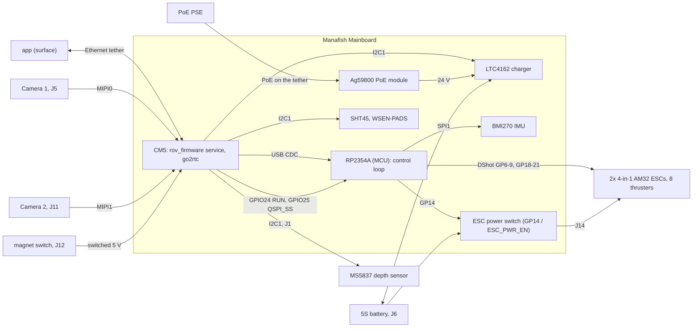

# Manafish Mainboard architecture

This wiki describes the architecture of the Manafish Mainboard and the code that
runs on it. It follows the [arc42](https://arc42.org) template.

## What the system is

The Manafish Mainboard is the main electronics board of the
[Manafish ROV](https://github.com/manafishrov). One 4-layer board replaces
upstream's Raspberry Pi 3B, the USB-connected Raspberry Pi Pico and the wiring
between them.

| Part | Role | Code in the main repo |
|---|---|---|
| CM5 (Raspberry Pi Compute Module 5) | Tether network, cameras, app WebSocket, hull sensors, charger policy, MCU flashing | `software/`: rov_firmware service (manafish-firmware) and the NixOS image |
| RP2354A (MCU) | Control loop (AHRS, PID, allocation), 8 thrusters over DShot, BMI270 IMU, ESC power switch | `firmware/`: C11, Pico SDK 2.3.1 |
| LTC4162 charger | Charges the 5S battery from PoE | driven by the CM5 over I2C1 |
| Ag59800 PoE module | 24 V from the Ethernet tether | PSE type read by the CM5 on GPIO6/GPIO12 |
| magnet switch | Hard on/off of the switched 5 V rail | no software |
| app | Pilot user interface at the surface | separate repo, out of scope |

State today: the PCB is designed and ordered; no board has been built or tested.
`firmware/` builds the `manafish_mainboard` MCU target (Phase 2) and `software/`
builds the CM5 image `cm5-mainboard` (Phase 3); neither has run on a board yet.
The Python service still assumes Pico boards until Phase 4. The rest of the port
follows the phases below.

## Overview

## How to read these docs

| Section | Answers |
|---|---|
| [01 Introduction and Goals](01-Introduction-and-Goals) | What must the system do, which qualities matter most, who cares |
| [02 Architecture Constraints](02-Architecture-Constraints) | What is fixed by hardware, owner rules and conventions |
| [03 Context and Scope](03-Context-and-Scope) | Interfaces to the outside and between CM5 and MCU; what is out of scope |
| [04 Solution Strategy](04-Solution-Strategy) | The main approaches, one line per goal or problem |
| [05 Building Block View](05-Building-Block-View) | Modules of the firmware, the software and the image |
| [06 Runtime View](06-Runtime-View) | Start-up, control, ESC power, flashing and recovery flows |
| [07 Deployment View](07-Deployment-View) | Image, UF2, releases, CI and flashing |
| [08 Crosscutting Concepts](08-Crosscutting-Concepts) | Safety, power, persistence, testing, naming |
| [09 Architecture Decisions](09-Architecture-Decisions) | Decisions and their reasons |
| [10 Quality Requirements](10-Quality-Requirements) | Quality scenarios and how they are checked |
| [11 Risks and Technical Debt](11-Risks-and-Technical-Debt) | Open risks, debt and bring-up checks |
| [12 Glossary](12-Glossary) | Terms and abbreviations |

New to the project: read Home, 01, 03 and 04, then the section you need.

## Status labels

Every page describes the target architecture. Each statement that is not yet
true on a real board carries one of these labels:

| Label | Meaning |
|---|---|
| **[upstream]** | Exists in the imported upstream code. It may still target the Pico or the Raspberry Pi 3B. |
| **[done]** | Done in this repo. |
| **[planned: Phase N]** | Planned in phase N; not in the code yet. |
| **[planned: Phase 3 spike]** | In the code, still to be checked on the CM5 IO Board in the Phase 3 spike. |
| **[bring-up]** | To be measured or confirmed on a real board, at bring-up step Bx. |

Hardware facts from the schematic and netlist carry no label.

Imported upstream bases:

| Folder | Upstream | Base |
|---|---|---|
| `firmware/` | [manafishrov/mcu-firmware](https://github.com/manafishrov/mcu-firmware) | `88bd6a0` |
| `software/` | [manafishrov/firmware](https://github.com/manafishrov/firmware) | `9e282b5` |

Naming trap: upstream's repo called "firmware" lives in `software/`.

## Phases

| Phase | Content | Status |
|---|---|---|
| 0 | Workstation, subtree imports, root `CLAUDE.md`, scoped dirty check | **[done]** |
| 1 | Root CI workflows, pre-commit, README and NOTICE fixes, this wiki | **[done]**, first CI runs green |
| 2 | RP2354A firmware: `manafish_mainboard` board target, ESC power state machine, protocol 0x26, IMU axis macros, release workflow, `mainboard_bringup.py` | **[done]**, release `firmware-v1.0.4-mb.1` published; measurements **[bring-up]** (B7, B11-B13) |
| 3 | CM5 NixOS image (`cm5-mainboard`), software H.264, second camera, one-day spike on the CM5 IO Board | Image, `board.nix`, libav H.264, `cam2`, `/dev/manafish-mcu`, bundled mainboard UF2, Pi-side BMI270 removal **[done]**; spike checks **[planned: Phase 3 spike]** |
| 4 | CM5 Python: MCU discovery and hardware BOOTSEL, charger, PoE, hull sensors, battery, ESC power, readings | **[planned: Phase 4]** |
| 5 | Bring-up tooling: `tools board-check`, `BRINGUP.md` | **[planned: Phase 5]** |
| 6 | Board bring-up, steps B0 to B16 | **[bring-up]** |

## Where the source lives

The source of this wiki is
[docs/wiki](https://github.com/Tropaion/Manafish_Mainboard/tree/main/docs/wiki)
in the main repo. Edit it there; the Gitea wiki is a published copy. The wiki is
a separate git repo, so links to code use absolute GitHub URLs.

Main references:

- [README.md](https://github.com/Tropaion/Manafish_Mainboard/blob/main/README.md): hardware
- [CLAUDE.md](https://github.com/Tropaion/Manafish_Mainboard/blob/main/CLAUDE.md): owner rules, quality gates, tag scheme, upstream sync
- [firmware/docs/PICO_CONTROL_PROTOCOL.md](https://github.com/Tropaion/Manafish_Mainboard/blob/main/firmware/docs/PICO_CONTROL_PROTOCOL.md): CM5 to MCU protocol
- [NOTICE.md](https://github.com/Tropaion/Manafish_Mainboard/blob/main/NOTICE.md): third-party terms
